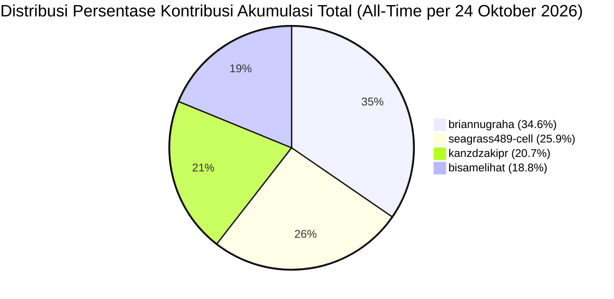
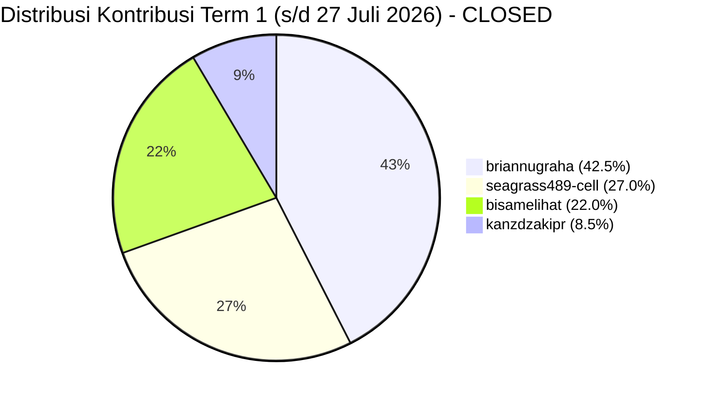
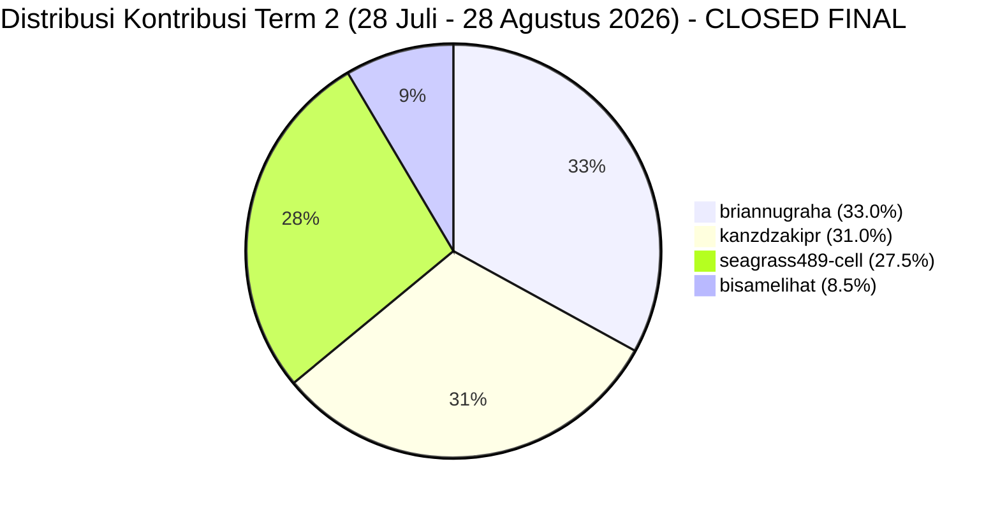
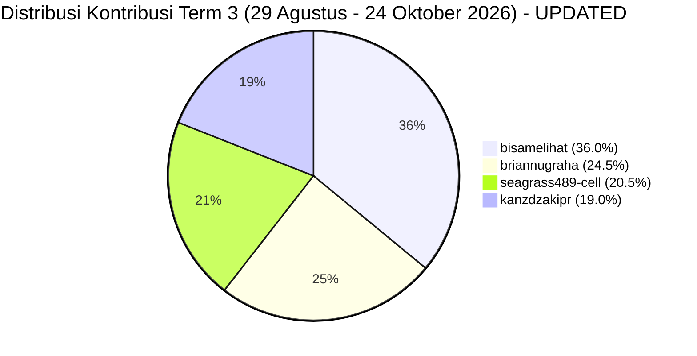

# 📊 Laporan Bobot & Persentase Kontribusi Pengerjaan Tim ServicePlan-BRA

> **Repositori**: `kanzdzakipr/ServicePlan-BRA`  
> **Tanggal Audit**: 24 Oktober 2026  
> **Basis Audit Git**: `484b0f3` (`main`/`origin/main`, 24 Oktober 2026)  
> **Metode Evaluasi**: Analisis Komparatif Multi-Faktor (jumlah commit, deliverable fitur, dampak arsitektur, risiko produksi yang ditutup, pengujian, data, dan dokumentasi). Angka `Git Numstat` dihitung dari commit non-merge dan dipakai sebagai bukti volume, bukan sebagai satu-satunya penentu bobot.  
> **Skema Periode**: 
> - **Term 1** (Periode Awal: s/d 27 Juli 2026) — `[CLOSED]`
> - **Term 2** (Periode Lanjutan: 28 Juli – 28 Agustus 2026) — `[CLOSED FINAL]`
> - **Term 3** (Periode Berjalan: 29 Agustus – 24 Oktober 2026) — `[OPEN / ONGOING - UPDATED PER 24 OKTOBER 2026]`

---

## 🏆 Ringkasan Persentase Kontribusi Tim

### 📌 1. Akumulasi Total / All-Time (Term 1 + Term 2 + Term 3 per 24 Oktober 2026)

| Rank | Kontributor / Contributor | Total Commit | Git Numstat `+ / -` (non-merge) | Bobot Kontribusi Fitur & Arsitektur Utama | **Persentase Kontribusi Akumulasi** |
| :---: | :--- | :---: | :---: | :--- | :---: |
| 🥇 | **briannugraha** | 140 (30,8%) | +134.090 / -55.090 | Lead Architecture & Roadmap, Blueprint Implementation Plan 1, 2, & 17 Okt 2026 (747 baris), Hybrid DB Config, Asset Population, Live Map & GPS, Fuel Anomaly Engine, Cost Control, Asset 360°, Productivity & KPI, ApexCharts Engine, Monitoring Unit Refurbishment, Heavy Equipment Properties & Diagnostics Inspector single-view, Modul User Management CRUD Lengkap (`api/users.php`, UI modals), Redesign Besar Unit Properties (Galeri 3x3, Hyperlink Dokumen STNK/KIR/SILO/JO, Kartu Vitals, Modal Histori Tersembunyi), Hyperlink Hover Unit ID Executive Dashboard, **Arsitektur Pengayaan 9-Batch Data Aset Tambang (Ingesti 40 Unit Kendaraan Operasional hingga 323 unit armada, Operator & Legalitas STNK/KIR, Valuasi Sewa/Leasing 36 unit, Pengarsipan Terverifikasi 3 DT Terjual ke `archived_items`, Standby Action Plan 49 unit, Identitas Teknis SN/VIN/Usia/Kapasitas/Dealer, Standarisasi Interval & Telemetri PM 100%, serta Repositori Lokasi Dokumen Fisik 100%)**, Mobile navbar/CSS fixes, serta Dev-Ops tooling & Laragon sync automation (`sync_to_laragon.ps1 -PreserveDatabase`) | **34.6%** |
| 🥈 | **seagrass489-cell** | 110 (24,2%) | +89.826 / -21.033 | Parser Engine 9.400+ baris, data completeness, backend laporan/form, arsitektur security server-side, authentication/session/CSRF/CORS/RBAC, upload hardening, attack simulation, automated security tests, CI quality gate, Mobile Responsive Framework (`mobile-responsive.js`, `dashboard.css`), automated mobile layout audit (`mobile_layout_audit.ps1`), audit rekapitulasi tim (`rekap-revisi-tim-brian.md`), Implementasi Audit Formula Matematika KPI (`core/KpiCalculator.php`, `api/kpi.php`, `verify_kpi_math.php`), Implementasi UI Tiket Work Order 12 Field (`new_work_order_ui_smoke.js`), Integrasi Work Order & KPI, **People & KPI Lifecycle F4 (`b4fa54b`), Galeri Foto & Integrasi Unit Properties, Rangkaian Sprint Visual UI Polishing (laporan aset, WO, dashboard), serta Automated Checkpoint Verification & Regression Suites (F5 & F6 100% PASS)** | **25.9%** |
| 🥉 | **kanzdzakipr** | 83 (18,3%) | +39.037 / -20.332 | Inisialisasi repositori, implementasi RBAC 10 roles & navigation guards, WO target status & autofill workflow, downtime split target/actual & overdue styling, monitoring cards active filter & global reset, maintenance routing, sistem arsip DB-synced (`archived_items`), migrasi Hostinger, anti-cache API, Core Architecture Engines (`CostLedger.php`, `ProductivityCalculator.php`, `WorkOrderSupport.php`, `AssetIdentity.php`), 4 Automated Integration Test Suites, Penuntasan Fitur Non-WO Non-JO (PM Hull multi-PIC, dropdown multi-mekanik), **Perluasan Skema Chassis & Backend Asset Management (`6166e71`, `1d0a32f`), Integrasi Endpoint Work Order & User Management (`4edff62`, `53d5a55`), Core Backend Workflows & KPI Integration (`07d67f3`), Roadmap & Checklist Integrasi DB (`5e65ef9`), Mobile view fixes, Filter Status Unit, serta tata kelola database dump & branch governance** | **20.7%** |
| 4 | **bisamelihat** | 121 (26,7%) | +124.911 / -68.791 | Fondasi struktur proyek, Prisma/seeder architecture, dokumentasi model sistem, prototipe dashboard, integrasi skill UI anti-slop, sprint UI overhaul A1–A9, Condition Monitoring interactive modal, Spare Part Card, People & KPI Standar Kinerja / Daftar SPL, Sprint Integrasi Masif 38 Non-Merge Commits Term 3, Penuntasan 8 Batch Rencana Revisi 17 Okt 2026, **Implementasi F0, F1 (F1ab), F2, Purchase Order (PO) Approval System & Testing Framework (`bf457ac`, `fe2e0cf`), HSE Hold & Release dan Recovery Workflow Kecelakaan (`6741eaf`, `956d878`), Penetapan PIC Alat Berat Durabel (`db0b4e6`), Pengayaan Valuasi & Pengarsipan Unit Terjual (`a24147f`, `e884a1a`), HTTP End-to-End Testing Script dengan Auto-Cleanup (`243f467`), serta Penyempurnaan Filter Lokasi & Periode KPI Dashboard (`4bf9731`)** | **18.8%** |
| **TOTAL** | **4 Kontributor** | **454 Commit** | **+387.864 / -165.246** | **Skor dinormalisasi menjadi 100% berdasarkan bukti Git dan dampak deliverable komprehensif lintas 3 periode per 24 Oktober 2026** | **100.0%** |

---

### 📌 2. Evaluasi Term 1 (Periode Awal: s/d 27 Juli 2026) — `[CLOSED]`

| Rank | Kontributor / Contributor | Commit Term 1 | Git Numstat `+ / -` (non-merge) | Bobot Kontribusi Fitur & Arsitektur Term 1 | **Persentase Term 1** |
| :---: | :--- | :---: | :---: | :--- | :---: |
| 🥇 | **briannugraha** | 45 (43,7%) | +55.120 / -10.289 | Blueprint Implementation Plan, Fuel Anomaly Engine, Cost Control & Valuasi, Leaflet & Google Maps Integration, Asset 360°, Productivity & KPI Modules | **42.5%** |
| 🥈 | **seagrass489-cell** | 27 (26,2%) | +24.875 / -331 | Parser Engine Data 9.400+ baris, Data Completeness Audit Checklist, Tabulasi Keuangan PO & SPB, Testing Master Asset & Form Laporan | **27.0%** |
| 🥉 | **bisamelihat** | 22 (21,4%) | +59.249 / -49.334 | Fondasi Struktur Proyek, Prisma ORM Architecture, Seeder Data Engine (`seeder.js`), PRD & Data Model Documentation, Early Dashboard Prototypes | **22.0%** |
| 4 | **kanzdzakipr** | 9 (8,7%) | +2.491 / -1.697 | Inisialisasi Repositori, HTML Scaffolding (`testkanz*.html`), Branch Governance, & Merge Integrasi Utama | **8.5%** |
| **SUBTOTAL** | **4 Kontributor** | **103 Commit** | **+141.735 / -61.651** | **Baseline Fondasi & Pengembangan Fitur Modul Utama** | **100.0%** |

---

### 📌 3. Evaluasi Term 2 (Periode Lanjutan: 28 Juli – 28 Agustus 2026) — `[CLOSED FINAL]`

| Rank | Kontributor / Contributor | Commit Term 2 | Git Numstat `+ / -` (non-merge) | Bobot Kontribusi Fitur & Arsitektur Term 2 | **Persentase Term 2** |
| :---: | :--- | :---: | :---: | :--- | :---: |
| 🥇 | **briannugraha** | 57 (33,1%) | +56.330 / -36.831 | Hybrid DB, asset population, live maps, Condition Monitoring dual-layer, material Ban & Grease, ApexCharts engine & interactive filtering, People & KPI, notification system, Executive Dashboard, Monitoring Unit grid 3x2 & title cleanup, RBAC master bypass, **Heavy Equipment Properties & Diagnostics Inspector single-view (Top Live Map, CANbus Gauges, Data Listing row-by-row zebra, 10-Tire Diagram, PAP Oil & P2H)**, dan hosting/Laragon sync | **33.0%** |
| 🥈 | **kanzdzakipr** | 56 (32,6%) | +8.453 / -4.723 | RBAC 10 roles & navigation guards, WO target status & autofill workflow, split downtime target vs actual & overdue styling, maintenance type routing, monitoring cards active filter & click reset, asset mapping schemas, sistem arsip MySQL `archived_items`, migrasi Hostinger, anti-cache API, dan Laragon DB protection | **31.0%** |
| 🥉 | **seagrass489-cell** | 42 (24,4%) | +43.178 / -17.858 | Backend laporan/form, security audit & threat modeling, server-side authentication, secure session, CSRF/CORS, RBAC, object-level authorization pada API, secure upload/download, deployment hardening, automated security test suite, dan GitHub Actions quality gate | **27.5%** |
| 4 | **bisamelihat** | 17 (9,9%) | +30.401 / -16.786 | Sprint UI overhaul A1–A9 (interaktivitas chart drilldown, filter status service berkala, refinement dashboard & monitoring), integrasi skill UI anti-slop, resolusi konflik UTF-8, Condition Monitoring interactive modal per kategori, Spare Part Card visual update, People & KPI Standar Kinerja & Daftar SPL, serta sinkronisasi Laragon & maintenance seeder | **8.5%** |
| **SUBTOTAL** | **4 Kontributor** | **172 Commit** | **+138.362 / -76.198** | **RBAC engine, WO workflow enhancement, UI overhaul A1-A9, security architecture & CI, sistem arsip DB, hybrid DB, ApexCharts interactivity, Equipment Properties Inspector, Condition Monitoring category modals, dan Hostinger/Laragon sync** | **100.0%** |

---

### 📌 4. Evaluasi Term 3 (Periode Berjalan: 29 Agustus – 24 Oktober 2026) — `[OPEN / ONGOING - UPDATED PER 24 OKTOBER 2026]`

> *Status: Periode Term 3 mencatat lonjakan masif hingga 178 commit aktif (termasuk 113 commit baru pada rentang 18–24 Oktober 2026) dengan penuntasan implementasi modul F0 s/d F6, Purchase Order Approval System, HSE Hold & Release, pengayaan 9-batch data armada tambang (323 unit aset), standarisasi telemetri PM, filter lokasi & periode KPI, perombakan besar Unit Properties, serta automated regression gates.*

| Rank | Kontributor / Contributor | Commit Term 3 | Git Numstat `+ / -` (non-merge) | Fokus Deliverable & Dampak Teknis Term 3 | **Persentase Term 3** |
| :---: | :--- | :---: | :---: | :--- | :---: |
| 🥇 | **bisamelihat** | 82 (46,1%) | +35.818 / -3.366 | **Eksekutor Integrasi Terbesar, Modul F0–F2, PO Approval & HSE Recovery**: Memimpin 82 commit Term 3 (70 non-merge) meliputi implementasi modul F0, F1 (F1ab), dan F2 (`5c5031e`, `68f2d2f`, `c274a2b`), penuntasan 8 batch revisi 17 Okt, Purchase Order Approval System terintegrasi audit logging & testing framework (`bf457ac`, `fe2e0cf`), HSE Hold & Release dan pemulihan alur kecelakaan `AccidentWorkflow` (`6741eaf`, `956d878`), penetapan PIC alat berat durabel (`db0b4e6`), pengayaan valuasi & pengarsipan unit terjual (`a24147f`, `e884a1a`), HTTP End-to-End Testing Script dengan auto-cleanup (`243f467`), serta penambahan filter lokasi site & periode waktu pada KPI Dashboard (`4bf9731`) | **36.0%** |
| 🥈 | **briannugraha** | 37 (20,8%) | +21.601 / -8.074 | **Arsitektur Pengayaan Data Aset Tambang, Blueprint, Unit Properties & DevOps**: Merancang dan mengeksekusi arsitektur 9-batch data enrichment (`material/ASSET` & `material/PREVENTIVE-MAINTENANCE`), konversi 97 halaman PDF Laporan Divisi Equipment Januari 2026 ke 28 file Markdown granular, eksekusi migrasi Batch 1 (30 unit alias, 672 parts katalog baru, saldo stok 1.393 SKU), eksekusi migrasi Batch 2 (rekonsiliasi 364 work orders riil dengan tanggal/jam breakdown `trouble_at` & `closed_at`, durasi downtime menit/formatted, assigned mechanic + JSON list, tindakan perbaikan, root cause riil, sinkronisasi unit 101-103, serta 196 entri `asset_operator_history`), eksekusi migrasi Batch 3 (ingesti 25 log pelumasan mingguan hauling di `grease_logs`, 12 log riwayat baterai baru di `battery_logs`, pembaruan telemetri servis berkala pada 13 unit RSV1 di `assets` & `pm_plans` dengan status dinamis OVERDUE/DUE_SOON), ingesti 40 unit kendaraan operasional hingga armada mencapai 323 unit, valuasi sewa/leasing 36 unit alat berat, pengarsipan resmi unit terjual ke `archived_items`, rencana aksi standby 49 unit, standarisasi identitas teknis, standarisasi interval servis & telemetri PM 100%, repositori lokasi dokumen fisik 100%, integrasi spesifikasi ban, modul User Management CRUD, redesign Unit Properties (galeri 3x3, hover modal dokumen, kartu vitals), hyperlink hover Unit ID Executive Dashboard, serta DevOps sinkronisasi Laragon & master dump SQL | **24.5%** |
| 🥉 | **seagrass489-cell** | 41 (23,0%) | +21.773 / -2.844 | **People & KPI Lifecycle F4, Rangkaian Sprint UI Polishing & Quality Gates F5/F6**: Mengembangkan People & KPI Lifecycle F4 dengan pembaruan skema & pengujian (`b4fa54b`), memimpin rangkaian sprint perbaikan estetika UI laporan aset, tiket WO, dan dashboard view (`acb952c`, `943283b`, `050bf4c`, `cb9dd1a`, `05716dd`, `fdec9fa`, `028d727`, `260a46a`, `b8a9408`, `e8741ec`, `b632fd4`), integrasi galeri foto unit properties (`0adcb7e`), audit data berat tambang (`e48fd3d`), penugasan PIC alat berat (`de9f991`), Mobile Responsive Framework, formula audit KPI (`core/KpiCalculator.php`), tiket WO 12 field, serta verifikasi kelulusan checkpoint F5 (29/29 PASS) dan regression suite F6 (37/37 PASS) | **20.5%** |
| 4 | **kanzdzakipr** | 18 (10,1%) | +28.093 / -13.912 | **Enterprise Core Engines, Perluasan Chassis & Tata Kelola Backend**: Perluasan skema chassis `chassis_number` dan API pendukung (`6166e71`), backend asset management & dashboard UI updates (`1d0a32f`), integrasi controller work order & user management (`4edff62`, `53d5a55`), core backend workflows & integrasi KPI (`07d67f3`), implementasi roadmap & checklist kesiapan integrasi database (`5e65ef9`), penanganan perbaikan data retrieval & mobile view (`e9a828d`, `ee48e19`), 4 enterprise core engines (`CostLedger.php`, `ProductivityCalculator.php`, `WorkOrderSupport.php`, `AssetIdentity.php`), penuntasan Non-WO Non-JO PM Hull multi-PIC, serta branch governance & database sync dump | **19.0%** |
| **SUBTOTAL** | **4 Kontributor** | **178 Commit** | **+107.285 / -28.196** | **Penyelesaian modul F0–F6, PO approval system, HSE hold/release, pengayaan 9-batch data armada (323 unit aset), repositori dokumen fisik 100%, standarisasi interval & telemetri PM, filter lokasi & periode KPI, User Management, Redesign Unit Properties, dan 4 automated testing gates** | **100.0%** |

---

## 📐 Matriks Bobot Evaluasi Multi-Kriteria

Penilaian kontribusi menggunakan dua lapisan bukti:

1. **Bukti kuantitatif Git**: jumlah commit, commit non-merge, serta `numstat` penambahan/penghapusan baris.
2. **Dampak deliverable**: keluasan modul, kebaruan fitur, keputusan arsitektur, risiko produksi yang ditutup, pengujian otomatis, data, dan dokumentasi.

Snapshot bukti kuantitatif Term 3 (Periode 29 Agustus – 24 Oktober 2026):

| Kontributor | Porsi semua commit | Porsi commit non-merge | Porsi lines added | Skor Term 3 setelah audit deliverable |
| :--- | ---: | ---: | ---: | ---: |
| **bisamelihat** | 46,1% | 49,3% | 33,4% | **36,0%** |
| **briannugraha** | 20,8% | 20,4% | 20,1% | **24,5%** |
| **seagrass489-cell** | 23,0% | 21,1% | 20,3% | **20,5%** |
| **kanzdzakipr** | 10,1% | 9,2% | 26,2% | **19,0%** |

`Lines added` tidak langsung disamakan dengan kontribusi karena dapat terdistorsi oleh impor data, pemindahan file, hasil generator, atau reformat besar. Skor akhir menormalkan bukti Git dengan dampak deliverable yang dapat diuji dan digunakan.

Formula bobot periode akumulasi (Term 1, Term 2, & Term 3):

```
Total Skor Akumulasi = (Bobot Term 1 × 35%) + (Bobot Term 2 × 45%) + (Bobot Term 3 × 20%)
```

### Breakdown Distribusi Kontribusi:



#### Perbandingan Distribusi per Term:







---

## 🔍 Detail Rincian Kontribusi per Kontributor

### 1. `briannugraha` — **34.6%** *(Lead Feature, System Architect & Strategic Roadmap)*
* **Total Commit**: 140 Commit (30,8% dari total 454 commit repositori).
* **Breakdown Commit**: 45 Commit (Term 1) + 57 Commit (Term 2) + 37 Commit (Term 3).
* **Kontribusi Kunci & Kebaruan Fitur**:
  * **Term 1**:
    - **Implementation Plan 1 & 2**: Merancang arsitektur menyeluruh sistem monitoring alat berat ServicePlan-BRA (`implementation-plan-1.md`, `implementation-plan-2.md`).
    - **Modul Fuel Management Engine**: Mengembangkan sistem deteksi anomali konsumsi solar real-time (LPH & KPL), penanganan modal FRM-BBM-01 & FRM-STK-02 sounding tangki.
    - **Modul Biaya & Cost Control**: Mengembangkan dashboard valuasi 7 unit utama, LPJ bulanan budget vs actual, register PO sparepart, dan perbandingan PM.
    - **Interaktif Spatial & Maps**: Integrasi Leaflet Live Map lokasi unit dan integrasi dinamis tombol Google Maps GPS pada Modal Detail 360° Unit.
    - **Modul Produktivitas & KPI**: Integrasi telematika KOMTRAX 18 unit, penandaan idling anomaly (>50%), dan audit armada standby 48 unit.
    - **Konversi Materi**: Menyusun dan mengonversi berkas spek material 1 hingga 14 ke dalam format markdown terstruktur.
  * **Term 2**:
    - **Database Normalization & Hybrid Config**: Menambahkan support konfigurasi database hybrid pada `api/db.php`, normalisasi skema SQL `ServicePlanBRA.sql`, dan sinkronisasi Laragon local environment (`7288c5d`, `8ed94b0`, `e703e3f`).
    - **Asset Population & Live Maps Update**: Penambahan populasi data aset tahap 1 & 2 (`bd0f1bc`, `260dcab`), perbaikan komponen Leaflet Live Maps dan tombol koordinat GPS (`63dcd5a`).
    - **UI Micro-Fixes & Status Badge**: Perbaikan encoding teks, penyelarasan rendering status badge UI, dan integrasi logogram resmi BRA (`8f348cf`, `a2dbe85`).
    - **Audit Data Completeness**: Melakukan peninjauan menyeluruh kesiapan 16 menu navigasi, update status dataset aktif, serta merumuskan 5 mekanisme teknis adaptasi API Controller.
    - **Reform Condition Monitoring**: Implementasi Dual-Layer Modal Rendering (`#globalCmModalContainer` at `document.body` level) & Universal Asset ID Extractor Regex (`^([A-Z0-9]{1,6}-\d{2,5})`) untuk seluruh 400+ entri `data.json`.
    - **Refurbish Master Asset & In-Place Popup**: Integrasi modal popup Kondisi tanpa pemindahan view navigasi, sinkronisasi `window.resolveAsset`, dan pembersihan duplikasi skrip.
    - **Refurbish Sparepart & Logistik, Biaya, & Pengaturan**: Penyesuaian layout responsive, manajemen role pengeluaran barang, dan visual audit brand.
    - **Populasi Datasets Material Ban & Grease**: Mempopulasikan data real dari laporan ban dan greasing ke modul Condition Monitoring & Executive Dashboard.
    - **ApexCharts Engine Full Implementation & Linkage**: Menggantikan grafik statis pada Executive Dashboard dengan ApexCharts interaktif (Donut Service Status, Donut Asset Category, Donut WO Status, Bar Jam Kerja Mekanik dengan target 176 jam, dan Area Gradient Tren Biaya Perbaikan Bulanan), serta linkage klik slice/legend chart ke filter tabel monitoring.
    - **Enhancement & Redesign People & KPI**: Membangun ApexCharts Area Chart interaktif untuk *Rekapitulasi Trend Nilai KPI Bulanan (Jan-Des 2026)* dengan annotation line serta redesign kartu KPI Head berikon FontAwesome (`fa-award`, `fa-clock-rotate-left`, `fa-bolt`, `fa-coins`).
    - **Heavy Equipment Properties & Diagnostics Inspector Subpage (`7c4b763`, `328f5c5`)**:
      - Membangun tampilan subpage mandiri `view-unit-properties` (SPA terintegrasi tanpa menambah menu sidebar baru).
      - Menata 4 modul data menjadi **1 halaman inspektur terpadu (*single continuous flow*)**.
      - Menempatkan **Peta Live Real-Time & Geofence Site** di bagian paling atas (Section 1) berdampingan dengan 4 Live CANbus Gauges (RPM, Coolant, Oil Pressure, Alternator) & tabel koordinat GPS / BAST.
      - Mentransformasi spesifikasi teknik dari kartu menjadi **Technical Data Listing 2-kolom** dengan pola belang berselang-seling horizontal per baris (*row-by-row zebra striping*) dan label tebal (*bold*).
      - Mengintegrasikan diagram visual 10 posisi roda ban 3 gandar (PSI/RTD), Program Analisa Pelumas (Oil PAP Lab Sampling), inspeksi P2H harian operator, dan log investigasi insiden TAR.
    - **Pembersihan Antarmuka Monitoring Unit**: Mengganti judul menjadi *"Monitoring Unit"*, menghapus subjudul deskripsi, menghapus capsule badge, dan membersihkan diagram alur integrasi status.
    - **RBAC Master Bypass & Admin Access Fix (`21cb18a`)**: Memastikan akun Administrator memiliki hak akses master penuh ke seluruh modul, implementasi fallback role auto-detection, dan proteksi event guard navigasi.
  * **Term 3** — `[OPEN / ONGOING - UPDATED PER 24 OKTOBER 2026]`:
    - **Arsitektur Pengayaan 9-Batch Data Aset Tambang (24 Okt 2026)**:
      - **Batch 1 & 2**: Operator Light Vehicle (16 unit) & Legal Expiry STNK/KIR diinjeksikan ke `assets` & `asset_operator_history`.
      - **Batch 3**: Pengarsipan formal 3 unit dump truck terjual terverifikasi (`DT-00071`, `DT-00073`, `DT-00061`) ke tabel `archived_items` dan `archive_audit_trail`.
      - **Batch 4**: Valuasi finansial dan tarif sewa/leasing (`monthly_rental_rate` & `monthly_leasing_installment`) untuk 36 unit alat berat di `unit_valuations`.
      - **Batch 5**: Rencana aksi standby (`standby_action_plan`), target ready date (`standby_target_date`), dan start date (`standby_start_date`) untuk 49 unit armada.
      - **Batch 6**: Ingesti armada 40 kendaraan operasional (`LV-00001` s.d. `LV-00027` dan `LV-00052` s.d. `LV-00064`), memperluas master fleet dari 283 menjadi 323 unit, plus 38 audit rows di `asset_operator_history`.
      - **Batch 7**: Pengayaan identitas teknis: usia unit `asset_age` (320 unit, 99.1%), factory `serial_number` (37 unit), `chassis_number` / VIN (78 unit), `capacity` (164 unit, 50.8%), dan `dealer` (204 unit, 63.2%).
      - **Batch 8**: Standarisasi interval servis (`service_interval_val` dan `service_interval_unit`) ke 100% armada (323 unit); injeksi telemetri operasional aktual HM/KM (`last_hm_km`), riwayat servis terakhir (`last_service_date`, `last_service_hm_km`), dan target jatuh tempo (`next_service_due_hm_km`) untuk 31 unit operasional di WUR EW Project.
      - **Batch 9**: Pengisian 100% lokasi fisik dokumen legalitas armada (`invoice_location`, `bpkb_location`, `stnk_location`) lintas seluruh 323 unit aset.
    - **Integrasi Diagram Ban, Spesifikasi Teknis & Tata Kelola Aset (`09c6f67`, `2d57580`, `35cf651`, `ec0325d`, `b869064`)**:
      - Integrasi spesifikasi diagram ban dan parameter tekanan angin (PSI/RTD) pada seluruh tipe alat berat di Unit Properties.
      - Penautan koordinat GPS dan lokasi site properties serta pembersihan layout double scrollbar modal Work Order (`260c4e4`).
      - Penyusunan dokumentasi aset terstruktur `material/ASSET` (`ec0325d`) dan penanganan anomali angka unit alat berat (`b869064`).
      - Tata kelola sinkronisasi otomatis Laragon (`scripts/sync_to_laragon.ps1 -PreserveDatabase`) dan pembaruan berkala master dump SQL `scripts/u646470441_ServicePlanBRA.sql`.
    - **Master Implementation Blueprint 17 Oktober 2026 (`3bddec0`)**: Menyusun berkas cetak biru komprehensif `implementation-plan-17102026.md` (747 baris) berdasarkan rekaman Zoom BRA; merumuskan arsitektur 12 field WO & mitigasi RFU bersyarat target kejar, penambahan unit di modul PM dengan 12 field onboarding & audit information gap, serta 5 inisiatif global modular (GLB-A s/d GLB-E) yang masing-masing dilengkapi actionable executable prompts.
    - **Modul User Management / Manajemen Pengguna Terpadu (`9cf390c`)**:
      - Membangun backend controller lengkap `api/users.php` (+311 baris) dengan dukungan CRUD user, assignment role berbasis RBAC matriks, status keaktifan user, dan hashing kata sandi aman.
      - Mengembangkan antarmuka User Management pada Executive Dashboard (`dashboard.view.php` +490 baris, `dashboard.html` +488 baris) dengan modal tambah/edit pengguna, modal reset password, filter role dinamis, dan tabel user responsif.
    - **Redesign Besar Antarmuka Unit Properties (`578a526`)**:
      - Memisahkan galeri foto dokumentasi unit menjadi kartu mandiri di kolom kanan dengan layout grid 3x3 responsif, indikator sudut pandang foto, dan modal lightbox preview foto (`modalPropPhotoPreview`).
      - Mentransformasi dokumen legalitas unit (STNK, KIR, SILO, PDF JO) menjadi hyperlink hover interaktif berstatus badge dengan modal viewer terintegrasi (`modalPropDocumentViewer`) untuk membuka/mengunduh berkas PDF.
      - Menata ulang metrik operasional vital (Operator saat ini, Servis terakhir, Interval, Target berikutnya & estimasi) menjadi kartu metrik terpadu yang selaras dengan vitals HM dan geolokasi.
      - Menyembunyikan tabulasi riwayat operator dan riwayat perawatan ke dalam modal popup terdedikasi (`modalPropOperatorHistory`, `modalPropServiceHistory`) yang dipicu dari ikon riwayat pada kartu masing-masing.
      - Meleburkan riwayat nomor lambung ke dalam hyperlink hover kode lambung lengkap dengan modal audit trail (`modalPropHullHistory`) dan tombol ganti nomor lambung.
    - **Interaktivitas Hyperlink Hover Unit ID Executive Dashboard (`b39285e`)**:
      - Mengembangkan stylesheet `.unit-prop-hover-link`, `.unit-code-text`, dan `.unit-prop-hover-icon` pada `scripts/unit-properties.css` dengan micro-interaction visual, highlight warna primer, dan efek garis bawah dotted-to-solid.
      - Mengintegrasikan hyperlink hover pada kolom Unit ID di modal Tabulasi Semua Unit Alat (`modalStatusDetail`), tabel Work Order Aktif, dan badge kode unit pada Panel Perhatian WO Emergency di Executive Dashboard, memungkinkan navigasi instan satu-klik ke lembar spesifikasi Unit Properties.
    - **DevOps, Laragon Sync & Database Protection (`3bddec0`, `07e59e8`, `d04aee6`)**: Hardening skrip sinkronisasi Laragon `scripts/sync_to_laragon.ps1` (IPv4 host binding eksplisit `-h 127.0.0.1 -P 3306`), perbaikan file migrasi database `scripts/migrate_wo_fields_17102026.sql`, sinkronisasi skema SQL, dan tata kelola merge branch integrasi (`390b46c`, `999f009`, `b83aac4`).
    - **Mobile Navbar & Responsive Styling (`5632ca4`, `ebf54c7`, `2df57a2`)**: Mengembangkan dan menyempurnakan stylesheet `scripts/dashboard.css` untuk adaptasi layar mobile, perbaikan navigasi navbar pada layar sentuh, dan penataan mobile checkpoint view.

---

### 2. `seagrass489-cell` — **25.9%** *(Data Engineering, Security Architecture & Mobile Lead)*
* **Total Commit**: 110 Commit (24,2% dari total 454 commit repositori).
* **Breakdown Commit**: 27 Commit (Term 1) + 42 Commit (Term 2) + 41 Commit (Term 3).
* **Kontribusi Kunci & Kebaruan Fitur**:
  * **Term 1**:
    - **Sistem Parser Data 9.400+ Baris**: Mengamankan dan mengunci parser data workbook besar (`ab602ab FINAL_LOCKDOWN: Sistem parser 9400 baris sukses diamankan`).
    - **Data Completeness Checklist**: Menyusun dan memperbarui `DATA_COMPLETENESS_CHECKLIST.md` untuk memastikan 100% kelengkapan data lapangan.
    - **Tabulasi Data Keuangan & Logistik**: Menyusun dokumen tabulasi detail untuk PO Trakindo Utama (`PO_DFT_01508`), PO United Tractors (`PO 10969`), SPPU Zona 4, dan Rencana PM Feb 2026.
    - **Pengujian & Verifikasi UI**: Menguji keterhubungan antarmuka Master Asset, Form Laporan, Inspeksi P2H, dan Dashboard executive.
  * **Term 2**:
    - **Backend Laporan & Form (`268e576`)**: Mengembangkan integrasi backend untuk modul laporan dan form operasional agar data tidak berhenti pada state browser saja.
    - **Security Audit & Threat Modeling (`d045e01`, `75e6468`)**: Menyusun audit menyeluruh terhadap authentication, authorization, injection, file handling, database privilege, secrets, dependency, dan production readiness; melengkapinya dengan attack-simulation checklist berbasis bukti PASS/FAIL.
    - **Server-Side Authentication & Session Security (`d045e01`)**: Membangun `api/auth.php`, shared security bootstrap `api/security.php`, adaptive password hashing, session regeneration, idle/absolute timeout, CSRF token, CORS allowlist, dan logout server-side.
    - **RBAC & Route Authorization (`d045e01`, `9e198d5`)**: Menerapkan permission matrix deny-by-default, migrasi RBAC, serta object/location authorization pada controller aset, work order, laporan, logistik, inspeksi, fuel, PM, accident, archive, init, dan sync.
    - **Credential & Deployment Hardening (`a2f0367`, `e7bdd38`)**: Memindahkan konfigurasi sensitif ke environment, menyediakan local temporary-password tooling, memperketat `.htaccess`, dan memperbaiki alur sinkronisasi Laragon tanpa mengekspos kredensial produksi.
    - **Secure Upload & Authorized Download (`9e198d5`)**: Menambahkan validasi MIME-ekstensi, nama file acak, pencegahan eksekusi PHP, helper upload terpusat, serta download controller yang memerlukan authorization.
    - **Automated Security Quality Gate (`9e198d5`, `a3cce11`)**: Menambahkan unit, static, dan HTTP smoke tests (`tests/security_unit.php`, `tests/security_static.php`, `tests/security_http_smoke.php`), runner PowerShell, serta workflow GitHub Actions `.github/workflows/security-tests.yml`.
  * **Term 3** — `[OPEN / ONGOING - UPDATED PER 24 OKTOBER 2026]`:
    - **People & KPI Lifecycle F4 (`b4fa54b`)**:
      - Membangun arsitektur People & KPI Lifecycle F4 lengkap dengan migrasi skema database, automated testing, dan integrasi siklus evaluasi staf/mekanik.
    - **Integrasi UI Galeri Foto & Properties Aset (`3916e07`, `0adcb7e`)**:
      - Mengembangkan visualisasi galeri foto unit properties, integrasi modal preview, dan penyesuaian konsistensi data dummy unit (`d7cc860`).
    - **Rangkaian Sprint UI Polishing & Estetika Antarmuka (18–24 Okt 2026)**:
      - Memimpin rangkaian 13+ commit penataan UI antarmuka laporan aset, formulir tiket WO, dashboard view, dan penataan mobile layout responsif (`acb952c`, `943283b`, `050bf4c`, `cb9dd1a`, `05716dd`, `fdec9fa`, `028d727`, `260a46a`, `b8a9408`, `e8741ec`, `b632fd4`).
    - **Automated Regression Quality Gates F5 & F6 (`ba96046`, `ad22b8a`)**:
      - Verifikasi kelulusan checkpoint F5 (`tests/f5_checkpoint_verification.php` - 29/29 PASS).
      - Verifikasi kelulusan regression gate F6 Analytics Reconciliation (`tests/f6_analytics_reconciliation_regression.php` - 37/37 PASS).
      - Rekapitulasi data alat berat tambang (`e48fd3d`) dan penetapan PIC alat berat (`de9f991`).
    - **Mobile Responsive Framework Architecture (`0cbdba3`, `3e67bc4`)**: Mengembangkan arsitektur antarmuka mobile komprehensif dengan penambahan 1.044 baris penataan responsif pada `scripts/dashboard.css`, 368 baris controller interaksi gesture sentuh & navigasi drawer pada `scripts/mobile-responsive.js`, serta optimasi mobile layout untuk lembar teknis `scripts/unit-properties.css`.
    - **Automated Mobile Layout Quality Gate (`0cbdba3`, `3e67bc4`)**: Merancang dan mengintegrasikan suite pengujian otomatis `tests/mobile_layout_audit.ps1` (317 baris PowerShell automation) untuk memverifikasi konsistensi tampilan elemen, tabel, dan kartu pada seluruh breakpoint layar ponsel/tablet.
    - **Implementasi Audit Formula Matematika KPI (`58c7350`)**:
      - Membangun engine perhitungan KPI armada alat berat `core/KpiCalculator.php` (192 baris) dan controller `api/kpi.php` (151 baris).
      - Mengimplementasikan formula standar Physical Availability (PA), Mechanical Availability (MA), Use of Availability (UA), MTBF, MTTR, serta benchmark target 176 jam kerja mekanik.
      - Membangun automated verification script `tests/verify_kpi_math.php` (142 baris) untuk memvalidasi akurasi perhitungan terhadap data historis.
    - **Implementasi UI Tiket Work Order 12 Field (`60607e0`)**:
      - Mengembangkan antarmuka tiket Work Order baru pada `dashboard.view.php` & `dashboard.html`.
      - Menambahkan stylesheet tiket WO pada `scripts/dashboard.css` (+622 baris) dan alur autofill cerdas pada `scripts/dashboard.js` (+385 baris).
      - Membangun automated browser smoke test `tests/new_work_order_ui_smoke.js` (151 baris).
    - **Integrasi Work Order dan KPI (`b197b54`)**: Menghubungkan transisi siklus tiket WO dengan kalkulasi metrik downtime dan KPI operasional, controller `api/sync.php` dan `api/work_orders.php` (+229 baris), migrasi database `scripts/migrate_wo_fields_17102026.sql` (75 baris), serta testing `tests/work_order_ticket_fields.php` (93 baris).
    - **Cross-Team Revision Review & Audit Documentation (`900c058`, `124b6d0`)**: Menyusun dokumen rekapitulasi teknis `rekap-revisi-tim-brian.md` (434 baris) sebagai checklist perbandingan, verifikasi kesiapan deliverable, dan tata kelola merge branch `main`.

---

### 3. `kanzdzakipr` — **20.7%** *(Repository Owner, Enterprise Logic Engines & Integration Lead)*
* **Total Commit**: 83 Commit (18,3% dari total 454 commit repositori).
* **Breakdown Commit**: 9 Commit (Term 1) + 56 Commit (Term 2) + 18 Commit (Term 3).
* **Kontribusi Kunci & Kebaruan Fitur**:
  * **Term 1**:
    - **Inisialisasi Repositori**: Membuat repositori utama `kanzdzakipr/ServicePlan-BRA` dan struktur percabangan awal.
    - **Scaffolding HTML Awal**: Mengembangkan berkas prototipe awal (`test.html`, `testkanz.html`, `testkanz2.html`, `testkanz3.html`).
    - **Governance & Integration**: Menangani proses *merge branch main*, penyelarasan prompt, dan koordinasi sinkronisasi tim.
  * **Term 2**:
    - **Implementasi RBAC 10 Roles & Navigation Guards (`065be6c`, `8a7d6b1`, `a37c574`)**: Merancang dan mengintegrasikan matriks RBAC 10 roles di `scripts/rbac.js`, menambahkan pengaman navigasi `showView()`, batasan aksi administratif dan tombol approve, serta modal override hak akses cell.
    - **Work Order Status Workflow & PM Detail Modal (`fb9bd48`)**: Memperbarui alur status Work Order dengan target status yang dapat dipilih secara dinamis, logika autofill cerdas, dan integrasi modal detail Preventive Maintenance baru.
    - **Downtime Split Target vs Actual & Overdue Styling (`e3b324f`)**: Memisahkan kolom downtime menjadi nilai target dan aktual dengan styling penanda overdue visual pada tampilan dashboard.
    - **Maintenance Type Selection & Route Routing (`112f2fd`)**: Menambahkan pilihan jenis pemeliharaan pada formulir Work Order baru dan routing otomatis ke tampilan modul spesifik setelah submit.
    - **Monitoring Cards Active Filter & Global Reset (`8c9b37c`)**: Mengembangkan indikator filter aktif auto-fading dan mekanisme klik global reset untuk kartu ringkasan status monitoring.
    - **Dashboard Script & Operation Form Schemas (`7937d2d`)**: Menambahkan skrip dashboard untuk pemetaan aset serta mendefinisikan skema formulir terstandarisasi untuk logistik dan operasional.
    - **Sistem Manajemen Arsip DB-Synced (`archived_items`)**: Mengembangkan infrastruktur backend arsip terhubung tabel `archived_items` dengan fitur auto-create table pada `archive.php`, binding handler click Master Asset ke `window.archiveData`, serta pembebasan `display:none` pada view arsip (`b53f4df`, `8b1ec15`, `2ea3bbc`, `be14899`).
    - **Global Scope Handlers & Dynamic Table Re-render**: Mengekspos handler `renderHistoryTable` dan `renderAccidentTable` ke scope global `window`, serta mengaitkan `inspectionHistory` & `initialAccidentLogs` agar data yang diarsipkan langsung hilang dari tabel aktif tanpa reload (`8e1849c`, `a18279c`, `cf41233`).
    - **Anti-Cache Headers & Laragon Sync DB Protection**: Menambahkan header anti-browser-caching pada respon API dan menyisipkan skema tabel `archived_items` ke SQL dump untuk mencegah penghapusan tabel saat sync Laragon (`3a29de3`, `58e52fd`).
    - **Migrasi Data Dummy ke Database Hostinger (`9103193`)**: Melakukan migrasi data dummy ke database MySQL Hostinger (`u646470441_ServicePlanBRA`), update `api/init.php` (`b870565`), dan koneksi `api/db.php`.
    - **Form, Logistik & Workflow Integration**: Memperbaiki form backend lintas perangkat (`e11efd6`), mengaktifkan searchbar, memasukkan inspeksi/unit parts, memperbarui plat kendaraan logistik, dan menyelaraskan fuel logs (`5b632f8`, `292ab96`, `3402709`, `f3394cc`).
  * **Term 3** — `[OPEN / ONGOING - UPDATED PER 24 OKTOBER 2026]`:
    - **Perluasan Skema Chassis & Backend Asset Management (`6166e71`, `1d0a32f`)**:
      - Menambahkan kolom `chassis_number` pada skema tabel master asset dan mengembangkan endpoint API pendukung.
      - Skrip migrasi backend dan sinkronisasi antarmuka dashboard manajemen aset.
    - **Integrasi Endpoint Work Order & User Management (`4edff62`, `53d5a55`)**:
      - Memperluas API controller work order dan komponen UI dashboard.
      - Integrasi controller user management dengan RBAC system.
    - **Core Backend Workflows & Integrasi KPI (`07d67f3`)**:
      - Implementasi alur kerja inti backend, endpoint API, dan penyelarasan frontend KPI.
    - **Roadmap Implementasi & Database Integration Checklist (`5e65ef9`)**:
      - Menyusun roadmap implementasi komprehensif dan checklist kesiapan integrasi database produksi.
    - **Mobile View & Filter Status Fixes (`e9a828d`, `ee48e19`, `2040402`)**:
      - Menyelesaikan masalah data retrieval tidak muncul, penataan tampilan mobile view, dan filtering status unit.
    - **Enterprise Core Business Logic Engines (`5d73ab1`, `049a173`)**:
      - `core/CostLedger.php` (+522 baris): Engine enterprise perhitungan buku besar biaya operasional alat berat, alokasi anggaran, dan kalkulasi variansi budget vs actual.
      - `core/ProductivityCalculator.php` (+461 baris): Engine kalkulasi produktivitas armada tambang terstandarisasi (jam kerja, breakdown, standby, scheduled hours).
      - `core/WorkOrderSupport.php` (+129 baris): Engine pendukung alur pembuatan dan penutupan tiket Work Order di backend.
      - `core/AssetIdentity.php` (+70 baris): Engine pemetaan multi-identitas unit alat berat (kode unit, nomor lambung, serial number).
    - **API Hardening & Controller Extensions (`5d73ab1`, `049a173`)**: Memperluas endpoint backend pada `api/costs.php`, `api/notifications.php`, `api/productivity.php`, `api/work_orders.php`, dan `api/assets.php`.
    - **Automated Integration Test Suite (`5d73ab1`, `049a173`)**: Membangun 4 berkas pengujian integrasi otomatis komprehensif: `tests/cost_integration.php` (226 baris), `tests/notification_integration.php` (110 baris), `tests/productivity_integration.php` (152 baris), dan `tests/master_asset_integration.php` (211 baris).
    - **Penuntasan Fitur Non-WO Non-JO (`2818824`)**:
      - Mengembangkan integrasi Preventive Maintenance Hull multi-PIC dan penugasan multi-mekanik pada formulir PM.
      - Memperbarui antarmuka `dashboard.view.php` (+251 baris), `dashboard.html` (+240 baris), dan `scripts/dashboard.js` (+357 baris).
      - Membangun test suite integrasi `tests/pm_hull_multi_pic_integration.php` (+104 baris) dan memperbarui notulensi rapat tim `notulensi-pertemuan-rabu.md` (+53 baris).
    - **Testing & Meeting Documentation (`5d73ab1`, `049a173`)**: Menyusun dokumentasi resmi `notulensi-pertemuan-rabu.md` (105 baris) dan `PANDUAN_PENGUJIAN_REVISI_1.md` (135 baris).
    - **Mobile Sidebar Interaction & Stylesheet (`6fa6653`)**: Mengembangkan skrip interaksi sidebar mobile dan stylesheet pendukung dashboard.
    - **Database Dump Sync & Governance Merge (`d881d4c`, `9aadd01`, `ed54710`, `e12b319`, `11870e6`)**: Memperbarui dump database SQL dan mengelola merge branch utama.

---

### 4. `bisamelihat` — **18.8%** *(Core Foundation, Module Integration Sprint & Database Architect)*
* **Total Commit**: 121 Commit (26,7% dari total 454 commit repositori).
* **Breakdown Commit**: 22 Commit (Term 1) + 17 Commit (Term 2) + 82 Commit (Term 3).
* **Kontribusi Kunci & Kebaruan Fitur**:
  * **Term 1**:
    - **Inisialisasi Struktur & Prisma**: Membangun struktur awal repositori Next.js/Prisma, dokumentasi skill set, dan arsitektur database.
    - **Data Seeder Engine (`seeder.js`)**: Membangun generator data mock realistis yang menyuplai `data.json` (unit aset, work order, riwayat BBM, biaya).
    - **Dokumentasi Sistem Utama**: Menyusun `docs/PRD.md`, `docs/DATA_MODEL.md`, `docs/IMPLEMENTATION_PLAN.md`, `docs/USER_ROLES.md`, dan `docs/STATUS_RULES.md`.
    - **Prototipe Dashboard V2**: Mengembangkan prototipe tampilan awal dashboard dan form antarmuka.
  * **Term 2**:
    - **Sprint UI Overhaul A1–A9 (`4896273` s/d `749e23b`, `e72fdaa`)**: Mengeksekusi rangkaian 9 paket pembaruan antarmuka terstruktur (refinement tata letak kartu, dropdown filter status service berkala, drilldown detail ApexCharts saat diklik, penataan visual tabel monitoring, dan polishing akhir).
    - **Condition Monitoring Category Modals & Cutting Bit Cleanup (`4d67318`)**: Memperbarui menu Condition Monitoring sehingga setiap kartu kategori dapat diklik untuk menampilkan modal informasi detail per kategori dan menghapus entri cutting bit yang sudah tidak relevan.
    - **Spare Part Card UI Component (`ebd17df`)**: Mengembangkan dan menata komponen visual kartu suku cadang.
    - **People & KPI Standar Kinerja & Daftar SPL (`c14d7ea`)**: Menambahkan tabel standar kinerja pegawai dan daftar Surat Perintah Lembur (SPL) pada modul People & KPI.
    - **Skill UI Anti-Slop Integration (`94fd0ba`)**: Menerapkan arsitektur desain anti-slop UI untuk meningkatkan standar estetika dashboard.
    - **Visual Redesign Tipis Antarmuka (`993dd4d`, `07b9fb6`)**: Melakukan penyegaran estetika tipis pada tampilan dashboard.
    - **UTF-8 Encoding Conflict Resolution**: Menyelesaikan konflik pengkodean UTF-8 pada `dashboard.js` dan sinkronisasi Laragon (`6ae6db9`, `3377eef`).
    - **Maintenance Data Seeder & Documentation**: Pemeliharaan data seeder dan penyusunan markdown parts (`f397d5f`, `f927bb5`).
  * **Term 3** — `[OPEN / ONGOING - UPDATED PER 24 OKTOBER 2026]`:
    - **Sprint Integrasi Masif 82 Commits Term 3**: Memimpin volume implementasi fitur operasional dan penuntasan batch revisi tertinggi di Term 3 (+35.818 / -3.366 baris kode).
    - **Implementasi Modul Fondasi F0, F1 (F1ab), dan F2 (`5c5031e`, `68f2d2f`, `c274a2b`)**:
      - Pembangunan arsitektur modul fondasi, sinkronisasi data master aset dan work order.
      - Perbaikan konsistensi SPB dan tiket Work Order (revisi 1, 2, 7) serta validasi data stok suku cadang (`8c1ef87`, `45b3919`, `bd32b4d`).
    - **Purchase Order (PO) Approval System & Testing Framework (`bf457ac`, `fe2e0cf`)**:
      - Membangun alur persetujuan PO lengkap dengan logging audit dan testing framework.
      - Memperluas approval PO untuk unassigned bulk stock dan aset nullable (`4fa72f9`, `5d90245`).
    - **HSE Hold & Release dan Recovery Workflow Kecelakaan (`6741eaf`, `956d878`, `b986978`)**:
      - Implementasi fitur penahanan (Hold) dan pelepasan (Release) unit berbasis audit HSE dengan integration tests.
      - Pemulihan status operasional pra-hold pada log kecelakaan legasi melalui `AccidentWorkflow`.
      - Pengayaan autofill aset HSE dan panduan interaktif formulir.
    - **Penetapan PIC Alat Berat & Manajemen Lokasi Master Asset (`db0b4e6`, `b34091b`, `018cccf`)**:
      - Migrasi satu-kali populasi PIC alat berat dengan marker durabel.
      - Penanganan konsistensi lokasi unit dan persistensi UI master asset.
      - Konfigurasi Preventive Maintenance dan pelaporan master asset.
    - **Pengayaan Valuasi Aset, Pengarsipan Unit Terjual & End-to-End Testing (`a24147f`, `e884a1a`, `243f467`, `b05ded9`)**:
      - Skrip migrasi valuasi dan integrasi snapshot arsip unit.
      - Pembangunan automated HTTP end-to-end testing script dengan kemampuan auto-cleanup (`243f467`).
      - Pembaruan panduan pengujian dan eliminasi detail status backend usang (`b05ded9`).
    - **Penyempurnaan KPI Dashboard Filter (`4bf9731`)**:
      - Penambahan filter dinamis berdasarkan lokasi site dan periode waktu pada dashboard KPI.
    - **Penuntasan 8 Batch Rencana Revisi 17 Oktober 2026**:
      - **Batch 0 - Baseline & Environment Sync (`fe32eb5`)**: Menyusun dokumen `HASIL_BATCH_0_BASELINE_17102026.md` dan `RENCANA_BATCH_REVISI_17102026.md`, serta hardening `scripts/sync_to_laragon.ps1`.
      - **Batch 1 - Notifikasi Beda Role (`4304273`)**: Membangun engine audience multi-role `core/NotificationAudience.php` (141 baris), controller `api/notifications.php` (+267 baris), migrasi database `scripts/migrate_notification_recipients_17102026.sql`, integration test `tests/notification_audience_integration.php`, dan panduan `PANDUAN_PENGUJIAN_NOTIFIKASI_BATCH_1.md`.
      - **Batch 2 - Identitas Aset & Audit Nomor Lambung (`1e20e5e`)**: Migrasi database `scripts/migrate_asset_hull_history_17102026.sql`, perluasan `api/assets.php`, visualisasi riwayat lambung di `scripts/unit-properties.js`, dan penyusunan `PANDUAN_PENGUJIAN_BATCH_2_17102026.md`.
      - **Batch 3 - Form Tambah Unit & Onboarding PM (`655bfbd`)**: Membangun `core/AssetOnboarding.php` (87 baris), controller upload berkas `api/asset_files.php` (76 baris), modal tambah unit di PM pada `dashboard.view.php` (+198 baris) & `scripts/dashboard.js` (+214 baris), migrasi `scripts/migrate_asset_onboarding_17102026.sql` (69 baris), unit test `tests/asset_onboarding_unit.php`, dan panduan `PANDUAN_PENGUJIAN_BATCH_3_17102026.md`.
      - **Batch 4 - Pencarian Global Aset GLB-A (`86270fd`)**: Membangun engine pencarian `core/AssetSearch.php` (58 baris), endpoint `api/assets.php`, migrasi indeks SQL `scripts/migrate_asset_search_indexes_17102026.sql`, autocomplete dropdown di `scripts/dashboard.js` (+144 baris), test suite `tests/asset_search_integration.php`, dan panduan `PANDUAN_PENGUJIAN_BATCH_4_17102026.md`.
      - **Batch 5 & 6 - Konsistensi WO & JO, Gap Bukti Fisik & Anti-Regresi Biaya (`5b9941d`)**: Controller dokumen `api/work_order_document.php` (61 baris), verifikasi konsistensi WO/JO, mitigasi regresi kalkulasi biaya `core/CostLedger.php` dan produktivitas `core/ProductivityCalculator.php`, script `scripts/ensure_cost_ledger_local.php`, audit test `tests/batch6_readonly_audit.php`, serta panduan pengujian Batch 5 & Batch 6.
      - **Batch 7 - Smoke Testing Browser & Rencana Penuntasan (`0cd453a`, `a9bbffe`)**: Pengecekan ulang alur kerja dengan automated browser smoke tests (`tests/work_order_detail_browser_smoke.js`, `tests/new_work_order_ui_smoke.js`, `tests/contract_csv_browser_smoke.js`), panduan `PANDUAN_PENGUJIAN_BATCH_7_17102026.md`, dan penyusunan roadmap `RENCANA_PENUNTASAN_BATCH_LANJUTAN.md` (132 baris).
    - **Integrasi Pergudangan & Logistik Lapangan**:
      - Transaksi bukti fisik: Integrasi form BHW-IN (`a725d89`), BHW-OUT (`60040ef`), LHO 1 & 2 (`9eac319`, `28bea5f`).
      - Pengadaan & inventaris: Integrasi laporan SPB (`d1c0483`), PPB ke menu parts (`b633c37`), Procurement Monitoring ke menu parts (`3791504`), dan SPPU Yard (`1de3437`).
      - Administrasi penerimaan: Bukti Kirim/Terima barang (`84fd762`) dan Laporan BAPP (`3917bf6`).
    - **Integrasi Operasional Lapangan & Pemeliharaan**:
      - Form P2H operasional harian operator (`040a38f`).
      - Integrasi unit A2B (`7abae1a`) dan penautan laporan A2B ke titik lokasi koordinat GPS (`abc5363`).
      - Pembuatan tiket Work Order otomatis dari Laporan Repair & Overhaul (`2e89b3b`).
      - Integrasi LPK ke modul Preventive Maintenance (`2cabcf7`).
      - Pemeriksaan alat berat ke modul P2H (`dc41675`) dan integrasi data MDE ke Master Asset (`7969c74`).
    - **Integrasi SDM & Tools Komponen**: Integrasi form Surat Perintah Lembur / SPL (`b74594f`) dan modul pemantauan Cutting Bit (`ffdd5bc`).
    - **Backend Database & Siklus Revisi Rapat**:
      - Eksekusi koneksi backend database (`87fa056`), verifikasi pengecekan akhir dan keamanan (`9b5ffaa`), serta dokumentasi `mdrekap` (`4e3d141`).
      - Penyelesaian rangkaian siklus revisi rapat operasional: Revisi 3 WO (`a55061c`), Revisi 4 SPB dari WO (`5fe7503`), Revisi 5 (`7e981b2`), dan Revisi 8 (`c09b382`).

---

## 📈 Log Riwayat Graph Commit Utama

### 📌 Log Commit Term 2 (28 Juli – 28 Agustus 2026) — `[CLOSED FINAL]`

```git
* 328f5c5 (briannugraha) minor
* 7c4b763 (briannugraha) add unit properties
* c14d7ea (bisamelihat) people n kpi addin standar kinerja n daftar spl
* ebd17df (bisamelihat) spare part card
* 4d67318 (bisamelihat) G Conditioning monitoring, hapus cutting bit dan masing masing card bisa dipencet dan menampilkan info per kategroi
* 6f37831 (briannugraha) update kontribusi tim per 25 agustus
* fb9bd48 (kanzdzakipr) feat: update WO status workflow with selectable target status, enhanced autofill logic, and new PM detail modal.
* e72fdaa (bisamelihat) Merge branch 'main' of https://github.com/kanzdzakipr/ServicePlan-BRA
* 749e23b (bisamelihat) A8 dan A9
* e3b324f (kanzdzakipr) feat: split downtime column into target and actual values with overdue styling in dashboard view
* 112f2fd (kanzdzakipr) feat: add maintenance type selection to new work order form and route to specific views upon submission
* 8c9b37c (kanzdzakipr) feat: add auto-fading active filter indicator and global click reset for monitoring dashboard cards
* 9897e45 (bisamelihat) A6 dan A7
* 8883c69 (bisamelihat) A5 bikin charnta bisa lebih detail saat diklkik
* 220a3f3 (bisamelihat) A4 dropdown di status service berkala
* 21cb18a (briannugraha) fix rbac
* 7937d2d (kanzdzakipr) feat: add dashboard scripts for asset mapping and define form schemas for logistics and operations
* 4a3711b (bisamelihat) A2 dan A3
* 4896273 (bisamelihat) A1
* 8a7d6b1 (kanzdzakipr) Merge pull request #1 from kanzdzakipr/tambahin-role
* a37c574 (kanzdzakipr) feat: implement role-based access control (RBAC) with secure navigation guards and administrative override restrictions.
* 065be6c (kanzdzakipr) tambah role
* 6e25f34 (briannugraha) minor
* 0330472 (briannugraha) redesign UI
* a3cce11 (seagrass489-cell) tes audit baru
* 66b9b9a (seagrass489-cell) tes
* 9e198d5 (seagrass489-cell) update security architecture, object authorization & upload + automated tests
* 241ecbc (briannugraha) fix hosting
* 699898a (briannugraha) update kontribusi tim per 9 agustus
* 75e6468 (seagrass489-cell) tes security
* e7bdd38 (seagrass489-cell) testlogin
* e9f5342 (seagrass489-cell) Merge branch 'main' of https://github.com/kanzdzakipr/ServicePlan-BRA
* 368373d (seagrass489-cell) tes
* c896528 (briannugraha) monitoring unit
* a2f0367 (seagrass489-cell) push password
* 9aa8ea5 (briannugraha) Merge branch 'main' of https://github.com/kanzdzakipr/ServicePlan-BRA
* 9d8691c (seagrass489-cell) tes audit baru
* a2e321b (briannugraha) refurbish exec dashboard 2 & people-kpi
* 7f3a654 (briannugraha) Merge branch 'main' of https://github.com/kanzdzakipr/ServicePlan-BRA
* 5af24cf (seagrass489-cell) Merge branch 'main' of https://github.com/kanzdzakipr/ServicePlan-BRA
* d045e01 (seagrass489-cell) test security audit
* 19dc7e5 (briannugraha) refurbish exec dashboard
* d48437e (briannugraha) added notification system
* 7cad144 (briannugraha) productivity menu
* f3394cc (kanzdzakipr) revisi fuel logs
* eb119f3 (kanzdzakipr) benerin archive ajg akhirnya
* 268c967 (kanzdzakipr) Fix accident archiving table to use globalData instead of initialAccidentLogs
* 4dff784 (kanzdzakipr) Resolve remaining conflict in dashboard.js
* 696d810 (kanzdzakipr) Resolve merge conflicts by keeping local bugfixes and rejecting mojibake
* bbc84f4 (kanzdzakipr) benerin arsip
* c41ed46 (briannugraha) update kontribusi tim per 8 agustus 18.47
* 249ba9c (briannugraha) fix bug
* 2bc5114 (briannugraha) fix bug
* 8f348cf (briannugraha) fix mojibake, status badge
* 3a29de3 (kanzdzakipr) fix(archive): Prevent browser caching of API data and stop dropping database on Laragon sync
* 8c16f56 (kanzdzakipr) Update dashboard.js
* 2ea3bbc (kanzdzakipr) fix(asset): Correct archive button click handler on Master Asset to use window.archiveData
* 8b1ec15 (kanzdzakipr) feat(archive): Auto-create archived_items table in archive.php to prevent missing table errors
* cf41233 (kanzdzakipr) fix(archive): Force re-render of History and Accident tables to hide archived items after initialization
* a18279c (kanzdzakipr) fix(archive): Expose inspectionHistory and initialAccidentLogs to global window scope so archive data sync works
* a502a9d (kanzdzakipr) fix(css): Remove orphaned css properties causing syntax error in report-counter
* 6ae6db9 (bisamelihat) Merge remote: resolve UTF-8 encoding conflicts in dashboard.js (keep clean HEAD)
* 993dd4d (bisamelihat) redesign
* a2dbe85 (briannugraha) add logogram
* 07b9fb6 (bisamelihat) redesign tipis
* 8e1849c (kanzdzakipr) fix(ui): Expose renderHistoryTable and renderAccidentTable to global window for archive refresh
* 58e52fd (kanzdzakipr) fix(db): Add archived_items table to SQL dump so it survives sync_to_laragon
* b53f4df (kanzdzakipr) feat(archive): Sync archive functionality with database state using archived_items table
* be14899 (kanzdzakipr) fix(ui): Remove display:none from archive view so it shows properly & render on click
* 894629a (kanzdzakipr) fix(ui): Fix javascript syntax error in archive functions & push to team
* 62221e4 (kanzdzakipr) Merge branch 'main' of https://github.com/kanzdzakipr/ServicePlan-BRA
* 9530336 (kanzdzakipr) arsip
* 219b5f5 (briannugraha) Merge branch 'main' of https://github.com/kanzdzakipr/ServicePlan-BRA
* 260dcab (briannugraha) populate asset pt.2
* 94fd0ba (bisamelihat) skill buat ui anti slop
* bd0f1bc (briannugraha) populate asset pt.1
* 3377eef (bisamelihat) sync laragon
* 63dcd5a (briannugraha) map update, fix minor
* 7288c5d (briannugraha) normalize database, sync laragon
* e703e3f (briannugraha) upload sql
* 8ed94b0 (briannugraha) hybrid environment support for db config
* b4d5e8c (briannugraha) update kontribusi tim & data completeness per 6 agustus
* 268e576 (seagrass489-cell) laporan & form backend
* 7e98617 (seagrass489-cell) tes
* 9103193 (kanzdzakipr) migrasi dummy ke database hostinger
* e11efd6 (kanzdzakipr) fiksasi semua form untuk backend bekerja dari berbagai device
* b4f8c96 (kanzdzakipr) rollback sebelum diotak atik
* 3fbcb9e (kanzdzakipr) lagi
* b870565 (kanzdzakipr) Update init.php
* a646a11 (kanzdzakipr) Update dashboard.html
* 1871357 (kanzdzakipr) hapus inspeksi p2h
* ed6e8d2 (briannugraha) minor
* 0668d42 (briannugraha) data completeness update (again)
* 677a1a1 (briannugraha) update kontribusi tim per 4 agustus
* 9a31ab9 (briannugraha) Merge branch 'main' of https://github.com/kanzdzakipr/ServicePlan-BRA
* 9525c8f (briannugraha) auditing data completeness as of 4th august
* d9cd912 (kanzdzakipr) inspek p2h
* a52c1ed (kanzdzakipr) Update dashboard.html
* d000ac5 (kanzdzakipr) Update dashboard.html
* 7ad3786 (kanzdzakipr) Update SeederDataJson.php
* 7507164 (kanzdzakipr) hilangin CLI seederdatajson
* b16f1e5 (kanzdzakipr) sesuaiin db.php untuk hostinger
* 4cf69f0 (kanzdzakipr) Update schema.sql
* 0b49c00 (kanzdzakipr) penyesuaian backend + pinpoint upload hostinger
* 6355400 (briannugraha) update kontribusi tim per 2 agustus
* 509d335 (kanzdzakipr) Update dashboard.js
* 5b632f8 (kanzdzakipr) bikin searchbarnya kerja
* 3466596 (kanzdzakipr) 1. Kode nomor SPB terinput No polisi untuk Unit 2. tambahkan sheet oli pemakaian atau pemasukan 3. tambahkan fitur upload foto Barang keluar, barang masuk, dan input Laporan PDF dari administrasi logistik
* 9c21ed1 (seagrass489-cell) tes
* d153d22 (seagrass489-cell) Merge branches 'main' and 'main' of https://github.com/kanzdzakipr/ServicePlan-BRA
* 170f0e4 (seagrass489-cell) tes workflow
* 33a5c87 (kanzdzakipr) Merge branch 'main' of https://github.com/kanzdzakipr/ServicePlan-BRA
* 88de28f (kanzdzakipr) formatting DT-000XX
* 005ba3f (seagrass489-cell) Merge branch 'main' of https://github.com/kanzdzakipr/ServicePlan-BRA
* a506771 (seagrass489-cell) tesgung
* de04dea (kanzdzakipr) Merge branch 'main' of https://github.com/kanzdzakipr/ServicePlan-BRA
* 3402709 (kanzdzakipr) Plat Kendaraan Spare Part Logistik
* 9a0be67 (seagrass489-cell) Merge branch 'main' of https://github.com/kanzdzakipr/ServicePlan-BRA
* adf3dbb (seagrass489-cell) tes
* 90da9cd (kanzdzakipr) input inspeksi dumptruck
* 52d8fa7 (kanzdzakipr) cocokin plat=id unit
* 292ab96 (kanzdzakipr) input SN/Plat kendaraan
* 4b2176a (seagrass489-cell) tes widya
* 0ca3a51 (seagrass489-cell) tesgung
* cc50cee (seagrass489-cell) tesgung
* fdc9965 (kanzdzakipr) update sparepart & logistik + PINPOINT UPLOAD HOSTINGER
* 91e6668 (kanzdzakipr) tambah foto cutting bit
* 1e36a6e (kanzdzakipr) unit parts
* f397d5f (bisamelihat) md parts
* f927bb5 (bisamelihat) parts
* 70a5cf3 (seagrass489-cell) tesgung
* d6acc86 (briannugraha) refurbish master asset
* b3ad2a1 (briannugraha) refurbish pengaturan
* e5c423b (briannugraha) resizing menu biaya
* e7c3fa1 (briannugraha) refurbish sparepart & logistik
* c8e96a4 (briannugraha) Merge branch 'main' of https://github.com/kanzdzakipr/ServicePlan-BRA
* b9f48f1 (briannugraha) reform condition monitoring, minor fix @ laporan&form
* b2ae15a (briannugraha) update kontribusi_tim.md
* 2d6bed2 (briannugraha) Merge branch 'main' of https://github.com/kanzdzakipr/ServicePlan-BRA
* a8b1615 (briannugraha) enrichment condition monitoring menu
* 40d9447 (seagrass489-cell) tesgung
* 62efdd5 (seagrass489-cell) tes
* 854d4fd (briannugraha) override sedikit 3
* afb1474 (seagrass489-cell) tes
* 1e77c1b (briannugraha) resolving dashboard.html
* 7985a33 (seagrass489-cell) Merge branch 'main' of https://github.com/kanzdzakipr/ServicePlan-BRA
* 9bc9ce2 (seagrass489-cell) tes
* 204b57f (briannugraha) Merge branch 'main' of https://github.com/kanzdzakipr/ServicePlan-BRA
* 2df2501 (briannugraha) fix work order
* 64efb42 (seagrass489-cell) tes
* 41c06b5 (seagrass489-cell) tes agung
* 94cb004 (seagrass489-cell) tes
* c295ec9 (seagrass489-cell) tes
* 55d6883 (seagrass489-cell) Merge branch 'main' of https://github.com/kanzdzakipr/ServicePlan-BRA
* 2cecca9 (seagrass489-cell) tes
* 0c3ee5f (briannugraha) Merge branch 'main' of https://github.com/kanzdzakipr/ServicePlan-BRA
* 541bb19 (briannugraha) checkpoint fix work order
* 683a222 (seagrass489-cell) tes
* 240165b (seagrass489-cell) tes
* 9645db4 (briannugraha) override sedikit 2
* cfda4e2 (briannugraha) override sedikit
* e74a3d1 (briannugraha) upload markdown cutting bit
* b93ff06 (seagrass489-cell) tes
* 56ba898 (briannugraha) insert logo BRA
* 3d9b3a1 (briannugraha) Merge branch 'main' of https://github.com/kanzdzakipr/ServicePlan-BRA
* 71cb0aa (briannugraha) fix kpi dashboard
* dd2d30e (seagrass489-cell) tes agug
* e739722 (seagrass489-cell) tesagung
* 0d358b1 (seagrass489-cell) tesmd
* 531190d (seagrass489-cell) tesmonitoring
* da5aa36 (briannugraha) enrichment menu dashboard & work order
* f1d1ec2 (briannugraha) rapi2 file
```

---

### 📌 Log Commit Term 3 (29 Agustus – 24 Oktober 2026) — `[OPEN / ONGOING - UPDATED PER 24 OKTOBER 2026]`

```git
* 77c54c1 (bisamelihat) feat(procurement-bhw): link BHW-IN goods receipt to emergency SPB fulfillment and WO auto-resume
* 2009991 (bisamelihat) feat(wo-spl): integrate overtime records and direct SPL creation from work order detail
* b335deb (bisamelihat) feat(wo-modal): connect live warehouse stock status badges and flow alert banner
* b900b4c (briannugraha) chore: synchronize master SQL dump with latest schema and 323-unit fleet data
* bb2b795 (briannugraha) Merge branch 'main' of https://github.com/kanzdzakipr/ServicePlan-BRA
* 600bac5 (briannugraha) docs: update team contribution report and metrics for term 3 up to October 24, 2026
* 484b0f3 (briannugraha) Merge branch 'main' of https://github.com/kanzdzakipr/ServicePlan-BRA
* 83215fb (briannugraha) feat: add ingestion and enrichment scripts for operational vehicles and technical assets
* a24147f (bisamelihat) feat: add scripts and SQL migration for asset valuation enrichment and sold asset archiving
* 8f35be8 (briannugraha) Merge branch 'main' of https://github.com/kanzdzakipr/ServicePlan-BRA
* 0932d83 (briannugraha) feat: add valuation, sold asset archival, and work order support batch scripts and migration SQL
* b05ded9 (bisamelihat) feat: Update testing guidelines and remove outdated backend status details
* 243f467 (bisamelihat) feat: Add backend finishing results and HTTP end-to-end testing script with cleanup functionality
* 9c0b4ee (seagrass489-cell) by kanzdzakipr (through seagrass489-cell's laptop)
* e884a1a (bisamelihat) feat: Implement archive functionality with snapshot integration and UI updates
* 4bf9731 (bisamelihat) feat: Enhance KPI Dashboard with Location and Period Filters
* fe2e0cf (bisamelihat) feat: enhance purchase order approval for unassigned bulk stock and nullable assets
* 5d90245 (bisamelihat) feat: add workflow, user management, and procurement integration APIs with database schema and UI updates
* f497a6e (bisamelihat) Merge branch 'main' of https://github.com/kanzdzakipr/ServicePlan-BRA
* 4fa72f9 (bisamelihat) feat: add procurement integration migration scripts for nullable fields and new procedures
* bc8bee2 (seagrass489-cell) Merge branch 'main' of https://github.com/kanzdzakipr/ServicePlan-BRA
* ad22b8a (seagrass489-cell) F6 kita gas
* 7dcf9ed (bisamelihat) testing
* 07d67f3 (kanzdzakipr) feat: implement core backend workflows, API endpoints, and frontend integration for asset management and KPIs
* ed54710 (kanzdzakipr) Merge branch 'main' of https://github.com/kanzdzakipr/ServicePlan-BRA
* 6166e71 (kanzdzakipr) feat: add chassis column to master asset table and introduce new core modules and APIs
* ba96046 (seagrass489-cell) f5
* 4edff62 (kanzdzakipr) feat: add work order API endpoint and update dashboard views
* 5e65ef9 (kanzdzakipr) feat: add implementation roadmap and database integration checklist for ServicePlan-BRA
* e22ba64 (seagrass489-cell) Merge branch 'main' of https://github.com/kanzdzakipr/ServicePlan-BRA
* b4fa54b (seagrass489-cell) feat: Implement F4 People & KPI Lifecycle with schema updates, testing, and documentation
* 25e82bb (briannugraha) Merge branch 'main' of https://github.com/kanzdzakipr/ServicePlan-BRA
* ec0325d (briannugraha) feat: add asset documentation markdown files and processing scripts for ServicePlan-BRA
* b986978 (bisamelihat) feat: Enhance HSE asset autofill functionality and improve user guidance in forms
* db0b4e6 (bisamelihat) feat: Implement one-shot migration for populating Heavy Equipment PIC with durable marker
* 9cd8454 (bisamelihat) Merge branch 'main' of https://github.com/kanzdzakipr/ServicePlan-BRA
* 956d878 (bisamelihat) feat: Enhance AccidentWorkflow to restore last proven pre-hold status for legacy accidents
* 22deeaf (seagrass489-cell) Merge branch 'main' of https://github.com/kanzdzakipr/ServicePlan-BRA
* de9f991 (seagrass489-cell) insert PIC alat berat
* 057a664 (bisamelihat) Merge branch 'main' of https://github.com/kanzdzakipr/ServicePlan-BRA
* 6741eaf (bisamelihat) feat: Implement HSE Hold and Release functionality with auditing and integration tests
* b869064 (briannugraha) fix kemunculan angka alat berat yg beda
* b34091b (bisamelihat) feat: Enhance Master Asset location handling and UI persistence
* 018cccf (bisamelihat) feat: Enhance Master Asset PM configuration and reporting
* c4d731c (bisamelihat) Add SPB item population and validation in dashboard and report references
* cc6f51c (bisamelihat) Merge branch 'main' of https://github.com/kanzdzakipr/ServicePlan-BRA
* bf457ac (bisamelihat) Implement Purchase Order Approval System with Audit Logging and Testing Framework
* b632fd4 (seagrass489-cell) revisi ui
* e8741ec (seagrass489-cell) revisi ui
* 6c735c4 (seagrass489-cell) Merge branch 'main' of https://github.com/kanzdzakipr/ServicePlan-BRA
* b8a9408 (seagrass489-cell) revisi tampilan UI laporan asset
* 24f0b4d (briannugraha) master asset
* 1712515 (briannugraha) fix minor
* fae78ba (briannugraha) fix minor
* e48fd3d (seagrass489-cell) rekap heavy
* 260a46a (seagrass489-cell) revisi ui master asset
* 028d727 (seagrass489-cell) revisi ui
* 90b015a (briannugraha) latest
* 11870e6 (kanzdzakipr) Merge branch 'main' of https://github.com/kanzdzakipr/ServicePlan-BRA
* 1d0a32f (kanzdzakipr) feat: add asset management backend, migration scripts, and dashboard UI updates
* 2d57580 (briannugraha) fix map unit properties
* deb0ade (briannugraha) minor fix2
* 09f2d95 (briannugraha) minor fix
* 795d8a7 (bisamelihat) benerin spb dan wo 1,2,7
* c274a2b (bisamelihat) f2
* 68f2d2f (bisamelihat) f1ab
* 5c5031e (bisamelihat) f0 dan f1
* 874d99e (bisamelihat) Merge branch 'main' of https://github.com/kanzdzakipr/ServicePlan-BRA
* 9b32a80 (bisamelihat) BENERIN BACK END
* fdec9fa (seagrass489-cell) revisi ui
* c0f389f (bisamelihat) Merge branch 'origin/main' and resolve conflict in dashboard.view.php and scripts/dashboard.js
* 066ccf6 (bisamelihat) update wo
* da71077 (seagrass489-cell) Merge branch 'main' of https://github.com/kanzdzakipr/ServicePlan-BRA
* ddb05bc (seagrass489-cell) UI revisi
* e12b319 (kanzdzakipr) Merge branch 'main' of https://github.com/kanzdzakipr/ServicePlan-BRA
* 53d5a55 (kanzdzakipr) feat: implement user management API and dashboard UI components
* 09c6f67 (briannugraha) feat(unit-properties): connect tire layout and pressure specs for all heavy equipment
* 1fe5ce5 (bisamelihat) Merge branch 'main' of https://github.com/kanzdzakipr/ServicePlan-BRA
* 9a9fce9 (bisamelihat) update lagi wo
* 7cc6125 (briannugraha) Merge branch 'main' of https://github.com/kanzdzakipr/ServicePlan-BRA
* 0eb5d3e (seagrass489-cell) Merge branch 'main' of https://github.com/kanzdzakipr/ServicePlan-BRA
* 05716dd (seagrass489-cell) revisi ui
* 810a52b (bisamelihat) Merge branch 'main' of https://github.com/kanzdzakipr/ServicePlan-BRA
* ebd63d7 (bisamelihat) tiket wo
* 4efa549 (briannugraha) sync: automigrate revisi 3 & 4 and ensure stock gudang parts are verified
* 12a9d2a (seagrass489-cell) Merge branch 'main' of https://github.com/kanzdzakipr/ServicePlan-BRA
* cb9dd1a (seagrass489-cell) ui lagi
* cdd746e (briannugraha) Merge branch 'main' and resolve stylesheet conflict in dashboard
* 6557255 (briannugraha) fix search button
* 4c06388 (seagrass489-cell) Merge branch 'main' of https://github.com/kanzdzakipr/ServicePlan-BRA
* 9be02a7 (seagrass489-cell) UI lagi
* 1388a76 (bisamelihat) Merge branch 'main' of https://github.com/kanzdzakipr/ServicePlan-BRA
* 4cc3b98 (bisamelihat) TIket WO update
* d0e27f5 (seagrass489-cell) ui minor
* 1ca24d7 (bisamelihat) Merge branch 'main' of https://github.com/kanzdzakipr/ServicePlan-BRA
* bd5ca65 (bisamelihat) naxt batch wo
* 19d1588 (seagrass489-cell) Merge branch 'main' of https://github.com/kanzdzakipr/ServicePlan-BRA
* 2ad0d00 (seagrass489-cell) revisis ui
* 33e6676 (bisamelihat) Merge branch 'main' of https://github.com/kanzdzakipr/ServicePlan-BRA
* 2f73b5a (bisamelihat) interasi wo spb
* acb952c (seagrass489-cell) UI lagi
* 943283b (seagrass489-cell) perbaiki UI
* 0adcb7e (seagrass489-cell) galeri foto properties
* 260c4e4 (briannugraha) Fix modal Work Order double scrollbar and bottom blank space layout bug
* 050bf4c (seagrass489-cell) revisi UI
* 8c48352 (briannugraha) Clean up merge conflict markers in dashboard.view.php
* eaa6b7c (seagrass489-cell) Merge branch 'main' of https://github.com/kanzdzakipr/ServicePlan-BRA
* d7cc860 (seagrass489-cell) perbaikin data dummy
* b181ff7 (briannugraha) Merge branch 'origin/main': resolve conflicts in dashboard.view.php, scripts/unit-properties.js, and align unit-properties.css
* 35cf651 (briannugraha) add site location properties
* 3916e07 (seagrass489-cell) Integrasi Properties Aset
* 45b3919 (bisamelihat) stock
* e9a828d (kanzdzakipr) benerin data ga muncul
* ee48e19 (kanzdzakipr) benerin mobile view
* 2040402 (kanzdzakipr) filter status unit
* bd32b4d (bisamelihat) laporan
* 8c1ef87 (bisamelihat) stock parts terbaru
* 314adc2 (bisamelihat) rapihin
* becb06d (briannugraha) update kontribusi tim per 18 okt
* b39285e (briannugraha) minor detail
* 578a526 (briannugraha) update unit properties
* 9cf390c (briannugraha) add user management, fix unit properties
* 07e59e8 (briannugraha) fix eror
* a9bbffe (bisamelihat) tiket wo
* 0cd453a (bisamelihat) cek ulang
* 5b9941d (bisamelihat) konsistensi wo dan jo, perbaikan gap bukti dan regresi biaya
* 86270fd (bisamelihat) pencarian glb A
* 655bfbd (bisamelihat) form tambah unit
* 1e20e5e (bisamelihat) rev identitas aset dan audit nomor
* 4304273 (bisamelihat) nyelesain notif beda role
* fe32eb5 (bisamelihat) sinkronisasi ken
* 9aadd01 (kanzdzakipr) Merge branch 'main' of https://github.com/kanzdzakipr/ServicePlan-BRA
* 2818824 (kanzdzakipr) kelarin yang non-WO non-JO
* b197b54 (seagrass489-cell) Integrasi WO dan KPI
* 60607e0 (seagrass489-cell) Implementasi UI Tiket WO
* 58c7350 (seagrass489-cell) Implementasi Audit Formula KPI
* b83aac4 (briannugraha) kontribusi tim per 17 okt
* 390b46c (briannugraha) Merge branch 'main' of https://github.com/kanzdzakipr/ServicePlan-BRA
* 3bddec0 (briannugraha) implementation plan 17 okt
* d881d4c (kanzdzakipr) Merge branch 'main' of https://github.com/kanzdzakipr/ServicePlan-BRA
* 5d73ab1 (kanzdzakipr) all revisi pertemuan senin
* 999f009 (briannugraha) Merge branch 'main' of https://github.com/kanzdzakipr/ServicePlan-BRA
* d04aee6 (briannugraha) update database
* 049a173 (kanzdzakipr) revisi 1
* c09b382 (bisamelihat) rev 8
* d42ab40 (bisamelihat) Merge branch 'main' of https://github.com/kanzdzakipr/ServicePlan-BRA
* 7e981b2 (bisamelihat) rev 5
* 124b6d0 (seagrass489-cell) Merge branch 'main' of https://github.com/kanzdzakipr/ServicePlan-BRA
* 900c058 (seagrass489-cell) tes
* 5fe7503 (bisamelihat) revisi 4 spb dari wo
* a55061c (bisamelihat) revisi 3 WO
* 4e3d141 (bisamelihat) mdrekap
* 9b5ffaa (bisamelihat) pengecekan akhir dan security
* 87fa056 (bisamelihat) backend database
* ffdd5bc (bisamelihat) integrasi cutting bit
* b74594f (bisamelihat) integrasi surat perintah lembuh
* abc5363 (bisamelihat) Laporan A2B ke lokasi GPS
* 2cabcf7 (bisamelihat) LPK ke preventive
* dc41675 (bisamelihat) pemeriksaan alat berat ke p2h
* 7969c74 (bisamelihat) MDE to Master Asset
* 3d20474 (bisamelihat) masalahserver
* 7e19f65 (bisamelihat) testing
* 1de3437 (bisamelihat) integrasi sppu yard
* 84fd762 (bisamelihat) integrasi form bukti kirim/terima
* 3917bf6 (bisamelihat) integrasi laporan bapp
* 3791504 (bisamelihat) integrasi form procuremnet monitoring ke menu parts
* b633c37 (bisamelihat) integrasi ppb ke menu parts
* d1c0483 (bisamelihat) integrasi laporan SPB
* 2e89b3b (bisamelihat) nambah WO dari laporan repair and overhaul
* 7abae1a (bisamelihat)  integrasi A2B
* 824c4ec (bisamelihat) perubahan
* 28bea5f (bisamelihat) integrasi LHO 2
* 9eac319 (bisamelihat) integrasi LHO
* 040a38f (bisamelihat) integrasi p2h
* 60040ef (bisamelihat) integrasi BHW-OUT
* a725d89 (bisamelihat) integrasi BHW-IN.
* 8317a87 (bisamelihat) listcheck
* 5632ca4 (briannugraha) fix navbar in mobile view
* 3e67bc4 (seagrass489-cell) tes
* 0cbdba3 (seagrass489-cell) tes
* ebf54c7 (briannugraha) checkpoint mobile view 2
* 2df57a2 (briannugraha) checkpoint mobile view
* 6fa6653 (kanzdzakipr) feat: add dashboard stylesheet and mobile sidebar interaction scripts
* fd6f9c1 (briannugraha) fix access role permit
* be56f32 (briannugraha) update kontribusi tim per 28 agustus (close term 2)
```

---

### 📌 Log Commit Term 1 (s/d 27 Juli 2026) — `[CLOSED]`

```git
* f1b6ee3 (briannugraha) google maps support
* 579cafa (seagrass489-cell) tesmasterasset
* 7c3da85 (seagrass489-cell) tesdashboard
* 8f2ccd1 (seagrass489-cell) tesinpeksi
* 124a250 (briannugraha) enrichment dashboard
* e7c2d37 (briannugraha) add new file
* 90f6705 (briannugraha) fix inaccessibity
* 87d55e1 (bisamelihat) seeder
* 2b80316 (bisamelihat) nambah data
* 30d3c0f (bisamelihat) fuel history
* fc83866 (kanzdzakipr) Merge branch 'main' of https://github.com/kanzdzakipr/ServicePlan-BRA
* da20603 (kanzdzakipr) nyoba lagi
* 7aa8d7a (briannugraha) Merge branch 'main' of https://github.com/kanzdzakipr/ServicePlan-BRA
* ab265d9 (briannugraha) remove
* 7d99cbc (kanzdzakipr) nyoba ngeprompt yg dari agung
* dc1c00b (briannugraha) remove
* 6e40bd0 (briannugraha) inspection under last commit
* f0d1b0c (seagrass489-cell) Merge branch 'main' of https://github.com/kanzdzakipr/ServicePlan-BRA
* 6645adc (seagrass489-cell) tessimporfile
* ab602ab (seagrass489-cell) FINAL_LOCKDOWN: Sistem parser 9400 baris sukses diamankan
* f0fa786 (briannugraha) .gitignore & .htaccess initialization
* b953741 (briannugraha) Merge branch 'main' of https://github.com/kanzdzakipr/ServicePlan-BRA
* 82c4f75 (briannugraha) update multi user role assignment scheme
* 22e71a2 (bisamelihat) admin
* 8acec8f (briannugraha) spatial position support
* ffc3126 (briannugraha) update checklist
* 19c629c (briannugraha) schema.sql preparation & update checklist
* 1dd50ef (seagrass489-cell) Merge branch 'main' of https://github.com/kanzdzakipr/ServicePlan-BRA
* 0f8f897 (seagrass489-cell) checklist for data completeness
* 828da4c (briannugraha) raw material
* 509eecc (briannugraha) menu produktivitas
* 7ca53d6 (seagrass489-cell) tes
* dcd094f (kanzdzakipr) hapus testkanz
* 41c4bdf (seagrass489-cell) Merge branch 'main' of https://github.com/kanzdzakipr/ServicePlan-BRA
* ca3239f (seagrass489-cell) laporan & form
* ff911fa (briannugraha) menu KPI & accident
* e338dfd (seagrass489-cell) Merge branch 'main' of https://github.com/kanzdzakipr/ServicePlan-BRA
* 36eef80 (seagrass489-cell) testtimoni menu
* 2ef9c6c (briannugraha) Merge branch 'main' of https://github.com/kanzdzakipr/ServicePlan-BRA
* 040d644 (briannugraha) implementation plan 2
* fb0aeef (seagrass489-cell) Merge branch 'main' of https://github.com/kanzdzakipr/ServicePlan-BRA
* f89ca6a (seagrass489-cell) test
* 6519792 (briannugraha) implementation plan 1
* f34fc17 (seagrass489-cell) Merge branch 'main' of https://github.com/kanzdzakipr/ServicePlan-BRA
* cfc7c18 (seagrass489-cell) tesgung
* 374a4f2 (briannugraha) Merge branch 'main' of https://github.com/kanzdzakipr/ServicePlan-BRA
* f3b59eb (briannugraha) markdown 14
* c7fafa7 (seagrass489-cell) Merge branch 'main' of https://github.com/kanzdzakipr/ServicePlan-BRA
* 82948fa (seagrass489-cell) tesgung
* 049b2f0 (briannugraha) Merge branch 'main' of https://github.com/kanzdzakipr/ServicePlan-BRA
* 7db9232 (briannugraha) markdown 13
* 370f568 (seagrass489-cell) Merge branch 'main' of https://github.com/kanzdzakipr/ServicePlan-BRA
* e7f2010 (seagrass489-cell) tesgung
* f6b575f (bisamelihat) Merge branch 'main' of https://github.com/kanzdzakipr/ServicePlan-BRA into restore-testkanz
* 295e1d4 (bisamelihat) form
* df49286 (briannugraha) markdown 12
* 0e7f3b9 (briannugraha) Merge branch 'main' of https://github.com/kanzdzakipr/ServicePlan-BRA
* 6d67285 (briannugraha) markdown 11
* 4a4065d (bisamelihat) dashboard v2
* c535bec (briannugraha) Merge branch 'main' of https://github.com/kanzdzakipr/ServicePlan-BRA
* 41d9917 (briannugraha) markdown 10
* 22da611 (bisamelihat) prompt dashboard
* 843f05e (briannugraha) Merge branch 'main' of https://github.com/kanzdzakipr/ServicePlan-BRA
* cb1b43c (briannugraha) markdown 9
* 4d76763 (bisamelihat) arsipbuwid
* 89b2ffe (bisamelihat) Merge branch 'main' of https://github.com/kanzdzakipr/ServicePlan-BRA into restore-testkanz
* 1450c93 (bisamelihat) purge
* 415f52a (briannugraha) markdown 8
* 89113c2 (briannugraha) markdown 7
* 44218ae (briannugraha) Merge branch 'main' of https://github.com/kanzdzakipr/ServicePlan-BRA
* f127dc8 (briannugraha) markdown 6
* b15569a (seagrass489-cell) Merge branch 'main' of https://github.com/kanzdzakipr/ServicePlan-BRA
* 94ce0e9 (seagrass489-cell) tesgung
* 4d3f716 (briannugraha) Merge branch 'main' of https://github.com/kanzdzakipr/ServicePlan-BRA
* 0f66093 (briannugraha) markdown 5
* 1d79726 (bisamelihat) Merge branch 'main' of https://github.com/kanzdzakipr/ServicePlan-BRA
* 4c56428 (bisamelihat) prisma
* 1b700f9 (kanzdzakipr) Merge branch 'main' of https://github.com/kanzdzakipr/ServicePlan-BRA
* 0b06ff7 (kanzdzakipr) Create testkanz3.html
* ecad77e (kanzdzakipr) Create testkanz2.html
* 9ddf2d7 (briannugraha) Merge branch 'main' of https://github.com/kanzdzakipr/ServicePlan-BRA
* 3143550 (briannugraha) markdown 4
* 7734782 (bisamelihat) fixed
* 757093c (bisamelihat) Merge branch 'main' of https://github.com/kanzdzakipr/ServicePlan-BRA
* aa68148 (bisamelihat) feat: initialize project structure and add Prisma documentation skill sets for agents.
* 4094109 (seagrass489-cell) Merge branch 'main' of https://github.com/kanzdzakipr/ServicePlan-BRA
* 221ab9c (seagrass489-cell) tes
* 6336ea9 (kanzdzakipr) ganti teskanz
* ffe5545 (bisamelihat) milestone1
* 3684071 (seagrass489-cell) Merge branch 'main' of https://github.com/kanzdzakipr/ServicePlan-BRA
* 6309b6b (seagrass489-cell) agungs
* 4acb276 (bisamelihat) prompt 1
* 595599e (bisamelihat) Merge branch 'main' of https://github.com/kanzdzakipr/ServicePlan-BRA
* c7c5bfa (briannugraha) markdown 3
* dd12856 (bisamelihat) pdf
* 0a89b10 (briannugraha) Merge branch 'main' of https://github.com/kanzdzakipr/ServicePlan-BRA
* c27910e (briannugraha) markdown 2
* e41d283 (kanzdzakipr) Create test.html
* 34f6ead (briannugraha) markdown 1
* 90bbc22 (bisamelihat) migrate
* 7ac8680 (bisamelihat) test login
```

---

*Laporan ini diperbarui secara otomatis berdasarkan audit komprehensif git log history & graph repositori ServicePlan-BRA per 24 Oktober 2026 (Progres Berjalan Term 3).*
