# Rekap Absen Finger Print Periode 21 Juli - 20 Agustus 2026

Sumber: `Rekap Absen Finger Print Periode 21 Juli - 20 Agustus 2026.pdf`

Metode: OCR lokal Tesseract (Indonesia + Inggris), render PDF skala 4. Jumlah halaman sumber: 15.

## Halaman 1

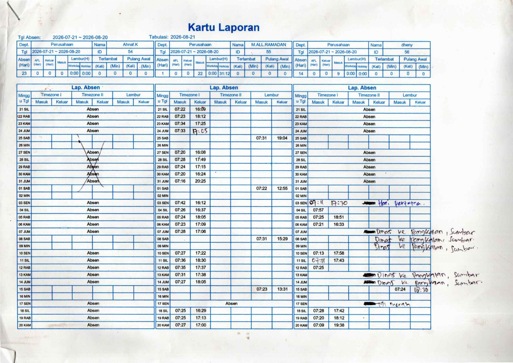

Confidence OCR: 45.00% · Render: 3364×2380px

````text
N                                                         |
|                                                                          Kartu Laporan
¥    Tgl Absen:      2026-07-21 ~ 2026-08-20                   Tabulasi: 2026-08-21
Dept] Pousaon [Nama] Aik [Dept] Perusahaan [Nama] MALLRAMADAN |[Oept]  Perusshsan [Nama] hey |
[Co |mwsorzi-2e6620 | | 5 || vo [somorzi-z0m0820 | iD | 55 | To [zeorzi-zzeoe0 | 0 | 56
Rosen] ar
|    a] 5 | 55 | me pe pr Tn (Har 0 |e FT Tom | Gn Je =e er gr oo]
~ [@T oo oJom[ooo] o [0 [0] o J + ojo edema o | 0 | 0 | o | o]|o]s ooofow] o | 0 0 | 0]
|    ee   | Timezonell |   HR   | Timezone ll |   —— NN na.   | Timezonell | Lembur |
| [970 (Masuk | Keluar | Masuk | Keluar | Masuk | Keuar || Tol (Masuk | Keluar | Masuk | Kear | Masuk | Kear || uTol Masuk | Keluar | Masuk | Kear | Masuk | Kouar |
[oc] Aen Wwe|orz2 | wed [ | [| we Amen
fmol Awen jera ora | iga [ | | | wee] Amen
[owl Ree low ore | aes [| |
ET) I SN | EX) CZ 5 3 I I I RN | Rep
moe] TNT TT wee] | | [Tost | wee |mew| | | 1 1 | |
mun] | TN [7 [1 few we] DD TTL)
z7zseN| MAbsen/ 0 |farsew| 0120 | 1608 | | | | farses] Absen |
wou Mesh [mew] ors [tae | | | | jer) Ase |
ore] Agen fmm] 0124 | aras | | | | jer) Absen |
owl phe foww| oro | eae [© | | | low Aes |
oss] | [| / | "| 0 lose] | Of OO] [or] 2s floss] | [OT OT
wn] | [TT ews TT few [|||
essen| Awsen fms] oraz [teiz | [| | |[wen[0]:0 [30 wm Kt. Yorkers |
fuse [| Aesen  fosw| ors [tear | | | | les omer [TT |
. Jera Ae Jess ora4 | wos | | | | |loswe| os | mst | | | | |
ooo] Meer jleeram) Oras | moe | | | | loom] 0721 | tess | | | | |
oom] Ase jferamf ore | ames | || | foam mmmDved ve Yamgidtan | Sumac
oso | [TTT few [| ore1 | 529 [wwe] | | Tak Ve Keruh Jonbar
own] TT [TT fel 7 TTT Www TT [Od W [Reedidawn, fe
 [ose ora fame || | | foses[ ors [wee | | | [|
isn] Aen [wef oras [ms [ [| | fwefoqut| we] | [| |
fame] Ameen Jfeme[ ors [wear | [| | Jfeme[ ores [| | | | |
fool Ameen [eww] ora [mee [| | mew] ae 0ieo8 ve Yaegvn\an, Sumbar
om Ree ww over [ees [|| | wa mm Deet We faoaan, Senbace
Gese [TT fee] [| Tora | wet |lwes| | TT 1 ora [(g.30]
ECL) I I I A el 11 LTT own] | [1 7
[rsa been |
 [osu | or2s [tee | | | | [we] ora [maz] | [| |
er men [mel Oras | amas | | | | lewse| or | wewz | | | | |
— Ee Ase for [roo [fo] ore [tess [| | |
IP                                                                                                 a
J                                                                                                            .
````

## Halaman 2

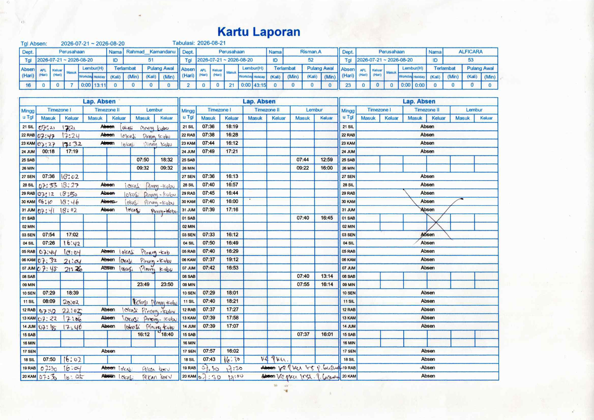

Confidence OCR: 48.00% · Render: 3364×2380px

````text
Kartu Laporan

Tgl Absen:      2026-07-21 ~ 2026-08-20                    Tabulasi: 2026-08-21

[7g [roosorzi-2oz0620 | © | 51 || To [omorzi-zomoen | © | 52 | Tg [mworzi-zmen | © | sm |
pro Rosen] x. | rae r= py    [ Combat) | Terlambat | Pulang Awa |
Pama 5 | Ka ma T pr i Tom | 5 | 5 | = ep Tm Te (on £5 25 | me ft mT yom To]
[#6 | o[o| 7 [ooofst 0 | 0 Lol o || 2] oo] [ooofassy 0 | 0 | 0 | 0 2] of o]o] oofow] of 0 | 0] 0]
 rp TT

Tol | Masuk | Keluar | Masui | Keluar | Masuk | Keuar || UT | Masuk | Kear | Masuk | Kear | Masuk | Keuar || Tl | Masuk | Kear | Masuk | Keluar | Masuk | Kena |
 EK oros [mo [| | | |
 22ran) O7:38 | 1628 | 00 | 00 | 00 | |
|Bemloyiap (9:32 Mme olay Dini von Ji2akam) O74 | 1612 | | po po Jeram) 0 Absen |
oom] 00:8 [ 17:9 | 0 | 0 Da feewm| ove | at | 0 | 0 Da  faewm| 0 Absen |
sas] | | | |orso | 1882 |[sses| | | | | ors | 1250 [jess] | | | |] | |
own] | |] Joes | 0982 (jamu) | f |] | 0022 | 3600 fawn | | | | | |
z7sen| 07:36 figio2 | po | 0 |  Jlorsew| 0138 | 1618 | 0 | 00 | 0 | farses] 0000 Absen |
 (os | o740 | 1657 | | | | flees] ~~ Apses |
 zoras| 07:45 | 1644 | po | 00 |
dora Colo \8:ue  Abeen- (ows Oram -icopy (JBoKAM) 0740 | 1600 Cf | | Nook] ON Absen |
oes] | | 1 17 fess] Of J] of  [or40 | 1645 flows] | | ON | 0 |
oem) | Fo] few FF Ff few ff ANT]
joes | 0726 Jlbiya| | | po Jos] orso | te9 | | | |] |
 josras| 0740 | 1620 | | |  f  |joseas| ~~ Absen |
 jookam| o7:37 | 1812 | po | | |
rome 224s 211k AEN (Nal Diy kubu (jeram) 0742 | tess | | 0 | 0 | flow] 0 Absen
sss) ~~ | [0] 7 ~~ loess] | | | ~~ Jor4o | 314 floss] | | | Of |] |
joomn) | Ff] | 249 | 2350 [oss] | | | | ons | 164 flown] | | | | | |
tosen| 01:29 | 1830 | | | |  jjwsew| 0120 | wot | 0 [ | | |                              :
aras pwn 22107  Absen OWN Priape duly |(2R#8) O77 | 727 | | 00 po po flees] 00 Absen |
aKamjog:22 lara Abeen focus: Puen. ulu |taKAm) 0730 | 178 | 0 | 0 | 0 | |
(amlGyt ly Ie.y6  Abeen  (SeoS Plug kubu [tem] 07:39 | amor | 0 | 0 | | leew] ~~ Assen |
sas] [| | 1  [te12 KOTA |[wsss] | | |  [orar | ot flwsw| | Of | | |
fon] ~~ | | 1 1 few OF 7 1p few ff of 1 of
sen]  Awsen [ween] 0157 | te02 | | | | |]
[osu] oreo [fbroa| | |] [ws] ord [pao] Vee | | |
 mows) no 1500 Been Vegvo a A Guede] Awe |

Ea   ak
-
````

## Halaman 3

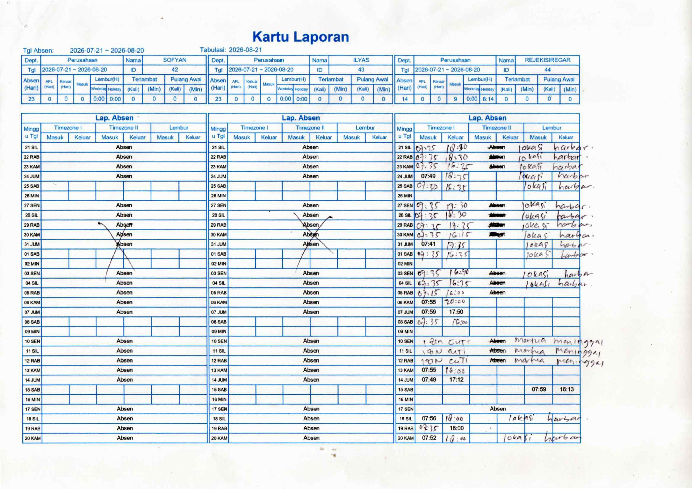

Confidence OCR: 41.00% · Render: 3364×2380px

````text
Kartu Laporan

Tgl Absen:     2026-07-21 ~ 2026-08-20                Tabulasi: 2026-08-21

[Oop] Perushoan [Nama]  SOFYAN [Dept]  Perushaan  JNama| VAS [Dept] Perusahan | Nema] REJEKISREGAR |

[Ty jn260r21-20260020 | © | 42 || To [eomorzi-zoeeoem | © | 4 | To [orzi-ameeoez | | aM |

Absen Absen Absen ar
a] 5 55 bean Tr Fa oa | 1 25 me fp Fe oy om a] 2 55 ef FT yo Ty

[2 10 0] oJoofooo] o | o | 0] o Je | oo] oooofooe] o | 0 | o | oJ =| o] os [ooo[ese] of o | 0] 0]
[CC tapAbsen J tap.Absen |

Mingo] _Tmezone1 | Timezonell | Lembur || ming  Mingg|__Timezone1 | Timezone | Lombur |
ee eT eT Tat = Da es Tree Time ete

EC I asec [§30 Mee oval Karbar:
we Amen lem) Amen |mwe[s) ic (§:40 Mme oben harbad -
mow Amen mew Amen |mewl0):95 Coc wn folkas Debat

mse | TT TT wwe TT TT TT ee ear) | Tekan | hajar
wn] | | | mw Twn [1
sen] Aen me Amen |we[0] 9¢ 3.30 Mews oVAs lade.
ow] SN Ape  wew[ Ag wwe) 3c joc men elas  hacfen-
EX I I A NS TI | CT) EE 4 TT S| CT CENTS D220: ER 2773 5 WP 2
ww] | 7 [NT New| | [71 1 Wow [" Do [ LT
ween] / meee ws Ase |me[6) ag TOF Ameen joka Jake
ome] meee lews| Aen (CO 15 Mia Jeon Awe |

ooo Awe News| Aen www ores [ago] | 1D 1
oo] Rese New| Aen low ore [reo | | | ||

wwe Dn TT Te TTT TT Nee fom | | | |

own | T dewe) lew DD DID DID DD                              |
osn Asep fos Abe | 9941                |
isc Awe we Awe 554i
(ema Aen wel Ae ewe ur) coll Mmm faba pen feos
foo] Aes lew Aen [ww ons [feos] | [|
ow men ww meen lwww| ore [wz | | | |
fess] | [TTT wee TT TTT wwe | | | ore | 1
own] | | [few [TT eww [|
frsen| Rep lms Awe [ws Ameen |

 oma Chg | moo | | | |
wow] Amen lew] Aer Hikam) 0782 [Jom] | [cba Dikota

-
````

## Halaman 4

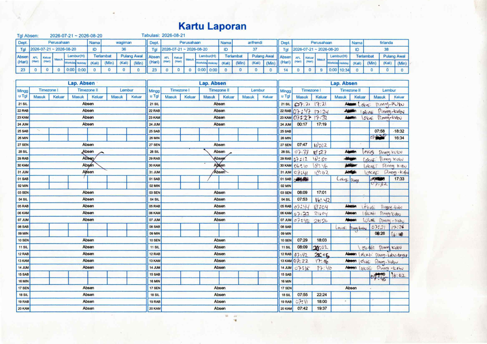

Confidence OCR: 47.00% · Render: 3364×2380px

````text
Kartu Laporan

Tgl Absen:      2026-07-21 ~ 2026-08-20                   Tabulasi: 2026-08-21

[Dept] Perusahaan [Nama]  wagman [Dept] Peruse [Nama] aiend [Dept]  Persahaan [Nama] finda |
[To [20260721-20260620 | © | 3% || Toi j20260r21-2026020 | © | 57 || To [oweorzi-aom0e0 | iD | wm |
(Her                 rove | cai | (Mim) | Kai) | (vin) || Har | on)            rare | Kan) | (Min) | ka) | (vin || (Hari) | © | 0 | ™ fovea | (Kan | (Mim) | oka | (vim) |
2/0 f0 oJooofooo] 0 fo [0] o [250] oo ooofooo] 0 0 0 | oa] 0] oe [ooofioss 0 o fo | 0]
  tapApsen |
Fr mL ——T 3 RN.
To! (Masuk | Keluar | Masuk | Keluar | Masuk | Keluar || uTol (“Masuk | Keuar | Masuk | Keuar | Masuk | Keuar || u Tol (Masuk | Keluar | Masuk | Kear | Masuk | Keluar |
sc Awe wer Awe BEI ae Am lo DE
mow Aen mew] Ae
ow] Aen ww Amen ww oz [re [|
mse DT IT IT Te [TT TT mes | [|| ores | ema
sen Amen we Aen wee ora ide | | | | |
awn | | [1 eww [eww] [| | STEE
sen Ase fms Aen [mse ome [ror | | | | |
EX EY CTT EY NE | CTS C7 TSX) Do EA
osm Awsen fem] Aen |
oom Awsen  fewew] Aen |[www[oy.37 20y Aes goss Dawa |
ow Amen foam] Amen |oam[o)iys oro. Mee OU Dan kun |
own] | TTT ewan TT we TY Toe [pe |
Gosen[ — Aeeen lose Aen [ose ore [eos [| | | |
fame Aen [we Aen |[nwe[()p oateg Abn (sad we ive]
fool Awe fee Aen  [ok[07:22 yh Abeen dag Dwele |
aw] Abe fw Ame [Wam[chtis [5 Ue Aen (gop Oem ay |
pwn] |] 1 1 of ffees) FJ 1 1 of few] ln [ [ JT*[ |]
 Green| Aen Kn. Aen
EE Rep [os| ores [2224 | |] [|
 EE) IT IE | I A
won| Amer lew Assen jek oraz [esr | | | | |

-
````

## Halaman 5

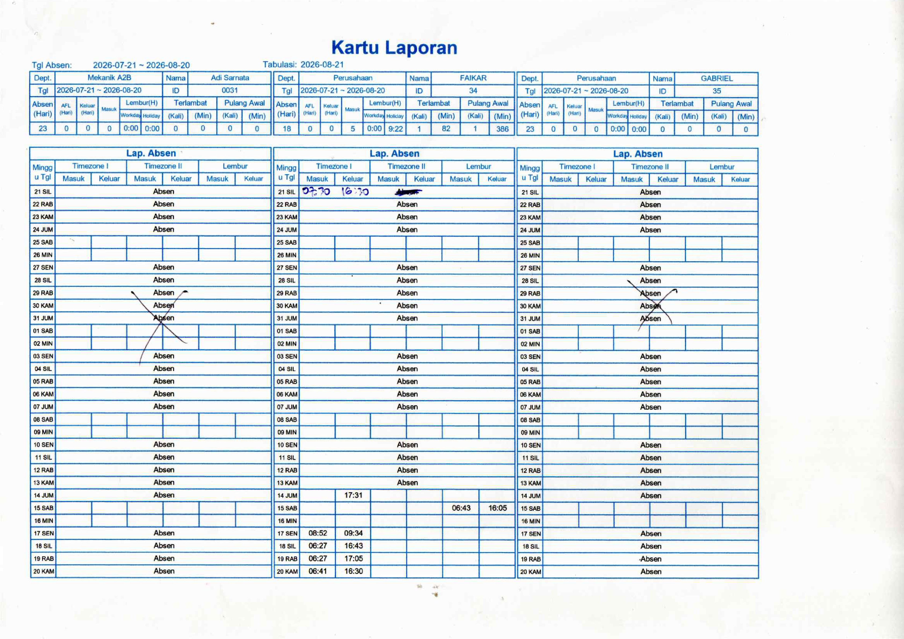

Confidence OCR: 42.00% · Render: 3364×2380px

````text
Kartu Laporan

Tgl Absen:      2026-07-21 ~ 2026-08-20                   Tabulasi: 2026-08-21

[Dept] MekankA25 [Nama] Adana |
[To [eoesor21 20060620 | 0 | 051 || Toi [oueoorzi 20200620 | > | 5 || Tol [soeeorzi-zomoem |p| m5
pre: an Rosen] ani Absen| sr. | aun
| 5 55 = Fe mT | | 55 25 oe eT a aa ea aa om Ee eT To
[=] oo] oJooofase] 0 fo [0] o |[ 600s ooofoze] 1] 62 | 1 [a6] 25] 0] 0] oow|oo] 0 | 0 [ 0 | 0]
Mingg  Mingg  Mingg
 ol ae ie Ba [ae © eT a Te sa TE
sn Rep EE EY
mow] meen
ow] Ase fw] Awe fw] Aen
moe] [TT TT wee TTT TT wel TT TTT]
CIC) I Do NN EN AN Do | YT A ANS SS DT A DT ee) EN EE EE
zzsen| 0 Absen 0 lesen] 0 Assen ase]  Absen
ose] DT DAN TT Jose TT TTT owe | [77 1 1 |
CIC) NN D7 NS AN Dee DI DT DT Do CIT DL DL Dll
sej Rep |
EE SE ME
oom] Aer Jjjeeram) Asen ose] Aen |
an] Ae C2 EY a |
sol [TT fesse [TT TT fms] [TT TT]
own [| [1 few [| IT IT IT Jew [| [|
KE Ase | KE IY SE |
osc] Awe fe Ae we Aen |
 Come Aen
Cowl Aes fee ase leew Aen |
CE IS je) par A 1 A C2 Rep
owe 1 TT TT fw [Toes | t06 [wee | [TT 1 |
own Do TT fees Te Do DD LD Dl,
Groen een fee] owe [owes | | | | |
 Cos] 0627 [ews | | | | |
 Gome| oer [mos | | | [|
wow Awe ww] ean [630 | | | | mew] Awe |

Ed   “x
w
````

## Halaman 6

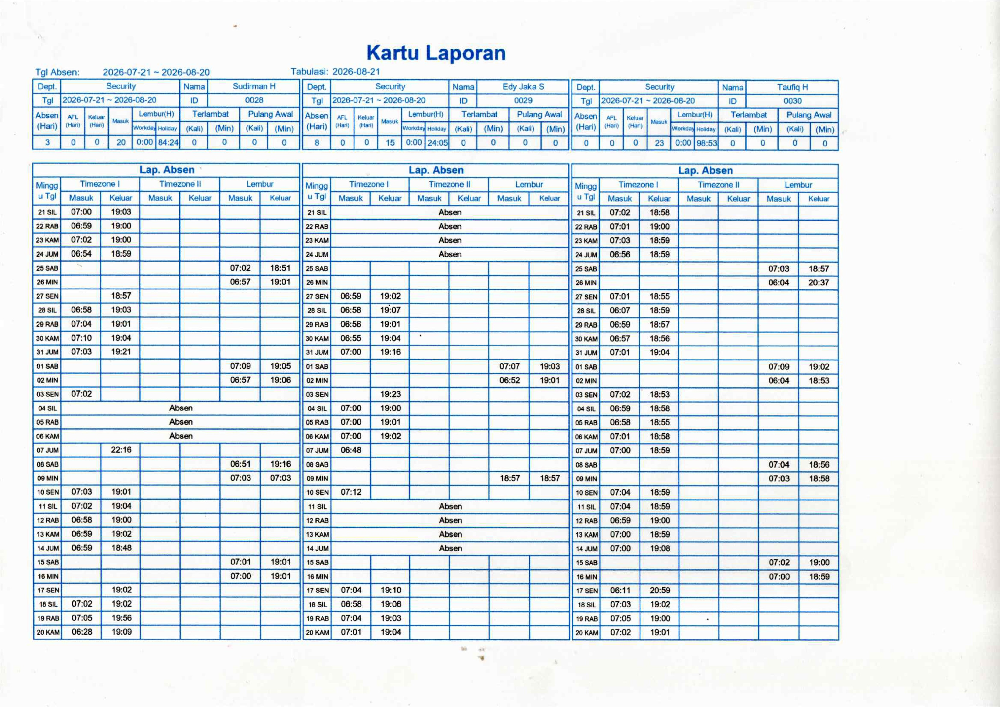

Confidence OCR: 53.00% · Render: 3364×2380px

````text
Kartu Laporan

Tg! Absen:     2026-07-21 ~ 2026-08-20                  Tabulasi: 2026-08-21                                         |

 [Dept] Seouty [Nama]  TauigH |
| Tol [0260721 -20260620 | i | 008 || Tol [20260721 20260820 | iD | 0020 | Tg [ooeo0rzi-zoze0e20 | © | oom |
proves gy Absen) wr [von rr Ga
Ee Ee oo ro df wr ome lr = em ee KI
[5 [oo 20ooofseza[ 0 | 0 [ 0 | o J[ e Do fo t5[o0ofze0s[ 0 | 0 | 0 | ol o | o] oz ooofessy of 0 | 0 | o|
Mingg  Mingg  Mingg
 Cle Taal Toe | oh To ol ie [ik Toa TT ie
[ru] oreo [wos | || | [ws] oroz [ese | | | ||
ET 0680 | 00 | I I ee oro1 | te00 | | [| |
wow 0102 | te ||| | low Aen lww| ores | tess | | | |
om 0654 | 1880 | | [| maw Aen lwww| 0686 | eee | | | | |
woe] | | | | ore | mst wesw | | TT | ss] | | | | oros | tee |
own | [Toes | teof Jen) | | || | jer | | | | oss | 2037 |
wen [dsr | | | | mee oes [eee | | | | we oror [mes | | | | |
ms] oese | eos | | | | ww oes | wor | | | | lms osor [ese | | | | |
ww oro | mo | | | | lwwe| oss | wor | | | | |lawme| ose | teer | | | | |
owl 07:10 | e04 | | | | fowl 0665 | tea | | | | loww| oes? | tess | | | | |
ow] 0703 [teat | || | [eww oreo [fete | | | | jeram oror | tees | | | | |
owe || | ore | 1e06 |[orse| | | | | oror | 1003 lls] | | | | ores | 1902 |
wn | ["oes7 | te06 |[eawn| | | | [oes | feof |[eewn| | | | | oos | tesa |
essen) ore | | | | | fms [teas | | || [sen] ore2 | tess | | | | |
fos Aen fesw| oo [geo | | | | los] ee | tess | | | |
 sms 0700 [fer | | | | jer) 0688 | tess | | | |
ow] Awsen  fsww| or00 | fe02 | | | | [eww] orel | tess | | | | |
om] Tze [| [TT jeram ore | | | [| |forwm[ oreo | wes | | | | |
fowl | TTomst [tee Je) | | [| | less] | | | | ores | tes
own| | | [ores [oros |[eww| | | | | esr | tee7 |[eewn| | | | | ores | fess _
[osen[ ores | wor | | [| Pesan oraz | | | || foses| omos | ese | | | |
ew omo2 | eos | [| [| use oros | ese | | | |
EE CE IE | I I fawe| ome | eo | | | |
[ow 0650 | te02 | | | | jer)  Aween jeram) oreo | se | | | |
am) 0650 [teas | | || [ww] Aen lww| ooo [feos | | |
[swe | | | Torot [eof [wee | TT |  fwes[ | | | | oroz | tewo |
own [| Toroo [mot [www] [||| | few] | | | | oroo | 1880 |
[mses | tea [| [| [ween oro4 | temo | | | | [wee] oer | mos | | | | |
[esc] ore2 | 1802 | | | | |[vesw| oes | feos | | | | [si] ores | e02 | | | | |
[ome oros [ese | | | jer oro4 [eos | | | | [wwe ores | 00 | | | | |
[oom] 0628 | 100 [| | | [www] ozot | 108 | | [| [www] ore2 | toot | | | | |

-
````

## Halaman 7

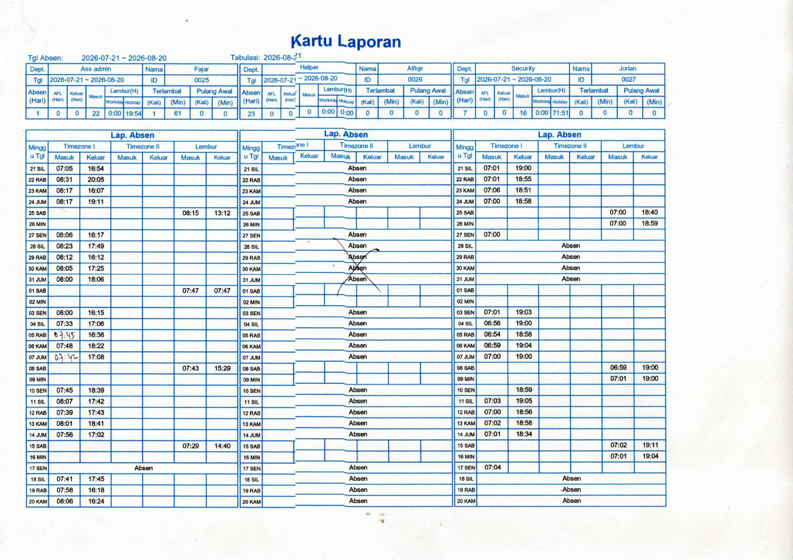

Confidence OCR: 57.00% · Render: 3364×2380px

````text
Kartu Laporan

Tgl Absen:      2026-07-21 ~ 2026-08-20                   Tabulasi: 2026-08-21                                            |

            Hope            [Nama Agr |
| Tg (202607-21- 20260820 | io | 0025 | 202607-2{~20260820 | i [| 0026 | Tol [202607-21~20260820 | wo | 0027 |
Absen| a Absen| ar | wens Absen| ar. | veer
[+ [of o[2eooofes 1 | e Lo o || 2s oo] ofofooo] o o | o [of 7 [o]o][tefooofzes| o | o | 0 | o|
                         Lap. Absen
 Mingg| Tmezoe! | Timezone | Lembur |

u Tl | Masuk | Keluar | Masuk | Keluar | Masuk | Keluar |  Keluar | Masuk | Keluar | Masuk | Keluar || uTol | Masuk | Keluar | Masuk | Keluar | Masuk | Kear |
2isn| o705 | 1664 | [| | lave]                        Absen                         2isn| o701 | 1900 | ff | |
ow] 0817 | 1607 | | [| |                        Absen                         sow 0106 | 1851 | | | | |
oom] 0847 | tet | [| [leew]                        Absen                         j4om| O700 | 1858 | | | | |
zeae] | | | | ows | 1312 [lasses] |]         | TT Nee | [| [oreo | tao |
EXT) I I (TT DI          | 1 mw] [oreo | 1859 |
jzrsen| 0806 | te17 | [| pn                         Absen                         zrsen| 0700 | pp po | |
2s) 0828 | 1749 | | | | |              :
oss] | | [| or47 | onar |forss| |         LT ST To ese TTT TT
loawn| | 1 0 1 [few]         1 few TT TT 1 1
essen) 0800 | 1615 | | | | |                       Absen                       essen) 701 | 1903 | | | | |
joes] o733 | 1706 | | [| Joes]                       Absen                       osu] 0686 | 1900 | | [| |
osras| Saus | 1636 | | | | [lose]                      Absen                       josras| 06:54 | 888 | | | | |
ooiau| 0748 | 1822 | | [| [joswam                       Absen                       oekau| 0659 | 1904 | | | | |
oom) ox M| 1708 | | [| |                          Absen                           jorom| 0700 | 1900 | | | | |
oosa| | | fo | oras | 1520 [lossas| |         | [TT Nose] [| [|] oese | 1900 |
EX) I A I I I | CYT ME         | 1 Jews] TF [oro | tem |                              |
iosen| 0145 | 1839 | | | po Jasa                       Absen                       osen] [eso | pp | |
non | 0807 | 1742 | | | | jus                          Absen                           neuf ores | 1905 | | 0 | | |
aras) 07:39 | 743 | | 0 | 0 | |                          Absen                           aras) 0100 | 186 I I po po
roan] 001 | 1841 | pp [swam                         Absen                  [vw] 0102 | 188 | | | | |
aou| 0788 | 702 | | [| [leew]                          Absen                           sam) o701 | 1834 | | pp
Tess] | | | | onze | 140 sel |]         | TTT fess] [TT Toro] iam]
own] | [ff Jeww]          | femw| 1] oro | 1804 |
                          Absen                           sen o7o4 | | [| |
[osu] ort | 1745 | po po | |]                          Absen
ores] 01:58 | 1818 | | | [|                           Absen
oom] 0806 | 1624 | 1 | | Jom                           Absen                           EX Asep

2   ak
-
````

## Halaman 8

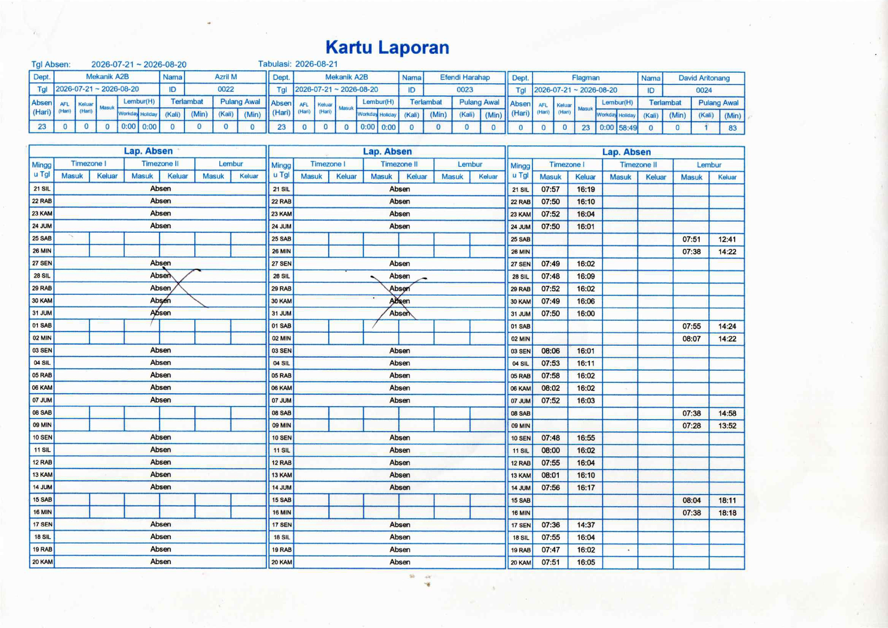

Confidence OCR: 46.00% · Render: 3364×2380px

````text
Kartu Laporan                                                                                                            .

Tgl Absen:     2026-07-21 ~ 2026-08-20                 Tabulasi: 2026-08-21

 [Oopt| Moka A28 Nama] Efendi Harabap |
Tol [2026072200620 | | oo || Tg [smeorzi-zome0s20 | © | ows | To [ozeorai-zmeoem | | oor |
pre Bp fy a iy a
[2] ofofofoonfow] of o [of 0 Jf2s] of o] ofooofooo] of oJ of of of ofof2sfooofseus] o | 0 | 1 | es
Ming  Ming  Ming
Te a ee let Re ee Es Lele a TT
 Ery  Absen 0 |me|ors7 | tete | | |]
Jr) Asep zea) 0150 | 1610 | | po | |
ow Asep | EXT 0152 | 1604 | po po po
2m) Absen | EXTEN IEEE I A DI
lose] ~ | | 1 [ [  mse[ OT TT OT Tse [1 1 Tomst | 1241 |
own] | 1 Tf Mew] TT TT fmm] 7 [Tomes | ta22 |
sen) Absen zrsen| o749 | 1802 | | [|
ose) | [TT 1 1 Nese] [7 TTT ese] [| | ores | 1424 |
enn] | | [few [Tf [1 lems [TT osor | 1422 |
 essen 0806 | 101 | | 0 [|]
 ossu| oss | te | | | |
 jooras| O7:88 | 1602 | | | | |
ooka| Abeer Jeram) Amen Jleeram) 0802 | &02 | | | |
 oram| o752 | 1603 | | [|
oss] | | | [Heese] | 1 TTT loess] [1 |] or3s | 1458 |
own] | | [ff fess] [TT T  feww| TT ors | 13m
 osen] 0148 | 1855 | | po po
 se] meen 000000 fimefomoo [teo2| | Of |
era) Asep | eran] 0785 | 1804 | | 0 [|]
roam] Abeen 0 fw] Amen leew] 0801 [eto [ [| 3
 room| mse leew ose | a67 | | | |
ose] | | 0] 0 1 Nese] 1 OT OT TT fesse] [1] 1 osos | 1811 |
own] [fT [1 ew [TTT 1 few] 1] [oss | tes
 vse] 0136 | 1437 | 0 | 00 po | |
[ose]  Absen | tos | o785 | 104 | | | | |
 oral O747 | 1802 | - | | | |
om] Abe zoxam| 0761 | 1805 | [| | |

kL   ak
hd
````

## Halaman 9

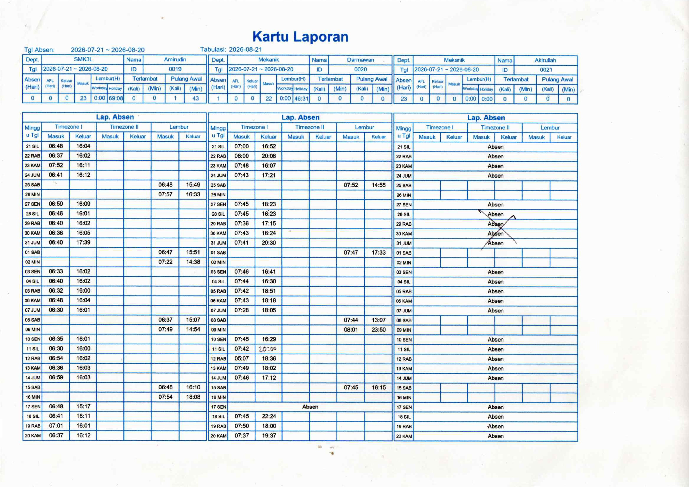

Confidence OCR: 49.00% · Render: 3364×2380px

````text
Kartu Laporan
Tgl Absen:     2026-07-21 ~ 2026-08-20                  Tabulasi: 2026-08-21
 [Dept] Mekak [Nama] — Damawan |
[Tol [20260721 20260620 | © | 01s || Toi [oozo0r2i-20m060 | © | oe || To [eozeorzi-zozme0em0 | © | oar |
Free: fy Absen) x [var pre py =
[i] 55 me Fe nT Te fr 55 me Fo a oT | 55 ee eT py om
[Coo 2s ooofeoosl 0 | 0 | 1 | 45 || 1 [0] 02 ooofaess] 0 | 0 | 0 | o | [0] 0] ooofooo] 0] 0] 6 | o]
Mingo  Mingg  Mingg
Pe Ta a a we Fra eo ea aie
[si] 064s | 604 | | | | [wef oreo | ese | | | | |
mre] 0637 | fe02 | | | | |[mwe| oso0 [es | | | | |
owl 012 [tet | | | | |fooww| ose jer | | | | |
ow] T0641 | 62 || | [ww ores | aren [| | fw] Awe |
woe | | Toews | ao js) | | | [one | tess je | [TT | |
own | Torer | tems jer) [fw] | | | [| |
oroen| 0650 | 1600 | | | | |{aee| ovas [em | | | | |
ose Toea7 [vss lose [| | | orar | free [fos [| TT |
fawn Tora | vem fawn | | few] | | | [||
[woe 0633 | 102 | || | lossen| ove | dear | | | | |
joran oso | 1602 | || | [ars] ora | temo | | | | |
o fesrae| 0682 | 1600 | [| | loss] oraz [ test | | | | |
oom| 0648 | 1604 | | || Jeon) Ozws | tee | || | jon Ase |
[orm 0680 | 1601 [| | Jeram) ores [tees [ | | | [aww Awe |
[ss oer | t507 loess] | [| for | or Jas] [TT | |
own] | Tora | wwe Jfemw] | | Do omot | zss0 flwww| | | | | | |
fosen| 0635 | 1601 | | | | |loee| ors | tem | | | | |
su oso [Tveo0 || || [wed] oraz jae | ||| jne) Ase |
fame] 0654 | 02 | | | | |[ewe[ oso7 | mse | | | | |
fow| 0636 | 1603 || [| jeram ore | wmoz | | | | lwew| Aen
[oow| 0650 | 1603 [| | | lwo] ors | raz | | || lw] Aen |
fos | [| Tomas jae es) | | | | oras | feds je) | | [TT |
own] | po [omsa [moe [www] | | | [| few] | | | | | |
[sen] eas jaan | | || dee  Aesen |
[osc| oat jae | | | | [wed] ors [eas | | TT |
ome] oro1 | t601 | | | | |fewe| omw | teo0 | | | | |
ow| 0637 [tote [| | | fwww| omar [tear | | | | fw] Aen |
=   hk
w
````

## Halaman 10

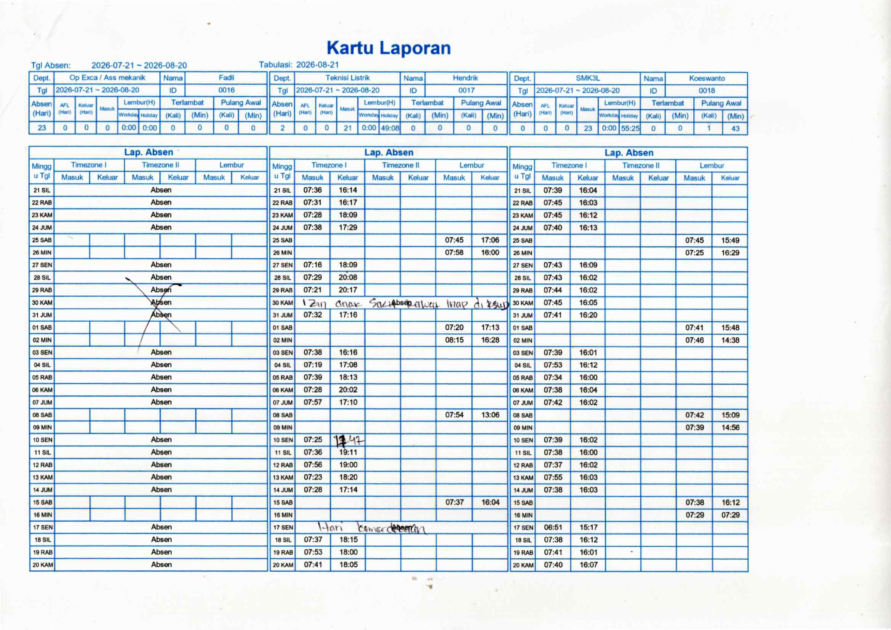

Confidence OCR: 52.00% · Render: 3364×2380px

````text
Kartu Laporan

Tgl Absen:      2026-07-21 ~ 2026-08-20                    Tabulasi: 2026-08-21

Dept. | OpExca/Assmekank [Nama] Fadi |[Dept| ~~ Teknisilistk [Nama] ~~ Hendrik |[Dept] ~~ SMK3L [Nama]  Koeswanto |
| Tol [202607-21~202608620 | iD | 0016 || To [20260721~20260820 | © | = 0077 || Tol [2026-07-21~20260820 | iD | 0018 |
ERE ——— | Terlambat | Pulang Awal |  ERE | Terlambat | Pulang Awal |  ERC | Terlambat | Pulang Awal |
ey                 wokcaf vay | (kal) | (Min) | (ai) | (Min) || (Hari)                 works rsa | (cal) | (Min) | (Kai) | (Min) || (Har) | tam            oss voy | (Kali) | (Min) | (Kai) | (Min) |
|  lap.Apbsen |
Mingg| Timezonel | Timezonell |  Lembur  [fMingg| Timezone! | Timezomell |  Lembur  |IMingg| Timezonel [| Timezonell | — Lembur |
RT ee ee le ae Te eT a
ots] Absen llaewfoorae | tea | | | |  lfxsc[orse | eos | | [1]
2m) Apsen 0 |lzms| 0131 | te? | 0 | 0 [ | fees] 0145 | 103 | | | | |
zoom]  Absen 0000000 low 0128 | 1800 | | | | fw ozs | a62 | | | 1
2am]  apsen 0 fewwf 0138 | 720 | | | |  ffww 010 | tea | | [|
ss) | | | |] flwss] | | |  [oras | 1708 |[ss.e] | | [| | or45 | 1540 |
own) | ff] Hews] Of J | forse | 1600 Jamu) | 1 | or2s | 16:29 |
ren]  Absen Jlersenf 0116 | 1809 | | | | lforsen] 0193 | 1600 [| | [| |
 2esu| 0129 | 2008 | | | | © ifsc] 0743 [02 | | |]
sra8| NN Abg llmwes|oo721 | 2047 | | | | = Jera) O744 | te02 | | [| |
oss) | | SIN] lose ff | 0120 | 1743 floss] [| [| | ora | 1548 |
own) | | J fff Jews] Ff] Joes | 1628 flew] | [| or4s | 14:38 |
osseN| © Absen 0 |josses| 0138 | 1618 | | | | ~~ fossew| 0130 | 1601 | | | | |
jose]  Apsen 00000 losswf ore | tree | | | | © floswfozss| ez | | [| 1
osras|  Apsen  |losmas| 0139 | 1813 | 0 [| | | © floseas[ 0734 [1600 [| | | | |
oka)  Apsen 0 |joswaw| 01:28 | 2002 | | | | ~~ flosww| 0738 | 1604 | | | | |
orom| ~~ Mose 0 Joww| 0157 | 470 | | | | fforwm| 0142 | 1602 | | | | |
ossas| | ff | of Joes] | | | ~~ [ors4 | 1306 lfoesas| | | | | 0142 | 1500 |
own] | | ff News) Of FT 1 few] J 1 ors | ase |
oseN]  Absen 0 Jjiosen) o72s [QM] | | © f © floss 0139 | 1e02 | | | | |
sw]  Awsen 0 |fvsufoorde | teat | | |] |  liwsfo73s | 1600 | | | |
ras) Absen Jjteras) 0156 | 1900 | | | | lems] 01787 [1e02 | | | |
akaM|  Awsen [waka 0123 | 1820 | | | | = lows 0185 | 1603 | | | |
aon meen 0000 www or | ama | 00 | 0 | po jam ors [eos | | [|
sae] | | ff fess] | ] | fora | 1604 ffs] | | | | orss | 1612 |
own) | | 1 ffeew ff Fp] few] J] | or | 0120 |
ese] mses |lwsw|ora | tess | [ | |  ffescforas | e2| | | | |
oRa8| Ase  ||weas[ 0153 | 00 | | | | ~~ leme[ozar | 1601 | -| | | |
ora mses 000 |joowwu| 0141 | 1805 | | | | = fowwuf o70 | 1607 | | | | |

-   -
-
````

## Halaman 11

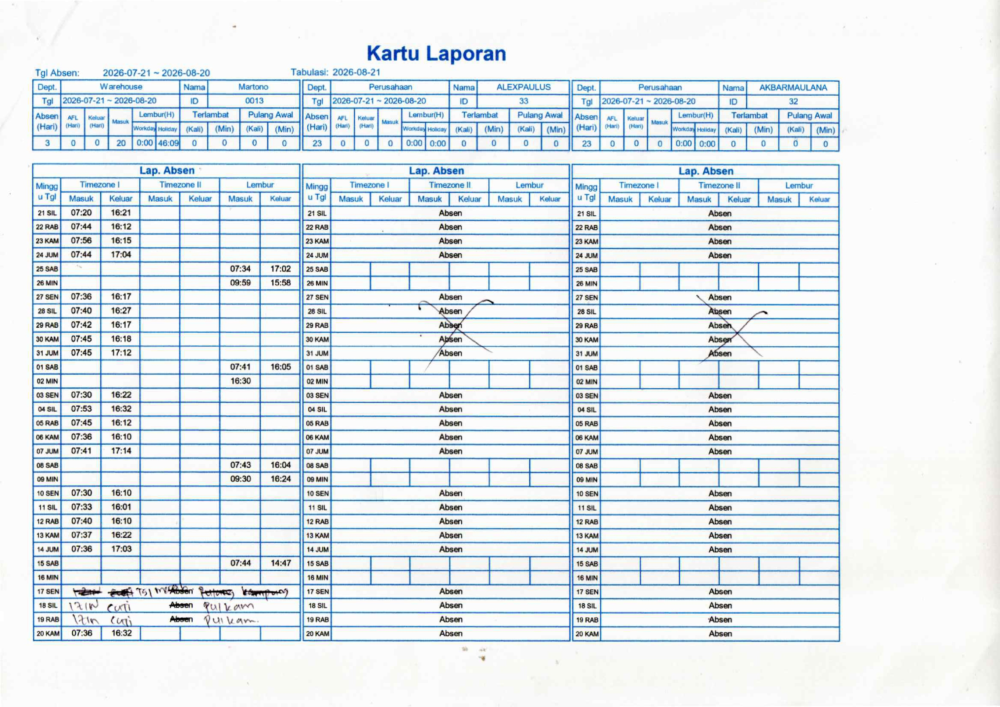

Confidence OCR: 44.00% · Render: 3364×2380px

````text
Kartu Laporan

Tgl Absen:      2026-07-21 ~ 2026-08-20                   Tabulasi: 2026-08-21

Dept] Worchose [Nama]  Martno |[Oept]  Pesshan [Nema] ALEXPAULUS [Dept]  Perusaan | Nama] AKBARMAULANA |
[To [20260721 20260620 | © | 0013 || Toi j2o280r21-20260820 | iD | 33 | To [oeeorai-zeeoez | 0 | 3 |
Absen Absen) ar. Absen
fr 2 55 em ke Toy ong | 55 | me pennant To Dana 55 em Fo
[5 [oo 2owofaecs 0 [ 0 | 0 o |[ 2s] 0] 0] ofooofooo] 0] 0 | 0 po 2] oo] ooofoe] of 0 6 | 0]
 [tap Absen |
Mingg| Tmezonel | Tmezonell | Lembur ||Mingg| Tmeonel | Tmezanell | lembur  |iMngg| Tmesonel | Tmezonell | Lembur |
Rat te a Tha LATE = Eo ile Teele ae To
[sul or20 [ear | [Wee Awe awe] Awe
| E20) ora (ee) I I EL I.
owl 0786 | ets | | | | fee) Aes lew] Amen |
owl ora [mo | [aww Ameen aw Aen
woe | po po Tors | tree je) | 1 TTT wee | [TTT |
wn] | || [oes | mee ju) | | | | Tee | | | | | |
sen] 0736 [ter | | [| wee Ren wee Aen
ose | | | for | wees [ese | | 7 TT Jews | [T_T |
own | [Tes [Jew] | | ew | [|]
sen] 0130 | f622 | | | | loses] Ase ws Awe |
ows | ores | ese || [| fas Awe lee) Aen |
oome| Oras | feta | | | | jer  Aeen wes Awe |
ooow| 0736 | f610 | | | | fos Aen low Aeeen |
ow] oman [ma || fowl Ase foam Ase |
sol | [| [ors | teed je) | TT IT Te TT TT [|
own] | [| ye | te24 jer) | | | | | Jews | | | | | |
Cosen| 0730 [ fe0 | | | | lose Aen less Ase |
isu | ores | teor | | || [we] Awe we Aen |
fame] 0740 | 1610 | | | | jer)  Absen jer)  Absen |
foo] onar | ee || | | few Aes leew Aen |
Coo] 0736 [ames [| | fee Awe fwaw| Awe
ose] | [| ora | tear [wes] | [TTT wwe TT TT 1 |
own] | [| 1 few TT TI few [| | 1
Cosi AW cun Mes Ruiveawn [ms Awe |
 fore Aen [ewe] Ase
oow| ose | 1682 [| [| [owe Amen mew] Awe |

-   -
»
````

## Halaman 12

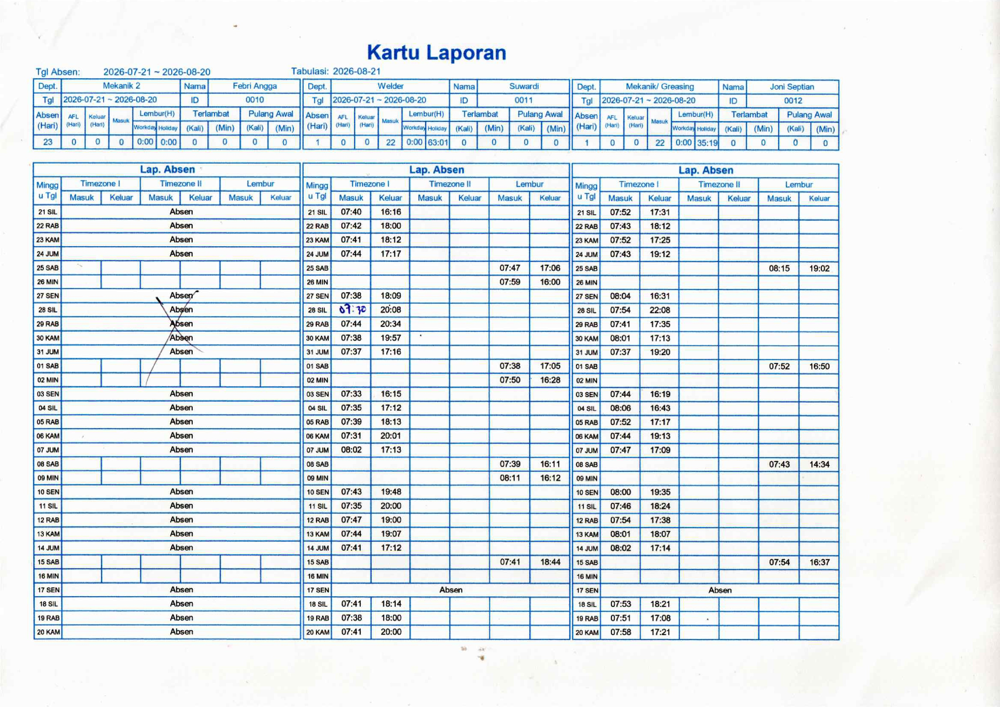

Confidence OCR: 47.00% · Render: 3364×2380px

````text
Kartu Laporan

Tgl Absen:     2026-07-21 — 2026-08-20                  Tabulasi: 2026-08-21                                          J

[(Ocpt.]  Mokankz Nama]  FebriAngos |
[Tol [20260721 -20260620 | © | 0010 || Tg [zomo07 212060020 | © | 001 || Tg Boer 20200820 [mo | oorz |
prow: jp ress gr Pena Absen) see | rou
a) 5 55 eo oon go 25 me fm aT ey oe] a) 5 5 me Fn To Ta ae ;
[25 [0 [ oo Jooofooo] o [0 | 0 o |[ +] ooze ]ooafesol o | 0 | o | o[ + [oo] 2 oss o]| 0] oo]
Mingo  Minos  Mingg
Tunas jua vr Tes | va oes Tom ed Toes | Toe | ee ee Tae Fa To
sc Aen jeep oro | ewe | | | | [we] ome | wma | | | | |
 mre] oraz | 1800 | | | | lowe] ors | rz | | | | |
mow] Aen fowl] ort | ae | ||| lew] omez | wras [ [ | | |
dow] Ase fw ora [amar [| [| few] ores | weiz | | | [|
wool | [TTT eren | [| [oar | woe |[wee| | | | | oss | te0z |
wan] | [fm oreo | eo jun) | | [||
owl meer rw over | mae | | [| ff omar [wee | | | [|
owe [T/T TT ferse[ | [ors | 05 |[wse| | | | | orsz | tes0 |
wn] | [7 TT fen [Tome | eee ffwww| | | | | [|
osen| meee [ose] ora | fers | | | | loose] Ona | temo | | | | |
 [os | ors Jam | | || fos] owe | feds | | | | |
 ore] ore | tes | | | | loses] ome | rar | | | | |
oor] Abeer  fooww| ori [2001 | | [| jer ora | tes | | | | |
row] Aes Jeram) 0802 | ras | | | | |forow| omar | ree | | | | |
os | TT TT fess [| | ora | ter [fess] | | | | ores | 1404 |
joswn | ff 0  feeww] J OT [Town | 612 flew] TT [|
 [osen| o7as | teas | | | | [osx oso0 | tess [| | | |
 [sc] ors [2000 | | | | [vec] ore | teas | | | | |
fame] men [wel oran | 100 | | | | |[owe| ores | ames | | | | |
 [owl orad | tor | | | | [owl os01 | wor [ | | | |
Coal Aen lea] ort [az | [|| eww] omoz [ame | [| |
fos] | [TT Tiles] [Toren | maa (ewe) | | | | ores | eer |
own] | [TT 1 eww TT few] [| [1
 (osu ovat | tera [| JO | 0 | les ores [tea] [OT OT |
 oran) 0738 | 100 | | | | |[wwe| oret | amos | | | | |
zoram| mbsen 00 [mew] or4t [2000 fo po fo fjowwf ores [aa [| [| |]

Ed   ~
w
````

## Halaman 13

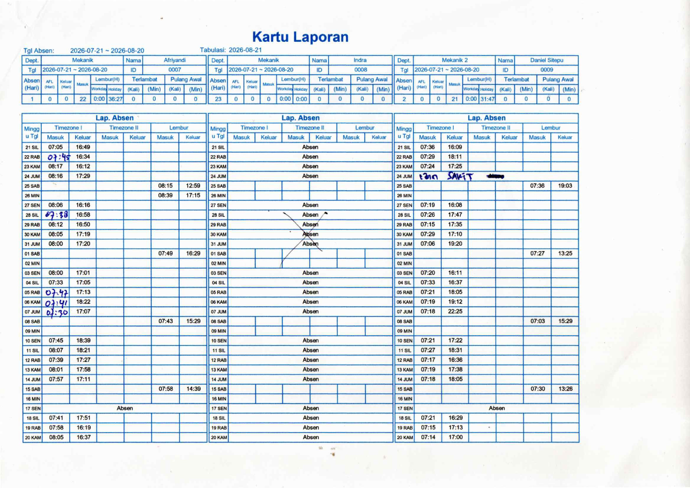

Confidence OCR: 50.00% · Render: 3364×2380px

````text
Kartu Laporan
Tgl Absen:     2026-07-21 ~ 2026-08-20                Tabulasi: 2026-08-21
 [Oct] Wekank [Nama] nda [Dept]  Wekak2 Nema]  DaieiShep |
[To [20760721 20260820 | © | oor || Toi [aueeorzi-2oz60620 | | ooo || Tol [aeeorai-20ze0620 | iD | oo |
Absen  prove am.  Absen| an.
(Har)         ravi] cio | (Kan) | (Min) | ka | (in || (Har) 0      raf ion | Kan) | (Min) | Kan | (Min) || (Har) | ©      roe] ron | can |Win) | Oka) | om)
1 [oo zomfswa] 0 | 0 Doll o |[ 2] oo] ofoofooo] 0] 0 | 0 le le polo pa dove 0] 0 | 6 | 0]
  tapApsen
Mingo  Mingo  Mingg| _Tmezone| | Tmezonel | Lembu |
Tol (“Masuk | Keluar | Masuk | Keluar | Masuk | Kor || 470! | Masuk | Keluar | Masuk | Kear | Masuk | Keuar || 470 [ Masuk | Keluar | Masuk | Keluar | Masuk | Kou |
aer ores [edo | | | | | [ms] ore [1600 [| | [|
mwa op:qg es | | | | | wel ore [mn [| [| |
owl oer7 [ez | | | | mew Ase lime oa | was | | | |
ow] ote | 720 | | | | aww Amen Jaws vie SAVY eee
wel | | | Toews [tase mew | IT ID [| wes] TT] Tora | 03
www | [| [oes | ms jer) | | | | www | | |
sen 0806 | ee | | | | wee  Absen wee ore [me | | | |
ws [#7:39 tose | | | | [ms] Aes jeje | ter | | [| |
oran) 0812 | 1680 | | | | |lwwe| Abeer  |lwwe| ors [was | | | | |
ow| 0805 | re | | | | owl Agen low 0120 [tao [|]
owe | [| [ora [tem [ewe] | [7 TT ~ [1 owe | | | | orar | tes |
wn] po Dn ew TF ew DD DT ln
essen 0800 | 701 | | | | jeep Aen ws or20 [wear | | | | |
EX BCE EE I I I DO (ows | O75 | esr [| | ||
ome Opp] rs | | [| wwe] Awe lwwe[ ori [wos | | | | |
owl gaya) 22 [| | | jer) Awe www ore | fez | | | |
jeram) ofegol mor | || | loam Aeen jleram| ore | 228 [| | |
ose © [|| ors | asa je) | [TT 1 Nee | | | | ores | tz
wn] [few | [ews | In
[osen| ors | 1830 | | | | wees Aen wee oraz [22 | | | | |
usu osor | ape | | [| we] Awe jer ora | west | | | |
era) 0730 | iman | | | | lees Aen lowe ora | wes | | | | |
ow] 0801 | tres | | | | leew Awe  |loww| orto [trae [ | | | |
Coan ors | rn || | | fw Awe ea ore [eos | | | | |
owe] | | | lores | tem |[wse| | | TT wwe] | | | | oreo | ts |
few] | [1 few | [few [| [1
 frees] Aen (Dn Abe |
esa omar [ret | [| [ws] Aen [we] ora [vem [ | | |
ome] ose | teto | | | | | [ome 075 (aras [| | | |
ow] 0805 | tear | | | | der) Ase Jeram ora | foo | | | | |
kd   -.
v
````

## Halaman 14

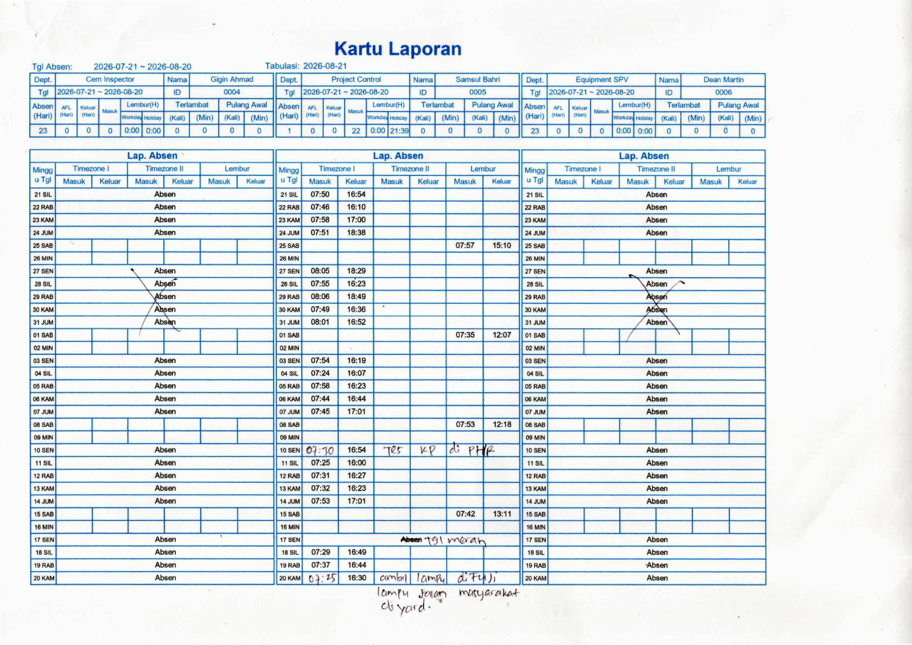

Confidence OCR: 43.00% · Render: 3364×2380px

````text
Kartu Laporan

Tgl Absen:     2026-07-21 ~ 2026-08-20                  Tabulasi: 2026-08-21
[Dept] Cominspecior [Nama]  GgnAwed [Dept Project Convl  JNama| Sameu Bai |
[Tol [2i260721-20260620 | i | 0008 || Toi [o260r21-2026060 | i | ooos || Toi [ose0r21-z0m08m0 | 0 | ooo |

onion | Kan) | (Win) | Kai | (Min) || (Hari) | 02           nrc | (Kan) | (Min) | Ka) | (vin) || (Hr | ©           romero | Kan J Wim) | ka) | (vie) |
[2s [oo ofowfoo] 0 | 0 [0] o | 1 [oo z]oofzisef 0 f0 0 | oJ 2]o]o] ol oofow] of 0] oo]
Mingg  Mingg  Mingg| _Tmezone| | Temeznen | Lembur |
Erie aE Deal A Tame ml El she oe Daan
isc] Awe Nee ooze [esa | [| [fest Ae
 Ze] Oras | @10 | | | | femal Awe |
ow] meen Jl) ore [roo | [| ee Awe |
owl Awe jam) omer | mse | [| | aww Ameen
mee [TT TT wee | Tore [60 je) | [TT
[ECT A IS AN EN | ETT) SN AS AS NN A S| ETT) SE
sen] N_ Aesen jlersen) 0805 | teas | | | | me _ Abees |
owl JAwen low ore [ved | ||| ow aby
ose] | [TT lovee [ores | reer Jesse] | [7 TST
own] | [| TT few TT few [|]
ween] Aes lose ore [fee | [| | leew Aen |
ose | Assen fos f ora [veor | ||| (CC | Aen |
 oom] O58 | 1623 | | | | [ose] Aen |
ow Awe loom] ores | ead ||| | sew] Amen |
ow] Rese jeram) ores [amor [|| | eww Amen |
sel [TTT fees [| ores | vets Jewel | TT TT
ICY A A A AN Do CT) I A Do AS UR MN CT) I A ID DT EN
isc mee fweforas [teoo | | [| Je) Awe
fame] Aen |[ewel ora [ter | | [| ewe] Ase
foo] meee [owe ora [tems | | [| leew Awe
fom] Ase flores [ror | ww Awe
fowl [TT TT few | [| Tora | vam Jee] | [TTT |
own] | [TT few DT IT Te [| [| |
 fren Aen
Cosi Aen KIE BEE [tess | [|
 teras) ora | 1644 | | | | lene] Aen |
oom Ase [ow] 0) 5] 1630 [ool | Tomi] dota) [mew Awe |

lampu  Jon Naya akad
hs ved :
````

## Halaman 15

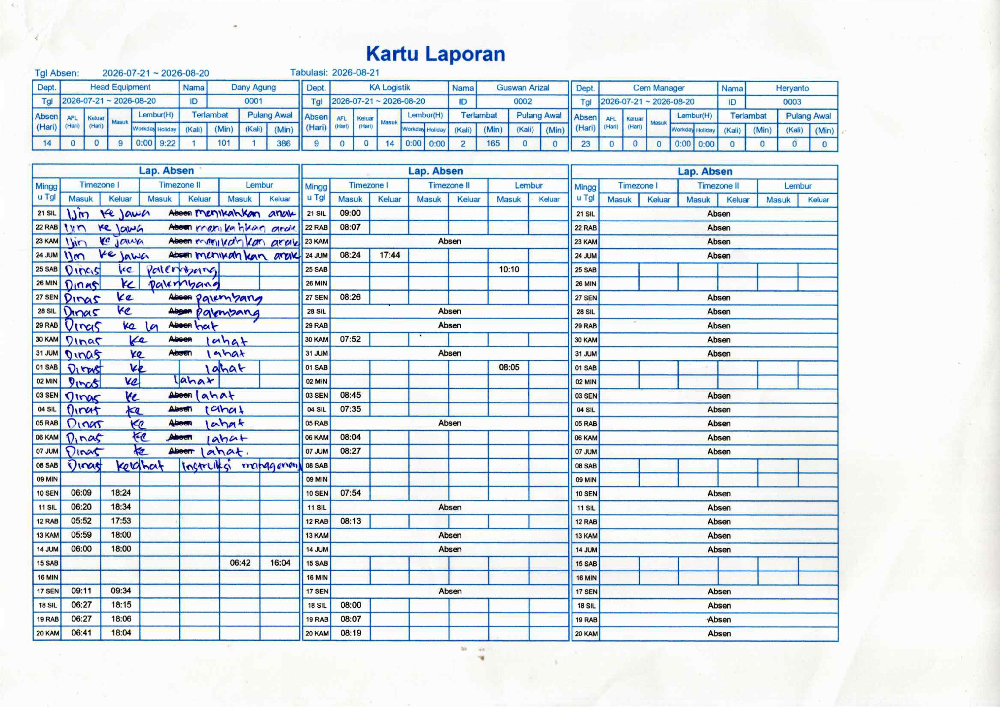

Confidence OCR: 41.00% · Render: 3364×2380px

````text
Kartu Laporan

Tgl Absen:     2026-07-21 ~ 2026-08-20                 Tabulasi: 2026-08-21

[Dept] Head Equipment | Nama] Dany Agung | [Dept] ComManager [Nama] Heyano |
| To [20260721~20260620 | © | owt || Tg [20260721-20060620 | © | 0002 || Tg [mesorzi-zomoe0 | © | ooo |
prove  Ansen| ari Absen| xt
| 5 125 me aa Daan aa aan | 5 25 me pe a ma mf SAS me Ee Tr
[4] oJ of ofaoofeze] + J 107 [ses ][s [0] of fooofooo] 2 | 15] 0 | o [25 | oo] o]eoofeoe] o| o fo po
Mingg| Timezone | Tmezonell | Lembu | Ming Mingg
 orm T fe Jr ie Ta oo Toe ona Ts i |
 eren | omoo | pp ae | Aen
 moo] oor | | | | [|
 Er Ae
[Gen VE Javon Abo mown Kari arukj fasum) 0524 [aaa [TT aw Abe
moe] Quoed We [Yalefvpmengl TT jeep | [ete [mee [TT
 sen 0826 | | | | |
EOE SA
mM Dua — ke Absen Neva fleww| Absen laun) Absen |
 woe oma | | MAN MAN DI
 osc ores | [|| [|
 ome] Aesen
oom] Dead EC Mem pee owl 0804 [TTT
jeram Quod Ye Bbeer (oak Jeram) 0827 [fra] Abe |
wan” TT few we DL DL DD,
|Jiosen) 0600 | 124 | lesen] ors [| || ese Rep
man oe20 [em | | | [| en Ae
ewe 0582 | res | | || Jero) | DID DT
fowl 06% | 1800 [| TT fel Aen Jeram) Aen
[oom 0600 [moo [| | EY
[oso] | TT Tosa | teed |fwse [TTT fees [TT TT |
ICICI EN I [EN ASN CIT AS AN NN EN AN SN CIT DO Ll DL
[rsa] oot [owe | | | DI Ce een
[osc] 0627 [wets | | | fwefoseo [TTT
ome] 0627 | 1806 | | | | femsl owor [| [| |
oom] 0641 | 1804 [TT fw 081 [| lmew] Abe

bad   a
“
````

