# Rekap Absensi Finger Print Periode 21 Sep sd 20 Okto 2026

Sumber: `Rekap Absensi Finger Print Periode 21 Sep sd 20 Okto 2026.pdf`

Metode: OCR lokal Tesseract (Indonesia + Inggris), render PDF skala 4. Jumlah halaman sumber: 16.

## Halaman 1

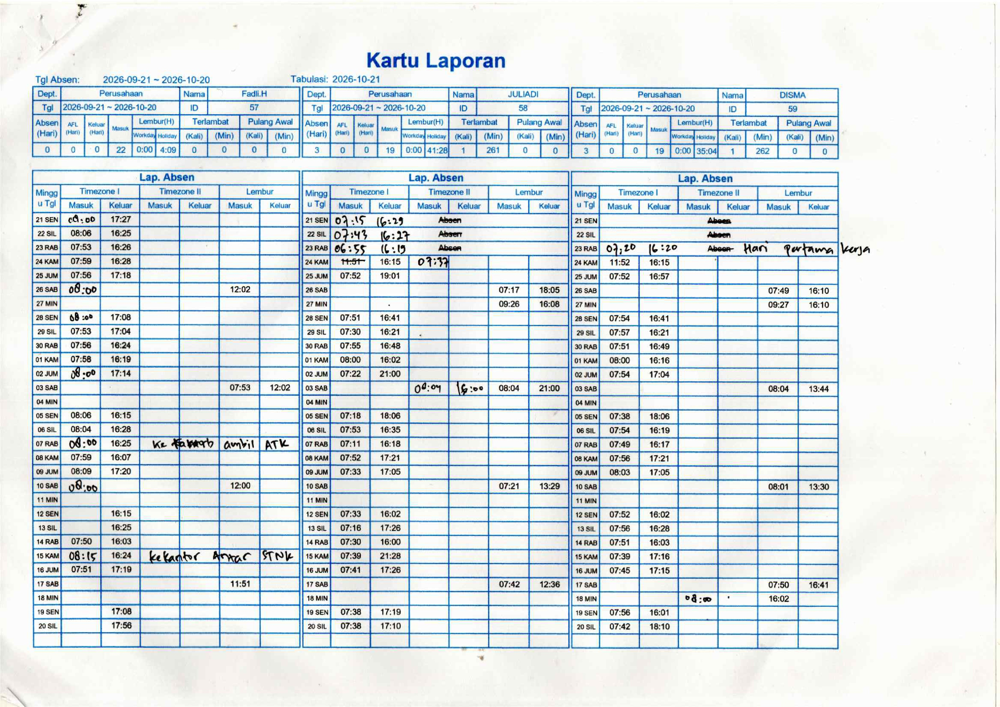

Confidence OCR: 51.00% · Render: 3364×2380px

````text
, 5                                                                                                                                                                                                            |
                                                                  Kartu Laporan
Tgl Absen:     2026-09-21 — 2026-10-20                  Tabulasi: 2026-10-21                                         |
Dept. | Perusahaan [Nama] ~~ FadiH [Dept] ~~ Peusahan [Nama]  JULADI  |[Dept| Perusahaan [Nama]  DisMA |
| Tol (2026-09-21 20261020 | © | 57 || Tol [202609-21~20261020 | 0 | 58 | Tol [20260021~20261020 | i |  s0 |                                    |
Absen| ari | ketua Absenf ai Absen| ar
EE er.            |
To | Masuk | Kear | Masuk | Keuar | Masuk | Kor || ul | Masur | Kolar | Masuk | Keuar | Masuk | ovr || To! | Masuk | Kear | Was | Kear | Masuk | Ker
2een] eio0 | 727 [| | 0 | 00 | | 2tsen| see
as | oboe [ems | | || | ef ep
ref 0153 | 1626 | | po | | rae] 09,20 [0:20 Abeer Han ferimvs [kena
exam] 07:50 | 1628 | | 0 | | Jeram) wer] ets [0% | 0 Tlf] 1052 [teas [ [|
sow 0786 | 1118 | | 0 | | www 0152 [gor | | 7 jam ore | tes? | | [|
zw] | 1 1 fess] 1] [oe] 1608 flzmw] [| | ["os27 | 1610 |
sen] ober | 1708 | [| | | mew] orst [tear | [| | jer os | tea | | | | |
asu) oss | 1704 | | 0 | | News| 0180 [rex]. [| 1 po Was] ors [2 | | [| |
soras| 0766 | 1624 | | | |  fsomss[ 0155 | 1648 | | [| jera rst [tee | | [|
oka 0768 | 1619 | | | | flow 0800 | te02 | | | | lowww| 0800 [ee [| | | |
oom] Wooo] 17:4 | | | |  feww] 0122 | 200 | | | |] leew 0154 [zoe | | [|
ass] | | | lors | 1202 Jos) | [09:09 [gree] 0804 | 2000 fesse] [TT | 0804 | 1344
CCT IN (SE Sen | [7 A i TT DL SE RE                                     |
ossen| 0806 | 1645 | | | |  llossew] 0118 | 1806 | | 1 ©] lfossen| 0188 | 1806 | | | | |
[oes] 0804 | 1628 | | | | foes] 0163 | 1685 | | | | jeep ozs4 [tere [| | Do
oaram) 0759 | 1607 | | | | ffoewa] 0152 | 720 [ [| po jeram ose | 720 | [| |
jooou| 0809 | 1720 | | | |  loeww ora | 470s | | | fo Hoowm| 0803 | 1705 | | | | |
BT joy ETD TE MT aa
reser] | tens | | 0 [| Jeep ora [veo [| | TT ey ee | ee) | | ||
ose] | wes | 0 [ 00 | |  l[wscfore| ae] | | Toe wwe [tes | | [| |                                     |
ras) 0150 | 1603 | | | 2  lwms[ oreo | teoo | | | wes] 0151 [03 [| | po po
oon] 0161 | 70 | ff | jim) ort [72 | |] | [wm ozs | azas | | | ||
ree] {| [ws] Nees] 1 OO] 1 for | 12% [vss] | 1 Torso | 1641 |
eminem) NN A EN EE TT EE EY | ET |
osen] | 17o8 | | | |  lwees[ ora | ame | J po | llwsew] oms6 | ae | | | | |
osu] [ee | | |] |  Nws[oras [amo] J po [lsu] oraz [www | | TT
EE PTET ES EE TTR TE NE a LS
vw
````

## Halaman 2

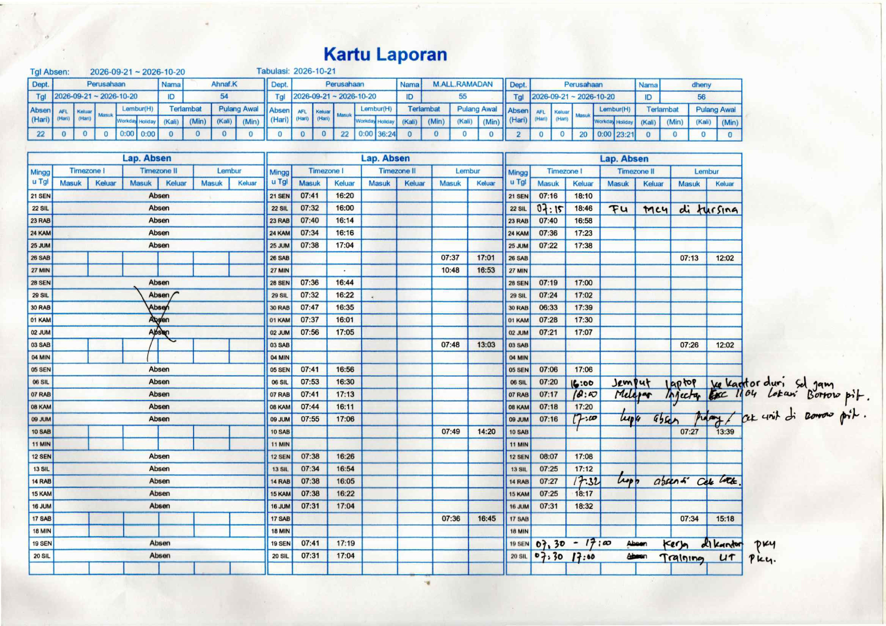

Confidence OCR: 48.00% · Render: 3364×2380px

````text
|                                                              Kartu Laporan
Tgl Absen:      2026-09-21 ~ 2026-10-20                   Tabulasi: 2026-10-21
Dept. | Perusahaan [Nama] ~~ AmnafK ~~ |lDept| Perusahaan ~~ |Nema| MALLRAMADAN |lDept| ~~ Perusahaan [Nama]  dheny |
| Tol [20260921~20261020 | wo | = 54 || Tol [202608-21~2026-1020 | 0 | = 55 | Tol [20260021~20261020 | DD [ 86 |                                 |
 Absen| se. | eum            po
| Lap.Absen =|
Bee    | Timezonell |  Lembur |      rae    | Timezonell | Lembur |      Era     | Timezone ll | Wo | Lembur |                                       |
UT | Masuk | Keluar | Masuk | Keluar | Masuk | Keluar || UTol| Masuk | Keluar | Masuk | Keluar | Masuk | Keluar || uTol | Masuk | Keluar | Masuk | Keluar | Masuk | Keluar |
CE ~~ Mbsen 0000 ETS o741 | 1620 | | | |  |fmreew| O76 | tt0 | [TT]                                 |
zou Absen Jleesuf 0132 | 1600 | fp | jlesu| 03:06) 1846 | Fu | meu] A hosing
zara Absen lows or4o | 1614 | 0 | 0 | | flem) 0140 | tess | PO Po [1
jaran) Absen 0000 |oawaw| 0134 | 1616 | 0 f 00 0 |  ffewamf 0186 | 17223 | 1 |] | |
som]  Absen 0000 Jlesum) 0138 | zea | | | | jieaw 0122 | 18) [TT [1
oss) | 0 f 0] | 0  Newsse | |] | fora] 1701 fess] | | |] or3 [ 1202 |
[07 I [SR ER EEE EC CE RE A A
2osen| 0 Abeen 00 |lmeew| 07:36 | ead | | | | des) o7te | moo [ | TT
(won| 0 NAb, 00 0 llwswoor32 | 1622 | | | 0]  ffeesuf 0124 | tme2 | Of |] | |
oral  Nabeed  Jjlooras) 0147 | 1685 | | 0 [ | = foes 0833 | 1730 | | | | |
ovkam| ~~ Agen 000 low 0137 [tet | ff |  fforkawf 0128 | 1730 | |] |
jozom| ~~ App 0 loeww| 0156 | 170s | ff |  ffoewm| o721 | 1707 | | | | |
essen) | | JT J 1 Nees] | [J] | oras | 1303 floss] | | | | or2e | 1202 |
oa) Loela (] J] 1 Hews | Eee] | meee 0 1] OF 1
 ossen) 01:41 | 1656 | | 0 | |  lfossew| 0108 | 1708 | | | |
 foosu| 0153 | 1830 | | [| floes] 07:20 |igioo | Jembut  \kptot [vg Uadtor duri Sd Jam
oral Awen  oms[ orn | ama | || ores 017 | [8:60] Meldpar Mechs [bre HO4  Lokaw Borow pF.
joka] ~~ mpeen 0 CX ora | tet | [| |  foewaws| oe | 4720 [ , [© MANDI DI       a            iL
joam|  mpsen 0 Now| o7ss [ 708 | | | |  ooww| 0116 | [Jee] Lgl Chas [4m SOE SN     sand Lal
oss) | fo 1] Hwee] | J] | [ore | 42 ffwee] |" | fT | orzr [ 1339 |
[Go 1 1 Joelle oe] alee | | EERE | | AEE Te                                 |
jase | 0 meen 0 CT oras | essa] | | T HNes|ors|aze2| 1]
are) Abs flees] 0738 | 1605 | | [| jer) 0127 | [7:3 app abah Cik “tk,
skal Mbsen 00 |lwewaw) 0138 | te22 | | | |]  ffwwauf 0125 [ez | | 1
eon] meen 0 lewm| ovat [area [| | po jam) 0131 [tes2]| | 1]
ves] | lf 1 wes] FJ] [ors] teas we] | J | | ora | 1548 |
EE 5 1 IL New Te 1 ET (I LL 1
esen| Aen 00000 wee ort | aro | JO PO DO jsm op, 30 - Jim Ameen Kerja Kikan pry
josu| 0 Ase 000000 jieosuf 0rs1 | roa | | | |  |fwsu[eF:30 [F:e0 sew Tanne UT | Ply.
Ll | UR NV 1 J CR 1] | EE
uv
|
````

## Halaman 3

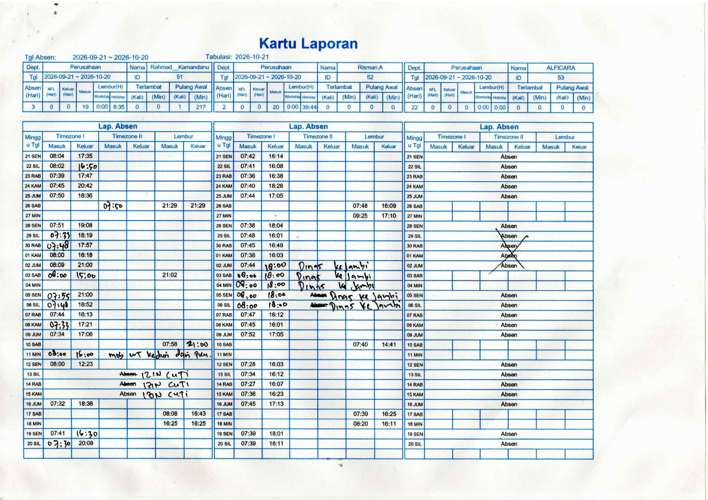

Confidence OCR: 42.00% · Render: 3364×2380px

````text
-                                                                                                                                                                                                             |
Pa                                                                                                                                                                                                |
Kartu Laporan                                                                                                       |
Tgl Absen:      2026-09-21 ~ 2026-10-20                   Tabulasi: 2026-10-21
[Dept | Perusahaan |Nama| Rohmad_Kamandanw][Oept| Perusahan [Nama]  RsmanA  ][Dept] Perusahaan [Nama]  ALFIOARA |]                                 |
[To [260021-20261020 | | 51 | Tg [r060021-20261020 | © | 52 | vo [om002i-zmeiom | |  & |                                 |
Abeer] Absen) an Absen| are
Tan 5 55 | Foe nT aa Doa | | me Ee aa Den aan Da mk Omar ney oe]
[sof of 1 fooofessf o | 0 | 12] 2] o]o]|a]ooofsews 0 | 0 | o | oz |o]o]oowfoe] of 0] oo]
Mingg  Mingg  Mingg
ee aa ai Te [ae Toc [me eT Tea aa
se] ose [ras | IT [TT lese ore [ea | | free Abe |
[asc] woz | fesgo| | | | jeep [eos | | | [|
ome] ora [mar | [| wel oree [ede [| | [lfm Aen
ow 07s | 2042 | | | ew oro [eae [| po fo feew| Aen |
ow 0180 | 186 [|| | www ores [amos [| [fam Aen |
ose] | Jose | | ates | 2120 (fase) | | | jones | %600 je | | | [| |
wn] en Toes [wo Jaen [| [|]
mesen ost [vos | | | [mse ora | feos [|| | lees] Awe |
oom 0808 [2100 [| | | Jlooam| 07#4 [19:00] Omar Veawdr | foram Ae |
ool on Ooo [ 00 | Drake Wd New low | [||
essen) gang) 200 | | | | |
osc oud ee | | [wei 68:00 (8:0 Aber )inas Nt Yan
ome] ora [tes | | | lomef ora Jet [1 TT Nowe Abe
oom] 0338 ma [| po Do foeww] os [tor | | ||]
oon] 0734 [ros [||| fowl ose | ares | | || Jw] Aen |
fossa] — | | ors [Bveolfose | | [ora | wai Jose | TT TT |
fase] 0800 | 1223 | | | Lo jas ores | wos | | | | |
 [osc] ora [wera [| lee been                                 |
(ma Awe (0 coy James) oren | teor | | | | lms] Aen |
— Jeram) TT Aen (pa CTU [low ore [628 [| | | leew]  Abeen |
oom] or32 | 1886 | | 0 | 0 [  lweww[ ores | vas [| f po po feww] Absen
ow | 1 Tos0s [teas jus) | | | [Torso fee jus) [TT |
[own] | Tess teas (sms) | | | lose | tem Jews | [| | | |
osen| 0141 |\oipol | 0 | 0] fess 0130 | 801) | 0 po fess] 0 Absen
(wsc[og:gl 2008 | | | fos ome [ent [ | | | |
ON SA CTO ET WN a | es NE A SR RU
w
````

## Halaman 4

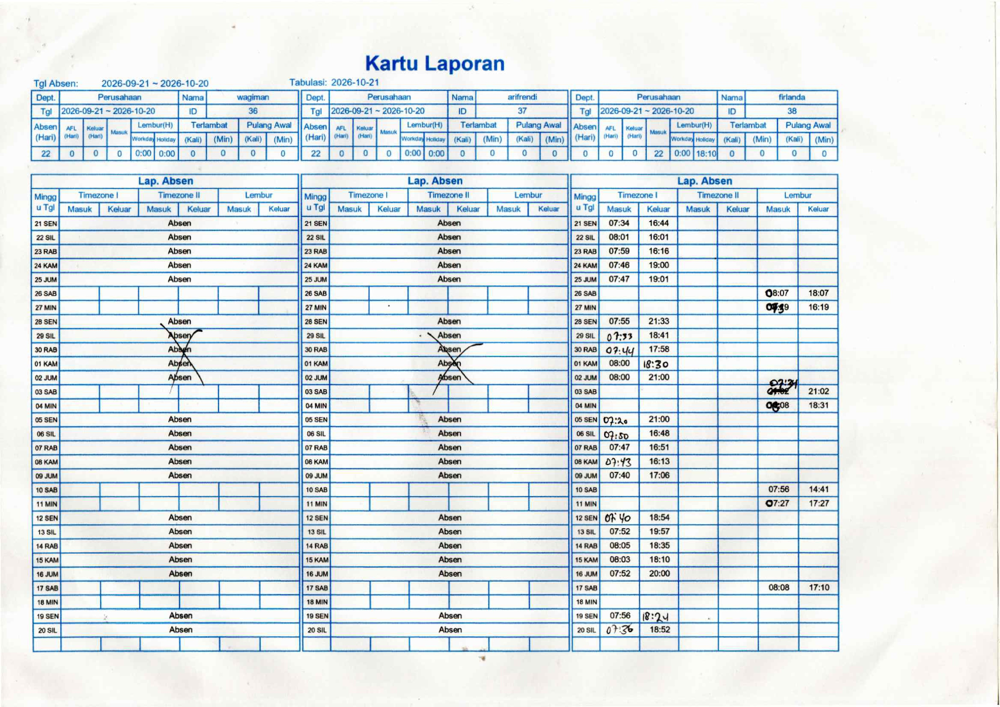

Confidence OCR: 50.00% · Render: 3364×2380px

````text
Kartu Laporan                                                                                                       |
Tgl Absen:     2026-09-21 ~ 2026-10-20                 Tabulasi: 2026-10-21
[Dept.| Perusahaan |Nama|  wagiman  |lDept| Perusahaan [Nama]  arifrendi  |{Dept| Perusahaan [Nama]  fidanda |                                 |
| Tol [2026-0921~20261020 | © | 3 || Tol [2026:09-21~20261020 | io | 37  |f Tg [20260921~20261020 | © | = 38 |
Absen Absen Absen| ar         | Lembur) | Terlambat | PulangAwal |.
|  Lap.Absen | | Lap.Absen |
ee     | Timezonell | Lembur |       Fr     | Timezone | Lembur |       ee     | Timezonell | Lembur |
uTol| Masuk | Keluar | Masuk | Keluar | Masuk | Keluar || UT9l| Masuk | Keluar | Masuk | Keluar | Masuk | Kear || uTol| Masuk | Keluar | Masuk | Keluar | Masuk | Keluar |
2iseN| 0 mbeen 000000 mew] 00000 Apsen 000 Jjeisenf 0134 | ted | JO | 0 | |
zs] ~~ Absen 00 lms] 00000000 Ase 00000000 fesfosot [ter | | Po po
ra] Absen 00 Jr) Absen 0 [mms 0150 | 1616 | | | | |
aka]  Absen  loawaw| 0 Absen  |foewau| O746 | 1900 | | | | |
som ~~ Absen 0 law 0 Absen  |fswm| 0747 | 101 | | | |
os8) | | OO] 1 Jessel | | of fp fms] | | | | 0807 | 1807 |
zs] 1 [71 Yew] 7-7 Fp eww] 7 |] ogse | tee |
sen]  (Absen 0 laesew| 0 Abeen Jiaesen) O786 | 2188 | | | | |
(su wpe” flaws | oc NAwen 00000000 CO KN tear | | | |]
orkamf ~~ Apfed 000000 lok 00000 Ab 00000 loka 0800 [i830 | | | | |
oss) | | 7] of] fesse} | f/f 1 | fesse] | | |] | arr] 2102
jose]  Apsen | ossenjoae | 2000 | fp po po
oral ~~ Absen 000200 |lormss| 00000 Absen 00 lormas| O747 | 1651 | | | |
joskau| ~~ Absen  lloswaw| ~~ Absen 0 loskaw[opyx | 643 | | | |] |
oom ~~ Apsen 0 ffoewmf ~~ 0 Abeen 0 |joewm O740 | 1706 | | | |] |
oss) | | | | of Nose f[ f | | | fesse] J] | | | ors | 441 |
own] | | 1p Www] ff fff few] Of] | era | 1a |
v2seN| 0 Absen 0000 leew 0000 Absen 00 |[esen|ohYo | 1884 | | 0 [ | |
osu] meen 000000 Wwe 000 Absen 0 |fwewfoors2 | tes7 | | |] | |
urap) Aen 000000 lume] 000000 Asn ~~ |lwmas[ 0805 | 35 | | | | |
skal Absen 0000 llvewaw| 0000 Apsen 0 |fwkaw| 0808 | 810 | Ff | Of |
sum)  Abeen 0 lfvewm| 00000 Apeen 0000 www 012 | 200 | | Of | |
ves] [1 Wese] JT 1 1 1 Wwee| | J] |] | oss | 17:10
EX I A lo Lo ee EL UN COU NU (KITT) AN CU a
sen]  .  Abeen 0 |fwsew| 000000 Apsen 0000 [ween O75 |g: | | | |
jose] ~~ Absen 0 ffwsef 0 Absen 0 Jlwosfo¥e| ws2| | | |                                  |
EA TEE TEE TE EE IE EE CC) RE ee                                  |
:                                                                                                                   |
````

## Halaman 5

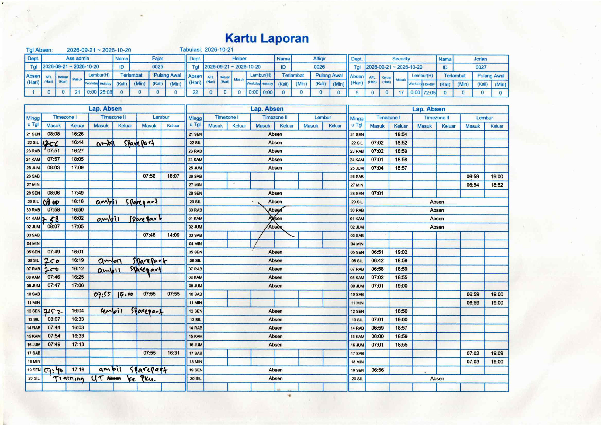

Confidence OCR: 53.00% · Render: 3364×2380px

````text
Kartu Laporan

Tgl Absen:     2026-09-21 ~ 2026-10-20                Tabulasi: 2026-10-21

[Dept J Assadmin [Nama] Fajar [Dept] Helper [Nama] Afar |[Dept|  Seculy [Nama] Join |]
[Tg [20260021-20261020 | © | 0025 || To [20260821~2026-1020 | 1 | 0026 || Tol [0260821-2026-1020 | i | 00a |
Fe 3 Pr, fc Fr
(Hari) | Han)            kin] ose | aly J (Min) | cal J (tn) || (Hari | Gian            rin] ver | (ca) | (Min) | kai) | (tin) || (Hari)                 roncel sm | kal) | (Min) | kai) | (Min) |
7" [oo [2 |ooofzs08 0 | © | 0 | 0 |[ 22] 0] 6] 0 ooojeeo] 0 | 0 | 0 | 0 | 5 | 0] 0] |ooofrzo8 0] 0 | 0 | 0 |
Wingo  Mingg  Ming
UT! Masuk | Keluar | Masuk | Keluar | Masuk | Keluar || 4 Tol ["Masuk | Keluar | Masuk | Keluar | Masuk | Kear || Tol | Masuk | Keluar | Masuk | Keluar | Masuk | Keluar |
sen] 0808 | tee | | | | | se [esa | | | [|
EM | ter | | | | we] 0702 | ws | | | | |
cow] Orr | 180s | | | | lwwws] ween |x| oor | ee | | | | |
sam) 0803 | zoe | | | | www] Aesen  |lmww| ores | tes | | | | |
sas | [| [orse | wor fms] | | [mse] | | TU To | 1e00 |
en) I IT Ll Te DT TT IT TT TO Ne TON TT TT Do | 188
sen] 0808 | ie | | | | je)  Awsen elo [| | | |
oran) ose | 1es0 | | | | lem Named |
wow | [| Doel woe flee] | | 7 [ ~~] ese 1 T_T T_T |
CT) I I NN I I | T° LL RI I | T Inn
essen ora | te01 | | | | | essen) 0681 | 1e02 | | | [|
oo] 0746 | 1625 | | | VU | osm] Amen loeww| ovoz | ws | | | |
oom 0747 | 1708 | | [| www]  Absen  lewm| oro1 [woo | | | [|
oss | | onf5| (Geeo | Ones | 078s Jose] | | | [| ese] | | | | oese | 1800 |
EE EEE rE 1 LD Ai Ll El AE
[esen|gac 5 | 1604 | Gulat  Safegark | es)  [wes0 | | | [|
[won| osor | ea [| |" | wer] Amen we] oro [woo | | | |
fora O44 | tees | | [| lwes| Aen luwe[ owe | esr | | | | |
fou] ors4 | 1685 | | | | fwew| Amen www 0600 [twee | | | | |
sam) ore | 7s || || lw Amen www] ovor | wes | | | | |
esl | | Tors | teat [wes] | 1 DO le) | [| | orez | tee |
en) | | 1 1 few 1 TT few LO Cl [ores [ temo |
[osen|oa: Yo | 17:16 | ambit SQaveQaty | [ose] 0656 | | | | | |
[msi] Teaming UT Aeon Ye Yew. |
PONE fo OER MR IRAE LL EEE RM LL. ERE Wl En CR I

-
````

## Halaman 6

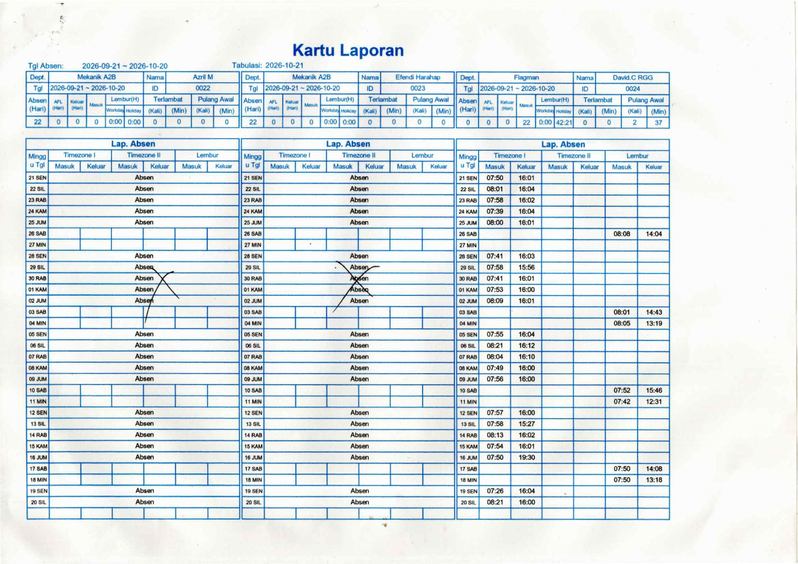

Confidence OCR: 41.00% · Render: 3364×2380px

````text
1

Kartu Laporan

Tgl Absen:      2026-09-21 ~ 2026-10-20                   Tabulasi: 2026-10-21                                                                                                                                               |

Dep | Wonk A28 [Nama] Ari [oi] — MeenkAm [Nama] Eendkaahap [opi] Fann Ines] DawiGRGG |                                  |
[To 20260021-20261020 |b | 0022 || To [mtd aeeiom |b | 0023 || Tg boeosai-zooeiom | io | oo |
rele | an) J in) | a | On) || (Har)         roel | (Kan) | On) | Kan | (Mo) || Har) | ve      FR 2 | (Gan) ACN CEN | Man)

2 oo feojesjoof 0 | 0 [of of ofo]oomfow] 0] 0] 0 ol opo fo 2 oo opo P2 3                                    |

 Gp Absen                                    |
 Eo eT BBI
Tol | Masuk | Keuer | Masuk | Keluar | Masuk | wet || 79 | Masuk | Kolar | Masuk | Keluar | Masuk | Keto || 76 | Masuk | Keluar | Mesuk | Kolar | Masuk | Kew |
EE) I Abe EEE) 0180 CTI I I I
 ETS IS EY BCT BCT SN EN SN —

moe Awe jane) Awe mwe[ owe [ee | | [||                                    |
owl Abe few] Awe Jawa) ome es [|
 awl Mee (mam) oso [feo [ [||
mss TT TTT dee TT TTT mse | [| emos | ros
IE) IN SN IS NS ee A ISN SN 1D SN ET) SS A I NN Dn
moe Aen wel Awe we omar [es | | | [|
E10) I) "GN | EI 1) ori SCI EN ER EE
weal TT [7 TT wwe [ T7 TTT dws TT TT osor [ aw |
IC) I EY SN SN SN I) SN IS SS SS SM SU CT) SO SN KAN — CN RET
C=) IY NE TE NN = C7 | ep A I
ICTY EY NE XY A ST ET NTE Dp pn
owel Aen lowe Awe Jewel see [eo | [||
ooowl Moen fw Awe Jera) ore [em [| pp
CY S|") SY. SO 7) ore 0 A I I
pose TT TT ws TT TTT wee TTT Tore [eae
ECC) ES IS SY [SN FN ACT) IS A AN MS CA I A CEN EE
fae] Ren fee Awe wed ows [we [TT
CTY EY SE KT AS TTY BZ (aer | I SR
ECL IY E71) ES SO (7) BC | ee I A SN
fowl Aen wes] mee wwf ome [eer | pp jp
foaml meen lel een jean) oro [ese | [|
roel TTT TT wel TTT TT Jes] | | | [ors | 0s]
ICC) A A I INS SN CT) AS HS SN IS I NN CT) I A SN NO ON RTH
fsa abe esl Awe we om [wer | [|
wo] Men Waa Aen lwsfoear [we | [|]

a NN | 1D 5 NE Ee                                      |

v

|

|

|
````

## Halaman 7

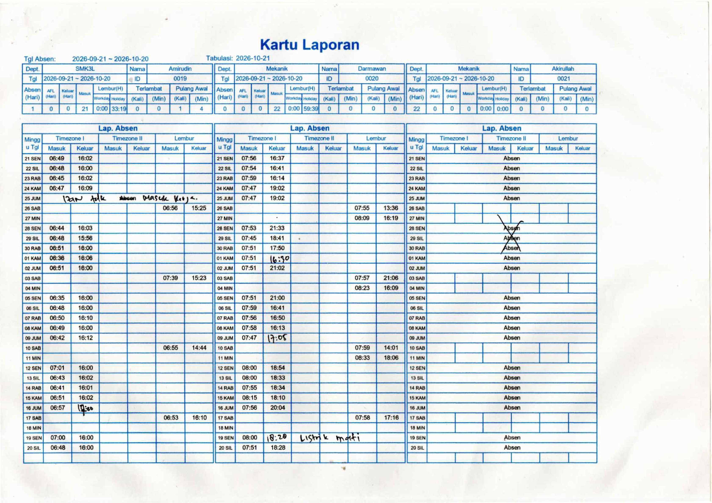

Confidence OCR: 50.00% · Render: 3364×2380px

````text
a                  ,                                                                                                                  |
Kartu Laporan

Tgl Absen:     2026-09-21 ~ 2026-10-20                  Tabulasi: 2026-10-21
[Dept] SWKGL  JNama| Amid |[Oept| Mekanik [Nama]  Damawan [Dept]  Mekak [Nama] Auman |                                 |
[To [20z50021-20261020 Jum | ote || To [woze062i-20mt020 | © | 0020 || To [oze002i-202e020 | © | oar |
Mw] an            [Comburt) | Terlambat | Pulang Awa || Absen| se. | tue Rosen] et

(Hari) | on            rove con [aca | (Min) | oka | in) || (Har | 0 | Man | oncom [cay | (Mn) | koi) | (vin || (Hari) | =            Ce) Ce | (Mim) | Kan | Min).
+ Lol o je [ooofsswe[ 0 (0 Did 2 J[ oo] o]|2|oofsese 0 | o | o | 022] oo] [ooofoo] 0] 0 | oo]                                 |
tap Apsen |] [tap Absen                                 |

To Masuk | Keuar | Masuk | Keuar | Masuk | Kolar || UTol | Masuk | Keluar | Masuk | Keluar | Masuk | Keuer || 470! | Masuk | Keuar | Masuk | Kear | Masuk | Keluar
sen] edo | 1602 | | | | lee ores | tear | | | | mee Ase |
ESIC TN BIM DA —— ET KM 0 — ——
wel 095 | 1602 | | | | [wwe ose | tend | | | | |
aw] 0647 | 1600 | | | | few over | ago | | [| owew| Awe
sam] ow) AMC meen VAS Marya. [maw] onar | ee | | [| maw] Ase
se] | [| [oese | f5z5 |[mwe| | | | | oss | fom |mwe| | | | IT TI
ww | mew loses | veto jam) | | N | Dl
(wo| owe | tess | | | | |[meu| ores [er | | | | we] Ae
ovow[ 0838 | 1606 | | | | jeram ost | {guo| | | | flovew| Aen
com| 0051 | 1600 | | | | jeram) ost [2te2 [ | | | flow] Aen
wae | || [ores | 52 |lwss[ | | | | orer | 2108 floss | [| TT |
oon] [| News| || | [oe je jaw) | | | | |
essen) 0635 | 1600 | | | | Mess) orst | 2ue0 | | | | ese Aen |
os] 0648 | 1600 | | | | |lossw| ore | town | | | | Jlws| Awe |
orme| 0650 | 1610 | | | | More ore | tes0 | | | | om  Absen |
osm] 04s | 1600 | | | | Noeww| ores [eis | | | | jer) Awe
oan 0682 | ie | | | | jeram) oraz [30S | | | eww] Aen |
Cowal | [| [oes | teed |lwsw| | | | | ores | wer je) | | | | |
Gown | Af | Toes [moe jaw) | | | [| |
Cosen| oro1 | woo | | | | |[mees| omoo | ees | | | | lee) Abses |
(os | os | woz | | | | [wef omoo [mss | | | | fee Awe |
ame] og | mot | | | | [wel ores | mss | | | | fume] Awe |
foo] 0651 | 02 | | | | [cw omits | mao | | | | [www Absen |
foo] 067 | Wes | | | | saw ons [aos | | | | www] Aen |
fro | | | [ows | temo [wee] | | | | ores | wae [www] | | | TT |
FCC I I I AS an ANN ETT) SN AN SS A SUN SU | I) LD SE Dl
osn) 0700 | 1600 | | | | [wees 0800 [8:28 | L\Gje maka | |
su | Obes | moo | | | | Jeep oret | teas | | | | |
TP | RE A SO (I)

El
|
````

## Halaman 8

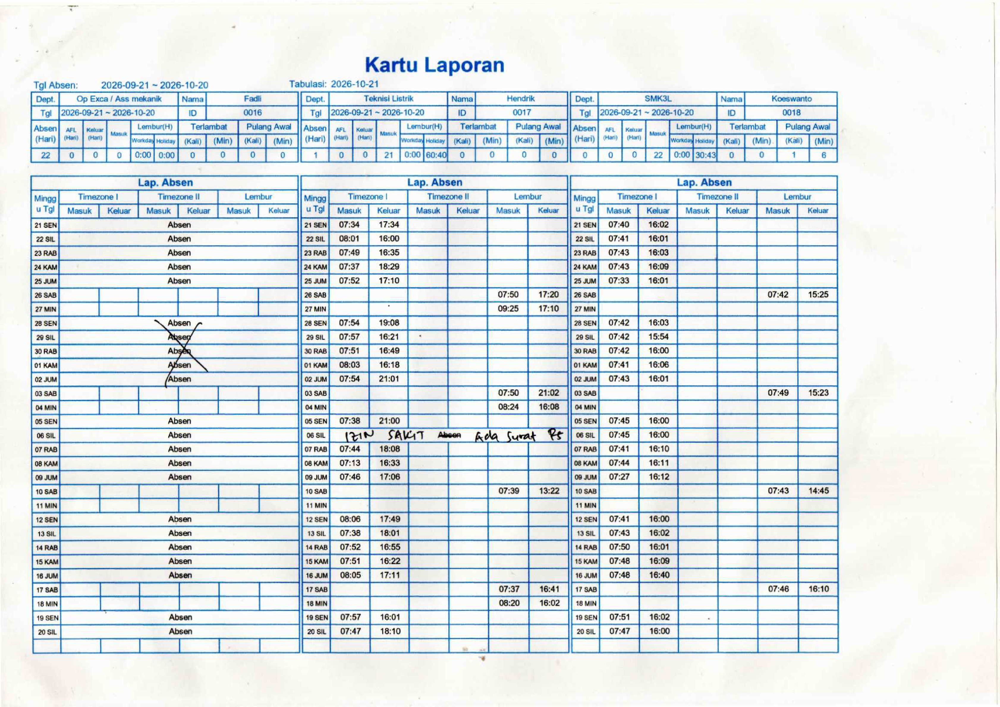

Confidence OCR: 48.00% · Render: 3364×2380px

````text
Kartu Laporan
Tgl Absen:      2026-09-21 ~ 2026-10-20                      Tabulasi: 2026-10-21
Dept OpErcalAssmekank JNama| Fai |[Dopt]  ToknsiUswk [Nama] Hendrik [Dept]  SMKSL [Nama] Koswanio |
[To fpo2e0021-20261020 | © | oot6 || Tg [om00zi-20ziom | © | oor || Ta [0ze002i-2069020 | © | oo |                                 |
| 5 5 Fn a or | | | | Fe pT i dl on || Fem aT | ir i]
(Hari)                ecnfoes | oan | (Win) | an | oa || (Har) | 00           CC CC CE ry                cof | oc | (Win) |) | (vin)
[22 | oo] ooo] o | © [0] o J[ +] o| oz [ooofeoao| 0 | 0 | 0 | oJ o | oo z]ooofsoad o | © | 1 [|
[tap Absen J tapAbsen I lapAbsen |                                 |
Mingo] _Tmezonel | Tmmezonell | Lembw _||Mingg| Tmezone| | Tmezonel | Lembur  |iMngg| Tmemonel | Tmezanedl | Lembur |
Bs a sae OR Ye va |i ice [EE ore a EA 0 TRE E oa
meen] Rese wee ores | wea | | | | levee oreo [ez | | | |
(as Amen lean j 0801 [woo | | | | jeep ore [tee | | | | |
 wel ora | teas | | | | |(owe| oras [tee | | | | |
ka] Absen Jjaaram) omar | tee] | 0 | | Jeram) 0148 | tee | | 0 | | |                                 |
saw] men maw[omee [wo | || | aml ora [tee | [| | |
woe | [TT ee ||| [oreo | wa |mwe| | | | | oraz | i525
wn] | [| fmwew] owas | ww Jw] | [| |
sen] Neen, lms] omee [feos | | | | [mee oraz [ews | | | | |
wo ee [wef omer [fez | | | | [we | oraz [es | | | | |
oom] sen ww| ores [zor | | | | eww ora jae | | | | |
weal [TTT ese || [Torso | 202 |lmwe| | | | Pore | t62 |
oo | | | eww | oe24 | eos flows [| | [|                                 |
ossen|  Absen [wee ora | zoo | | | | less Oras jae | | | | |                                 |
ome Aen lowe ores [wos | | [ | owe ovat [eo | | | | |
ooo] Abeen  Jloeww| ora | tee | [| | oww| ores [en | | | | |
oon mee Noam ores [moe | | | | New oraz [ez | | | | |
owe | [TT Te [| | | [ore | 2 je) | | | | oras | aus |
ICE A I SN DI SN TT") Dl NN NS S| CIT") Dn SN EN
 [asen| omo6 | wo | | | | [ween ora ee) | | | |
osc] Rep ef ore [mor | | | | fos| om | wee | | [|
fame] Rep wwe[ 0182 [tess | | | | Nwew[ ome [wor | | | |
foo Aen jeram oret | tez2 | | | | [www] ores [ee | | [| |
Coe Ree eww oeos [war [| | | eww ores [tee | | | | |
vee] | [TTT wes || [over | owt |) || || ore | temo |
own] | 1 | eww] [| Toea0 jae Jun) | | | [|
es — Aeeen [ws] omer | weor | | | [ese omer [woz | | [| |                                  |
ose | meen 00 lms over | 2810 | | | | Jas) onar [eco | | | | |
EEE del Ee CE EWP OE EEE a ee ee
+
|
````

## Halaman 9

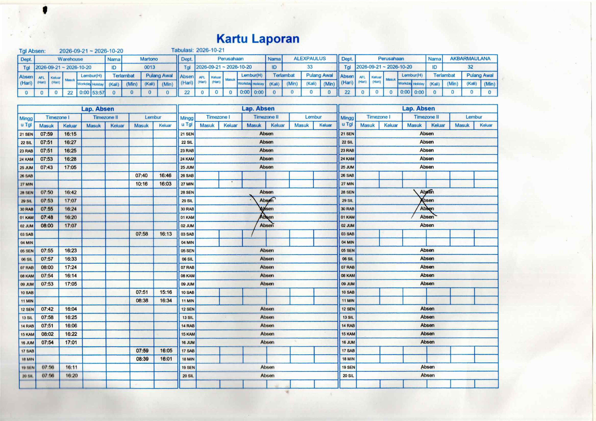

Confidence OCR: 45.00% · Render: 3364×2380px

````text
j         ¥                                                                                                                                                                                                                           |
|                                                                                                                                                                                                                                  |
                                                                           Kartu Laporan                                                                                                                      |

Tgl Absen:       2026-09-21 ~ 2026-10-20                       Tabulasi: 2026-10-21                                                                                                                                                                             |

(Dept | Warehouse [Nama] Manono J[Dopt] Persamaan Nama] ALEXPAULUS |]

[To [posozi-20e1020 | © | ow | To j20260021-20201020 || 35 | vo jRn2eoe2i-20261020 || we |

prove) an Tatan Absen] ar. Absen] an

fi 2 [5 oe oe Te ie COD FT ero | 55 =e mmm

[0 [ooze oofsss 0 | 0 [0] o |[2 [ooo ooo] o 0 | o | oJ 2|o]o]o oes] of 0] oo]

 tapApsen |

Ming  Ming  Mingg                                       |

Mami aa Sea mar TE                                       |

mse oreo [ters [| | ee Awe

(zs ozs [ter | [| [Wes] 0000000 Absen 00

ws] 7st | ae | | | |]

ow ores | vez | | | | leew] Awe leew] Awe |

am ons [ros | | [| lwaw| Ase jaw) Awe |

wos] | | | [ora | dese mss] [TT TT mee [TT TT

Pow [Tow [eos je | ~ | | | | www | [1
[msc ores [mor | | | | [ws] Nome we New
[oma ore | teen | | | | wm] See www JAR

[orl ods [ozo [| [| lorew[ Abe loww| 7 Abe

oom 0800 | mor | ||| www] Ae lea] Awe

[ws] | [| [ome | tem Joss] | TOT To LT we TT TTT

oo [1 TTT eww | 1 | ID Do | 1]

KK ors [te | | | | lose] Aen leew] Aen

[won| omer [ems [| | | flessc| Ae lees]  Abeen

lomo 0800 | maa [| [| lowe Awe low Awe

owl 0784 [tea | | [| losew| Awe lee) Aen

am 0783 [705 | | [| lean] Amen loam] Aen |

ose | [| Tomei | me lose] TTT TT lees] [TT TT

own | | | [oem [fem [www] | | | | | Awww] | [| |

[ose oraz | ago | | | | we Awe

(wou ors [teas | [| | Jee] Awe |

fame] ori | eos | | | | flame Amen lume Awe

oo] 0802 | 1622 | | po [lew] Abe  ffeww] Asep |

Foon] ore [mot | | [1 eww Awe eww] Awe

wel | | | Tome [tees jul | TT wes | [TTT

wwf [1 I Joes] wot lw] | ff [ [ few | Of |] | AA

| C3 SH RF SN wor me me Ame
|i CORN. J TT ET TT
-
3                     |
````

## Halaman 10

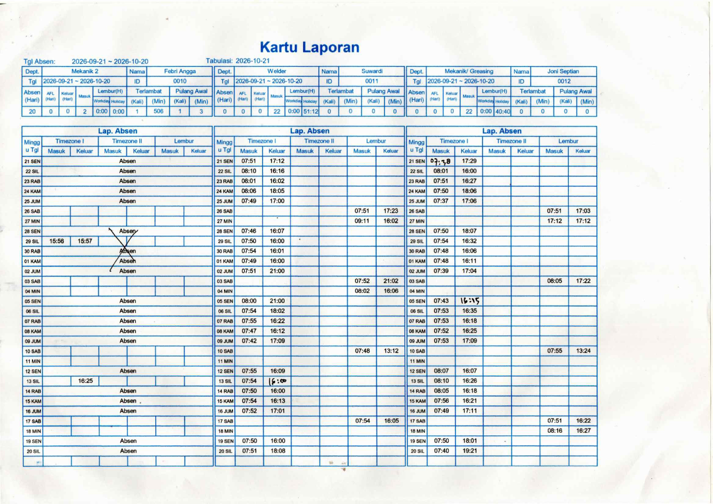

Confidence OCR: 51.00% · Render: 3364×2380px

````text
Kartu Laporan                                                                                                       |
Tgl Absen:      2026-09-21 ~ 2026-10-20                   Tabulasi: 2026-10-21
(Dopt] Mook? [Nama]  FebiAmggs  |[Dept| Weds [Nema]  Soward  |[Dept| Mekanik Grossing | Nama] Joni Septen |                                 |
[To [20250571-20261020 | iD | 000 | To [soeoeai-zee0m | © | oon || To [oeoeor-zoeiom | © | oo |
 el [rm [oe [oie [rime al D3  BE      [Lenbut) | Terombat | Pulang Awal |
sos B es me ER eT sar ha  Wan       | [woofer | (Kai) | (Min) | (Kai) | (Min)      ToT or The
[20] of of 2ooojooo] 1 | 56 1] 3 || of of of2efooofsiad o | o | o | off o [of of2]ooofsoao] of 0 | 0 [ o |
                                 |
Mingg| Timezone! | Timezone! |  Lembur  |fMingg| Timezone| | Timezone |  Lembur  |fmingg| Timezone! | Timezone# | Lembur |                                    |
oe RE oT ee et To BE raket
 CE o751 | 172 | 0 | 00 | 00 | 0 Matsen[o03,e8] 1728 | 00 | 00 | 0] |
2s 0 Absen 0000000 lms 0810 | 1618 | | | |  flesfosot | 1800 | | | | |
ara) Meer Ners os01 | woz | | | | |lmwe| oret | ter | | | | |
wow] men laa] 0806 | 05 | | | | wf oreo | mos | | | |
maw] Aen law] oes | eo | | | | em oar [ree | | | | |
wwe] [| IT wwe] | | | [ost | ia |lmwe| | | | | ore | tres |
wn] | | | || mew | [| oem fee Jw] | | | | ww | wz
wou] tom | 87 | NJ | | [me oreo [tee | | | | lm] ome [es | | | |
wwe phe wwe| ore | teor | | | | lms ore [tes | | | |
joan] fC Asep Neeww| ost | 200 [| po | | few 0130 | moa | | Of | |
ossas| | | | | | Nesse| | | | ~~ |ors2| 202 f[losas| | | | | 0805 | 17:22 |
oom] | | | 1 | Neeww] 7 0 |  Joeo2| 1608 flown] | | | Of | |
ossen| ~~ Absen |lossew| 0800 | 2000 | | | |]  ffossew| o743 [\NS| | | | |
oosw| ~~ Absen  Noesu| 0154 | wee2 | | | |  ffosswf omss | 2685 | | | | |                                  |
omas| 0 Absen Jjorras) 0155 | 1622 | | | | formas] 0158 | ets | | | | |
oka]  Apsen  loswww| 0147 | 1612 [ | | | ~~ Jloewws| 0152 | 1625 | | | | |
ooo] Absen Noowm| 0142 | 1700 [| | | | jeram) 0153 | i709 | | | | |
oss] ~~ [|] | Nose] | | | | ors | 13:12 jos) | | | | orss | 1324 |
own | 1 ff few fF 1 ll Mew 1 1 AB NS
osen| ~~ been 000 |jreeew| 0155 | teow | | | |  ffwesewf 0801 | 3607 | | | | |
jose] [teas | |] | |  |[wsu| omse [pre] | | |  Jfresu]omwo |e] | | |
amas] 000000 Aven 0000000 wes] O80 | t€00 [ | | | fmf 0805 | tes | | | | |
oka] meen. 0 veal 0164 | 1643 | | | |  ffwww o756 | 1621 | | | | |
eww] meen 00 lewm 0152 | zor | 0 | Of | femora | azn] | Of | |
veas] | | 01 feel Of | 8 orsa]| 1605 lus] | | | | ors | 16:22 |
wn] [| [1 CT 1 DISS Sani DD Dai be. TT BOS BEE. Of | oste | 1627 |
 tosen| 01:50 | 1800 | | | |  ffwses o7so | 1801 | | | Of |                                  |
jos] ~~ Apsen ji2osuf 0151 | 1808 | | | |  Jlwsu| oro fea | | |] | |                                  |
EERE TT PT 1 1 WIR © I A I 17 55 EE Re
|
|
````

## Halaman 11

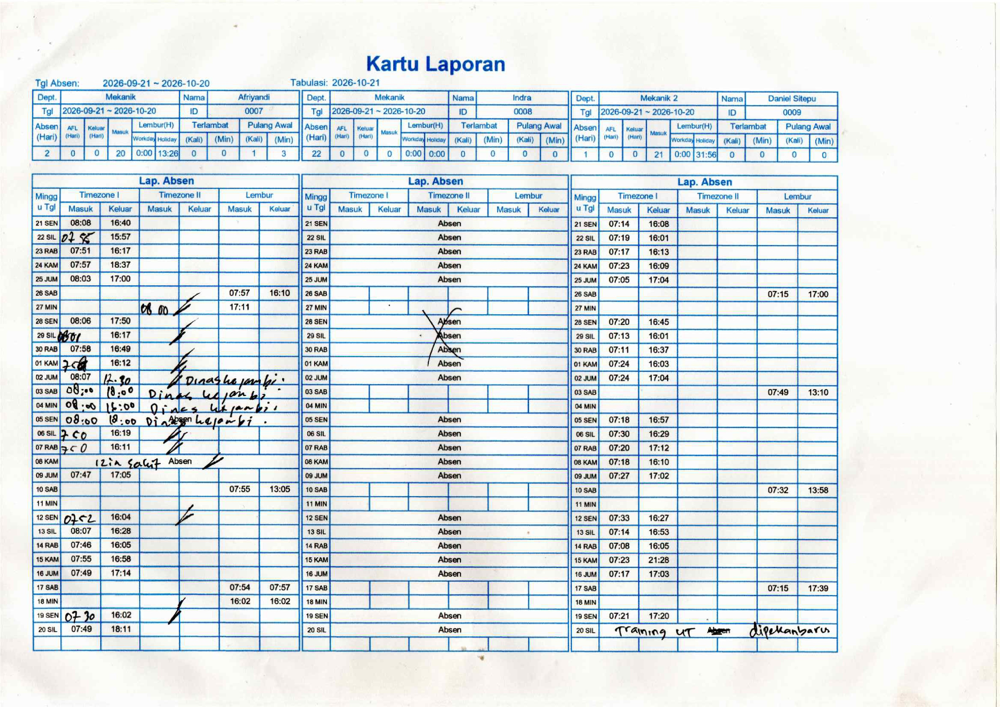

Confidence OCR: 53.00% · Render: 3364×2380px

````text
Kartu Laporan
Tgl Absen:     2026-09-21 ~ 2026-10-20                  Tabulasi: 2026-10-21
[Dept] Mekanik [Nama] Ayan [Dept] __ Mekak [Namal nda | Dept)  Wekak2 [Nama]  DunieiStepu |
[Tol [20260921~2026-1020 | © | 007 || Tg jeo2s0e21-20261020 | | 0008 || Tg [zoze0ezi-z0zei020 | © | ooo
Absen Assen Absen
(Her)          ref ose | oka) | (Mim) | Kan | in) || (Han)          nrc | can) | (Min) | ka) | (vin || (Hard          roaTrere | ca | (Min) | ka | i)
[2 0/0 z0]o0ofiszef 0 | 0 | * | 5 |[ 22] 0] 0] oooofooo] o | 0 | o | ol + | 0] oaifoofsred 0] 0 [ 0 0]
Lap. Absen                                      |
Mingo  Mingg  Mingg                                      |
Tl (Masuk | Keluar | Masuk | Kelvar | Masuk | Keuar || Tol | Masuk | Keluar | Masuk | Keuar | Masuk | Keuar || uTol | Masuk | Keluar | Masuk | Keluar | Masuk | Foor |
woe] 0608 | veo | | | | jeep meen loeew| owe | eos | | | |
are) CZ I I I I wel 077 [ets [| [| |                                        |
ow] 0787 | tear | | | | ww Aen jam ora [eos | | [|
sam) 080s [zoo [| | mwa Amen www ores | toa | | | | |
wwe || Pore [temo jer) | | TT wwe] | | | | ors | we
oran pig [tere | Z| | ovew| TAbsen flow 0128 | 605 | | | | |                                      |
 08:60 Goo Ding" lejos - ose] ore | tes7 | | | | |
omelgcg | to | A | | forme Awe lom oreo | mae | | [| |
ow (2th galt Absen ZF lose Asem jean Ore | emo | | | |
oom] omar [mos [TTT Apem)  Aesen loam] ora | mre | | | | |
fos | | [ore | 1306 [fsa] | DT TT [loss] | | | | ors | tem
EL TS PE ee. Oe 0 SY SO I 1
[oo] osor | 1628 [| | | feed] Amen lw] ora | tess | | | |
[awe] ores | eos || | | | [ume] O06 [1605 [| | |                                      |
(oom 0755 | 1658 | | | | jer Amen eww] ore [za | | | | |
Cool ores | maa | po leww] Amen eww[ oraz [res [| | ||
es | || Tors [over flwew| | [1 TT mew | | | | ors | 17a |
Cowan] Pp po Peer fee je) || [| ews ||]
ose oF do | B02 | A | | es or2i | wma || | |                                     |
sej ore [wm | | | |                                     |
OO ON Nt CE fe SO Se REY 0 Tm ET                                     |
vw
|
|
````

## Halaman 12

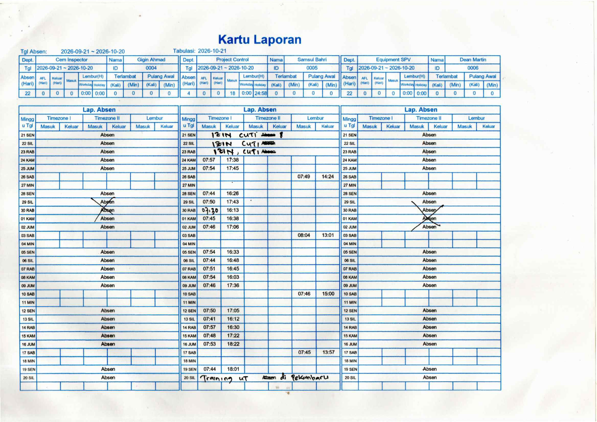

Confidence OCR: 46.00% · Render: 3364×2380px

````text
Kartu Laporan
Tgl Absen:      2026-09-21 ~ 2026-10-20                    Tabulasi: 2026-10-21
[Dept | Cominspector [Nama] _ GomAmad _|[Dept| Project Contra [Nama] Samsun [Dept] Equipment SPV | Nama]  DemnMarin |
[To feo2e0e21-20261020 | © | 0008 || Toi [zeo02i-2ztom | © | ows || To [wzecezi-z2zeiom | | 006 |
an | Aan ee eT a fa | 5 os pf aT Ti | oa
mL           reefs | cca | (Min) | a | (Min) || (Har)                rove | Kan) | (Min) | kai) | (vi) || (Hari) | 0           ref etc | can | im) | cca) | (vin |
[2 | o| oo fow[oo] 0 | 0 [0] o || «oof e|coofosse[ 0 | 0 | 0 | o | 22] oo] ofowloe[ 0] 0 [ o | 0]
                                 |
Tea — Tea T_T BRC MBA
To (“Masuk | Keluar | Masuk | Kear | Masuk | Keuar || UTol | Masuk | Keluar | Masuk | Kear | Masuk | Kear || UT | Masuk | Keluar | Masuk | Keluar | Masuk | Kelar |
EE I
EX I ms Awe                                 |
 wwe Awe |
pow] meee www omer [mee | [| Do ee) Abe |
ow] Rese www ores | tas | | [| mew Ren
mse | [TT wwe | | | [ora | waa mes] | | TT
wn] | | | few 1 www [|
ween] meen meen ora | tee | | | | mee]  Abeen |                                 |
wor] Spp&  Ame[ ome [as | ||| mer] Aen |
ov Amen joran) ores [ese | || | je) Dk
wom] Rese Noaw| ora | roe | | | | jeram) abe                                 |
wel TTT TT ee | || ows | wot flows] DI [TT |
own | | 1 few TN {| | [|
oosen| Asn [ween ores | tema | | | | [ws  Absen |
fos | Aeeen lees | orwa | ews | | | |  jjeeep Awsen |
oma] Amen lowe| ost [eas | | || owe Abe
ow] Aen oeww| ome [wes [||| fowww Abe
TEE wees] +1 ow Ase
ose | [TT ese | [| [ore | 1500 Jlwss| | | TT
ICICI I EN SY A Dae Dn AS A ANS XI") DD DD 1D,
fasen| meee lees ome [ames | | | | wee Ae |
ose] men wef om Paste | [| | flee] Ae |
ws] meen luwe| oer [eso | | || wwe[ Ase
Coon] Aen [wwf ore | me | | | | wow Aes |
fom] ase eww] ores | tee | ||| ew Ame
wee [TT 1 lwes| | | | | ows | wor je) Do DT TO,
pe SN NN SS A I ETT AS AS ES I I SN EI Dl ID EN                                 |
fosen|  Absen Nisan ora jae | | | Je  Aesen |
EX IY. aa EX EY
LT 1 TE. 1 De Ni | eT LT                                 |
|
|
|
````

## Halaman 13

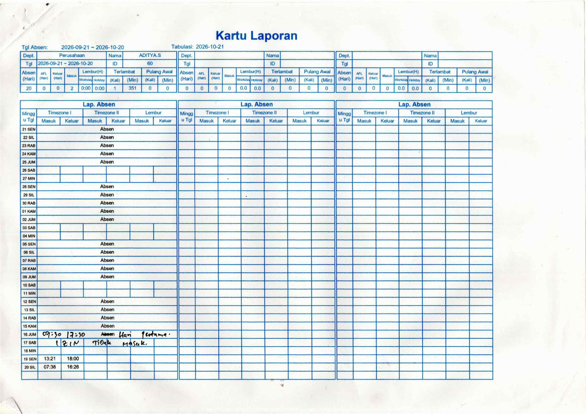

Confidence OCR: 34.00% · Render: 3364×2380px

````text
I"                 -
a
l   1                                                                                                                                                                                                                  |
Kartu Laporan                                                                                                              |
Tgl Absen:      2026-09-21 ~ 2026-10-20                   Tabulasi: 2026-10-21                                           B
[Dept]  Peusahaan JNamaf ADTYAS Joep] ~~ TNema]  JfDeetf ~~ TNem[ 1]
To f0260921-2026020 [wo | 60 Wt] 000 fw] 0 Ww] ~~ Jw] 0]
Absen| an | vue Absen| an Absen| are
[20 J ofof2fooofooo] 1 [351] of 0 Jl oJofoJofooJoof of of oJ ojfofoJofoJooJooJo] of of ol]
                                     |
Mingg  Ming Mingg| Timezonel | Timezonell |  Lembur |
Sean. amar Tae
ELE orn NT | ON WN WET | dn A ar n—
 = | Useless [CF 1 Rear                                    |
 = | 1 =a J sg 1 1. 1 1 —F
om] mee 000000 0 Ir rr rr wr rr rr 1T © |
 TT WN fe Cs <I ST (SN A SE
es (I, TN NC SSS OS I ET
LE i Ef 0 ET TT a A al ll
 En ies a) WT DD Dl ln,
 ee TE Do je ID lo i Sm
C2 oo TR 00 1 OE EN 1 SN RUS el
ea) Ae WW +r rr rr rr wr rr © © © [ ]
[I ERECT S| ES ST We I RN NN AN
EET) I DOSS) Bo (SEE RS I 0] Ea I fhe mi) I SS A I I WR ——
2 I NN Sia RT IA sr SC Ti EE jp (a
 CT Cw WR Den On Dn I
5 JR IO SU I UN CaN |) SS ou NE I (NN AR DE
 FP ja CD CN SE RN (NS NN A                    |
 re SW (es EE) ER NO (RN —
Gc EN NC CO UN GR NN MEE La NN IRN EC
fo 0 TRL EDERAL ln an beri
ee foew eae 1 | ee 1 ema |] le
 COE EEC OEE. EERE Oe a.
CEE ETERS. CO Ee EE SE NE Ee ae Be
COE WT CT SE NE SRR EET 7 [SE NN RT (Th Da ln
EC) I TN eT IS NNN | NN TR [NN ST NN WT DL nan
osen] 1320 | tw | FF 0 0 ff fp or or rr wr rr | |
[oonf ozs | 026 | 1 | | 4 | ( |} rr tr tr wr rr tr [I p |] |
[Er CT TV OR FR TE (SEEN TR NR. a I
v
````

## Halaman 14

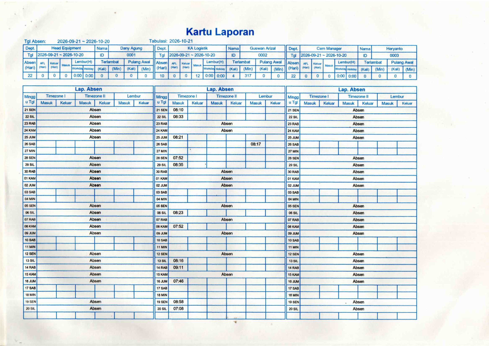

Confidence OCR: 37.00% · Render: 3364×2380px

````text
Kartu Laporan
Tgl Absen:      2026-09-21 ~ 2026-10-20                    Tabulasi: 2026-10-21
[Dept] Head Equipment [Nema]  DanyAgung |[Dept]  KALogstk Nama]  GuswenAuzal |
[ Tol [20260521~20261020 | © | 0001 || Tol [20z60921-20261020 | © |  owz | To [oze0ezi-20m1020 | D | 0003 |
prow 2 Absen Absen
ra 5 525 me ep art aa aa fr] 3 Da Ty oo] ra 57 = Feet The oe]
[22 [0 (oo oofooo] o | 0 | 0] o |[ 10] oo] |ooojoso| s [57] 0 | ol 2] oo] o omow] of 0] oo]
  tapABsen
Mingg] _Tmezonel | Tmezonell | Lembu | Ming  Mingg
Bore asa ae uu Tat Ea Tema a Tre Te Ba
 sen ee [| ve Aen
 Zo | os3s | | | | [ae Aen
 EL IY.
pow] Ase few] Aen leew] Aen |
[Ew Reser  Alww[oean [TT [|
[el TTT TT ee | ow | ee IT TT [| |
IEC) IN EN I INS ANS NNN E71 IN SN IS AN SN SN E77) I SE
sen Ameen me ome [| || fw Aen |
[os Amen jfeeej oess | {| | | Nee)  Aesen
ome Awe jer) Absen |
oven Amen love Ase loan) Ase
eon Awe eam been
TEM LT ee SS NT LT A = Nn |
own] Tee ee] IT DD
ossen| Aen lose] Asn le Aen |
foes | mse lose] oma | |] ID Il jer) Absen
oa Aen
oo awe jeermj ors |] lmew] Amen
oon] sen ooaw] been CX Aen
ae LT TT 7 “lewel — T [°F TT fess] 1 TT TT
ICE. I I Do Dl A [7 ln DOD I 7) ER SS
fase Aesen  lmee| Aen |
osc Aen jeep) 1 [TT wee] Aen TT)
fame Awe jera owt | | | || lee Abe
fowl Aen leew Ase |
fom Awe eam ome | [TT
COM fe. IRN NE TTB Co (NS MN or) (SN I I Tn
own] TT ewe TT ee TT
Posen Abn ws og | | | we  Absen |
EX EY" SN EXT ore I I I DT
Ur | EE nd TP a OS 1 EE ea
ou
````

## Halaman 15

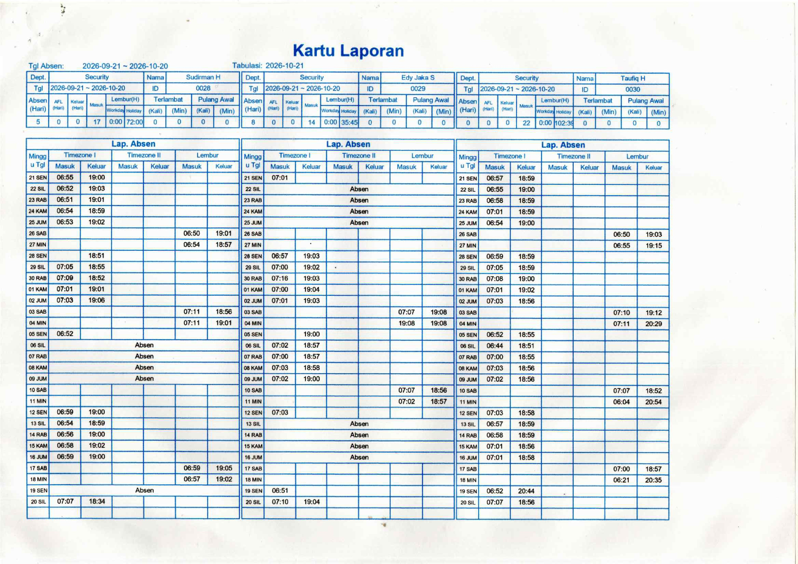

Confidence OCR: 53.00% · Render: 3364×2380px

````text
i                                                                                                                                                                                                             \
:          #
                                                                                                                                                                                                                    |
a                                                                                                                                                                                                                       |
Kartu Laporan
Tgl Absen:      2026-09-21 ~ 2026-10-20                     Tabulasi: 2026-10-21
[Dept| Security [Nama]  Sudrmant [Dept] ~~ Secwity [Nema]  EdyJakasS [Dept] ~~ secury [Nama]  TauigH |                                   |
Tol [202609-21~2026-1020 | nj 0028 || Tg |202609-21~20261020 | ob | — 0029 || Tol (20260921-20261020 | © | 0080 |
Absen| ar. Absen| ari | aus Absen| ar.
Gap] we            edo Hoicay | (cai) | (Min) | (Kai) | (Min) || (Hari)       tof Jwonsafuoiaey) (Kai) | (Min) | (Kai) | (Min) JI (Hari) | te            onsale | (Kai) | (Min) | kai) | (win) |
Lap. Absen                      Lap. Absen
Mingg  Ming  Mingg
UTO | Masuk | Keluar | Masuk | Keluar | Masuk | Keluar Jl uTol| Masuk [ Keluar | Masuk | Keluar | Masuk | Keluar || uTo!| Masuk | Keluar | Masuk | Keluar | Masuk | Kear |                           |
2isen| 055 | 100 | | JJ fms ore | po po po ]  flzsen[ oes? [eso [ [| |
jou] 0652 | 1903 | | 0 [ 2 [ Nas] ~~ Absen lef 0685 | 00 | | | | |
ore 0651 | 1901 | | 0 | | lfm] ~~ Aeen  lsmes| 0688 | 89 | | | |
aa 0654 | 1889 | | 0 | 0 | Jeram) Ameen lew Oot | 180 | | | |
joom| 0853 | 1902 | | 0 | | Wesww| ~~ Absen  lsww[ 0684 | teo0 | | |||
ose] | | fo  Josso | toot Wess] | [TT dee | 1 oes0 | 19:03 |
zon] | [0 [  loesal test eww] | - [TT Weww] TT Toes | tes |
een] [test | 0 [0 | 0 |  Nesew] 0687 | 1803 | | | |  flmeew| 0680 | ese | | [| |
wu 0105 | tess | 0 | | | 2 Wme]oroo | 1002)» [ 1 fo Wwew|oros | ese | | [||
ores] 07:00 | 1852 | | 0 | | Jleoras| 0116 | 1908 [| 0] 0 | | fom] ores | a00 [| [| 1
oad] 0701 | 101) [00 | 0 [  Noww| 0100 | 108 | [TT How oror [we02 | | [|
asm] 07:03 | 1906 | | | |  loewm| 0101 | 1803 | OO] | |  lfeww| ores | wse | | | [|
joss] | | fo | oran | 1856 fos] | J | [oror | 1808 floss] | | | [orto | 1092 |
Joewn) 1 fF [ort] eof flwww|] | | TT | 1eos | 1908 flown] [| |" [Tort | 2020 |                                     |
ossen| 0682 | | po | | flees] JJ teoo | fo po ]  flossen[ 0882 | ess | Pp Do
joosn| 0 Absen jloosuf or02 [test | [ | |  loesu| ogee [esr | po po
 ores] 07:00 | 1857 | | | | flores) 0100 | tess | | [|
osrow|  Absen 00000 low] 0703 [1888 [| [| | low ozos [ese | | [|
ooo) Aen  feww] oro2 [goo | [| | flooww| 0102 | 1886 | | | |
oss] ] pn ffese] ] T [ ~~ [oror| 1a flwse| [| TT oror | 1852 |
ow] [ff TT Mews] TT 1 Toroz [tes lw | | | oeos | 2054 |
rzsenf 0680 | 1000 | 0 | 00 | Jo fess ores | Of | |  Jese[ ores | ws | | | |
osu f 0654 | eso | | 00 | 00 | Jeep 00000 Ave 0 wef 0661 | 1880 | | | |                                     |
eras] 0656 | 1900 | 0 f 00 | | flues] 000 Abeen  flwme| 0656 [ese | | | | |
sam) 0858 | 1802 | | 0 f JO  ffwew] Abe leew ozot [ese | | | ||
roomf 0650 | 1000 | 0 | 00 | |  ffwaw] Awe weww| o7or | ess | | | |]
reas] | 0 | po Joese | wos Jas) | OT TT TT Hwee [TT] oreo | 1887 |
pawn] Jf] Joes [eee flew] TT TT Tews] TT os2t | 2035 |
 sen 0851 | | po | Of less 0682 | 2044 | | [| |
2osu| oor | 1834 | | | | Mwsfomto| eos] [ [|  fws|oror | mse | | [||
|
MN MN WT TO PN ON MN SU st MT WR                                     |
be                                                                                                   :                |
````

## Halaman 16

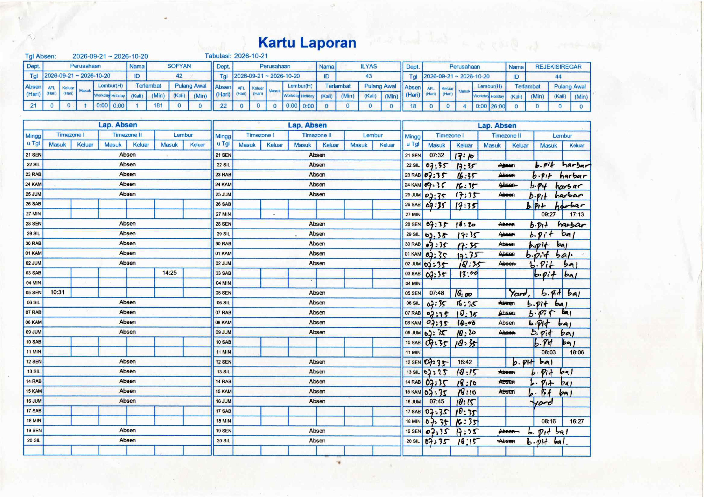

Confidence OCR: 44.00% · Render: 3364×2380px

````text
                                                  -                                                                                                                                                                                      |
Kartu Laporan                                                                                                                      |
Tgl Absen:      2026-09-21 ~ 2026-10-20                   Tabulasi: 2026-10-21
 [Dept] Pesan [Namal  WvAS [Dept]  Pesahen Nama] REJEKSREGAR |                                       |
| Tol [2026:0921~2061020 | 0 | 42 || Tgl Jo0260921-20261020 JD | 43 | Tol [0260921-20261020 | iD | a4 |
Absen| art Absen| ar, Absen| act | wom
[21 [0 [0 + [owo[ooe] 1 fire | 0] o |[ 22] 0] 0] o]oofoe] ol 0 0 | os] oo] a ooofseod 0] o | 0 | 0]
Ming  Ming  Ming
et Toe Te eT] lat iT relies ea Ta Fe Ta
zisen] 000000 Aen 0000000 Jas 0 mwsen we 0732 [(gip| | | |
 oral Asep |
2aram| Aen www] Amen Jakw[e3C rei Asses bpd harbac |                                     |
 zoom] Abs  |[maw[o3:3e (3:35 Awe bp} barber |
zon) | ff ffeww] [TT ffmww[” [| 1 [oer | 174s]
 2esen|  Absen
 | 25t [ey 38 (3:38 Absen 5. prt Bay |
 0R8| 99:38 page Mee ppid bay |
ovow| Aen ows] Aen  Jokw[ed:3¢ (3.35 asm bord bal |
 joo] Absen leumf63=9e  j§:38  Awees  L.PiL ba) |
joann | FF 1 ee Wee] J OT CT few] ~ TT [1]
essen 081 | | 0 | 0 |] 0] losses] 0 Absen  lossen| 0748 [Woo | (Yara, | b.fd[ ba) |
                                     |
os] Asep |                                     |
jooom|  Absen 000 loeww] ~~ Absen |
owe] [fT TT ews] fF [1 [ Wwww[ TT | os0s | 1806 |
 esen[0p9x-] 1642 | | bop bal | |
 | 35063215 (OS Abeen Lo Pig ba) |
| aras 03:3C (Qo Mmm Login bay |
ef [ff 1 0 ws] TT TT TT ee Ar | [| |
pawn) fT 1 few] Tf TT 1 Jlemwfopse[p:3sf | | ome | 1627 |
|= Re
eT NE DS PTC) PROT, Ran fr RR REE DIY, SN A | J i (i je Sh Sa                                        |
vw
|
````

