# Rekapan Absensi Fingerprint Periode 21 Ags Sd 20 Sept 2026

Sumber: `Rekapan Absensi Fingerprint Periode 21 Ags Sd 20 Sept 2026.pdf`

Metode: OCR lokal Tesseract (Indonesia + Inggris), render PDF skala 4. Jumlah halaman sumber: 16.

## Halaman 1

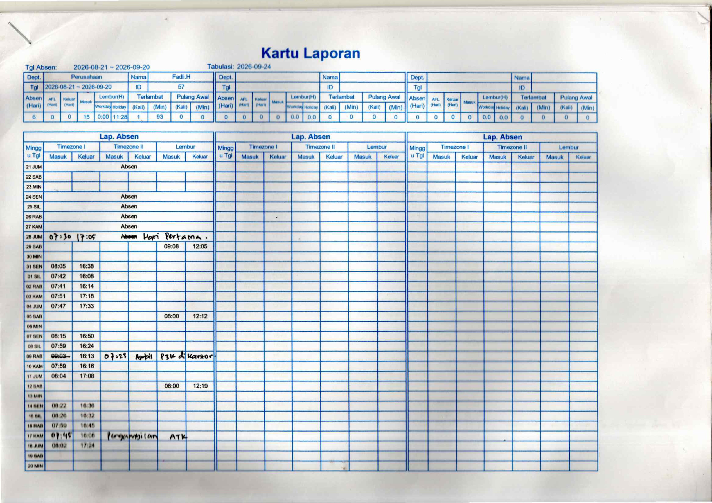

Confidence OCR: 40.00% · Render: 3364×2380px

````text
NE DEA RRR RRR RRR RRR    —      —
Kartu Laporan
Tgl Absen: 2026-08-21 ~ 2026-09-20            Tabulasi: 2026-09-24
BR | 0 | | © |__| | Tol |
                                              J     rata                                                                 —
| 6 JoJo] fjooofuasd 1 | 93 | 0) o JfoJoJoJoJoofoof of of of oo JL oo fofjof of o| 0 [ 0 [ 0]
uTol | Masuk | Keluar | Masuk | Keluar | Masuk | Keluar | u Tol | Masuk | Keluar | Masuk | Keluar | Masuk | Keluar || Tol | Masuk | Keluar | Masuk | Koluar | Masuk | Koluw |
maw] see 0000 0 HOC | [FB 1 FT Pe
zon] bo) | 1 HOSE | | CF oof fF] TT
CITE 0) EE ©0000 1 BE Ge OU 1 RE
ET Nn I LA | OR I EN 1
ma] a Aen 000 0 WEEE | 1 1 mmeb | | 11 CF
COTE STN (OC NN SC Sn NR NN ER A ——
mam] oFs30 (por Awe Hari Perkawa ff DO fF. fF OW FF FT fT n
El | [| [oe] wos le | | 1 OEE 1 1
EE | 1 | 1 wes] | Te LF]
Me ee D1 BE CT NOAH OS RN NEN ERR a —
tre | eos | | [0 1 Weep ep ve) 1] | ERE
erat | tee | PO [Hed cf 1 1 TT SSS
gory | es | DO ID 1 HF 1 1 DL IT EE]
7  Bee jins DO Dn il In ln NN NN Ea
Me 1 TT Toso [tem || [| MEN Ds —— —————————
© (LC) il nan NG NUNS DUNN DUN DUNN NN 1. IT
MD Eee few | | 1 1 OW TT 1 1 1 |
posal oreo | vee | 1 1 1 Hr OF 1 oF 1 FE |
ooras| 00:03-| 16:13 | 03:23] Awbi | P3 dilkanor ONE NNN NNN NNN AA  ee KAN MI
es Ol ses] | | 1 ll 1 1 1 [I Cl |
fami osos dp tron ] 1 | 1 0 1 1 1 1 1 POOF |
aia) 1 Joe] 2s] | | J I fF “FEE | |
© UU |" NN (SUNN [NN DUN DN DN NN GN NNN GN WRC
TIT NUNN NUNN CN | CNN UN GUNN NUNN NN BW MN CUM (NS  —
Ee on 1 1 1 1 Aa | LL
CUI (NU UU | (ND ANN UN LL LL IL Da NR 1 na
8 ELC TUL WL CAT ST S| (NN A A NUN (SUN (NUON UO (vm SU NN A DE |
eam] Os |     |     |  ~~  © EEE NN sll
[oem]     1           |     |TV CUT EN SN YC 0 SN — ——
own] |     CTT EEE TE LL |
oo.                                                                     1                  i                                                                 1     |                               =
n         [                                            i=  = IL |   -  1           LB                          BP                        I
J      J                                            :    —        EE CT aa aa aa                  ——
````

## Halaman 2

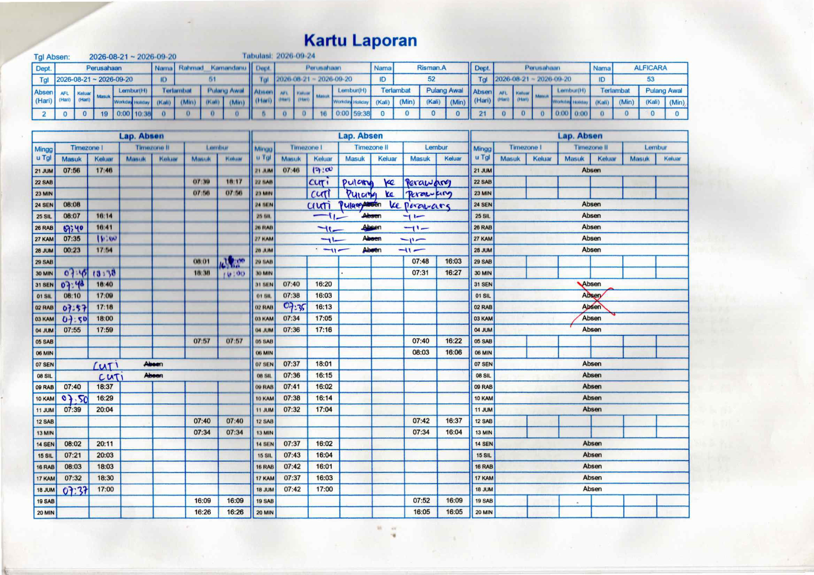

Confidence OCR: 49.00% · Render: 3364×2380px

````text
| +                                              Kartu Laporan
~~ TglAbsen: 2026-08-21 ~ 2026-09-20                   Tabulasl: 2026-00-24
        [Dept.| ~~ Perusahaan | Nama| Rahmad Kamandanu || Dept | Perumahan ~~ [Nama] ~~ RismanA  |lDept| Perumahan JNamaf ~~ ALFICARA |
|        | To) [20260821~20260020 | 0 | 81 | To Jo0a6onai-2000020 | if 52 || To [20260821 -2020020 | wo | 53 |
|     | Lembur) | Terlambat | Pulang Awal Jansen) an es     | Lombur(t) | Terlambat | Pulang Awal || Absen      El ET Be er
uni B iu: |e Ee a te on et em Ee Fo Too] 5 | 25 Juna Wossaf isis | (Kal) | (Min) | (Kai) | Min) |
(2 JoJo] iefjooojioas of 0 f0 f 0 je jof of se fjooofsese o| o | o | off21]o]o]ofJooojoco] of of o fo |
(To! (Masuk | Keluar | Masuk | Koki | Masuk | Wor {| 010! |“ Masuk | Keluar | Masuk | Keluar | Masuk | Keluar |       | Masuk | Keluar | Masuk | Keluw | Masuk | Kotor |
Jeram) one | ama | ff] jeram) ores fnew | OO] 0] po jeram) Abeen |
zow| | LLL oreo [eas fame] Jour (pulang Ye fexawdeg Jas) | fF Da
i      fawn] 1 Lf forse Loree Imun) [col | Puech ke [poewcpeg Jam) DO DO DO | 0 [|
|        een] 0808 | | ld Nm] cum ueeneEn We Deonears [lesen] Asep |
|        ssn | 0807 | vena | | Nae] ~~ ti Mewen ——  flmsw| Abeer |
|         ras] go | tot | ff lew) ~~ Absen  —\— Jera) Assen |
on] 07:38 | (pw) po no do dee)  —— Abeem —yo— florea Abeen 0000]
         om] 0029 | wre | || lfmam| cc —u— Absen —n— Jum) Abeer |
zs] | | [| os0r [AS © NE SE CN wee] [ 0 [ [ [|
[own] 00] a8] | eam [poo fem) | 0 [|  [orat | 627 flow] | Of | | | |
reen| 03:48] seo | | | floes oro | 1620 | | | | jie) 00 Nase 00000
osu f onto | 1700 | | 1 | Now oss | eos] | | | Hoe 00 Abmey” |
ookam| 0:0] 800 | [| flow 0134 | amos | | | | jer) 0 Abeen |
foam) 07:65 | 1760 | | 1 | jeram) ora | ize | | | | Je) © Abeer |
sss] | | | | omsr [ore Hose | | | [oreo] te22 floss] | DO [ [ | |
oon] [| [1 1 ffosww] 7 1 |] J osos| eos Jews] | | | | | |
 orsen| 0737 | teot | | | of  fforsew| ~~ Absen |
[oss] cwafy  Meeen 0 Mlowsaf 0186 | tes | | | |  ffossef ~~ Absen |
eoras| 0740 | 1837 [| | 1 fo lowes] 0141 | 1602 | | | | fees] 0 Abe |
f        foam © Sg 1620 | | [| joox) 0138 | tet | 0] | | Jeram) Absen |
vow 0739 [2004 | | 0 | po Jum) 0132 [ moa | po [ | flaw] Asep |
ess] | [| Jord | 0140 fuss | | | [oraz | 1687 flese] | Of | | |
ows] | [1 lors] ora fluww| | | | [ora] teo4 flew] |] Of | | |
asen] 0802 | 2011 | | | fp Nees] 0181 | teo2 | | | |  ffwsew] 0 Absen
[wou] or21 | 2003 | | I | ~~ NwsJoras | twos] | |] | ffs] 0 Abses |
tora] 08:03 | 1803 | | | | flees] ora2 | teot | | | | fees] ~~ Absen |
ram) 0732 | 1830 | | 0 | po ffuwwf 0137 | eos | | | |] jeram) Absen
oom] oH oo | | po fo Jjeeam) 0142 | 100 | 1 |] |  ffewm] 0 Absen |
ose] | | | [eos] 1600 Jos) [ | |  [ors2] 1609 less] | | . | | | |
fon] | | | | 126 | 1626 [[www] | |] | | 1e0s | 3605 flown] | | |] | | |
|
ik                                                                                                                                                                                                             :
````

## Halaman 3

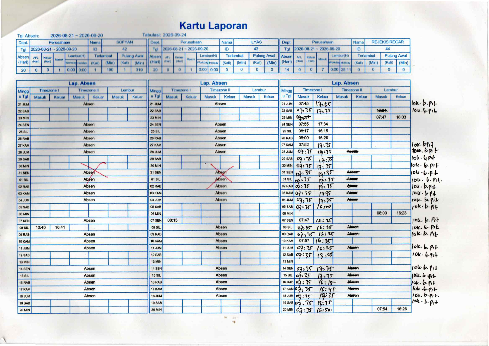

Confidence OCR: 41.00% · Render: 3364×2380px

````text
Dr
|                 pr                            3                                                                                                                                                               |
|         /                                                                   Kartu Laporan
L        Tgl Absen:      2026-08-21 ~ 2026-00-20                    Tabulasi: 2020-09-24
(Ocpt] Perusahaan [Nama] BOWAN [Oe |  Peusahan [Nama] VAS |[Depl| Passa Nama] REJEKSREGAR |                                 |
[To [pooeos2r-20e00a0 | 0 | 4 |g [moss -20z0020 | © | 4 || To [aeobai amen | o | aa |
ER EE = ro od ed ea ma ma Bab Giaa aa Er
BE  onsen | on | in) | oy | oi) | (1       eof nos | ct) | (Mi) | Kam | i | (Hari) | ©     a (oy | Kan | (Min) | Kan JM).
[20 | 0 | 0] + [oefooo] v | 6 | 1 | sw Jae [6] 6 | i [ooofooo] o [ 0 | o | oJ | oo] 7 owbsunf 0] 0 | oo]                                 |
Gap Aen lap Absen | LapAbsen |                                |
fo LT BD a | Fr KG B3 Bem
Wamu | oar | Masuk | Kelar | Masuk | Kaos | uTol | Masuk | Kekar | Masuk | Kear | Wasik | Kena || uTol | Masuk | Kear | Masuk | Kear | Masuk | Ko |
Gow] Awe awl Ree ow] ora (nee) | || flekbpit
EZ) EN I A NS NN ee A A A I A ET IC Tick Ic 5 LJ A A I I (TR 2
sen] Awe we Awe wee ones [wae [| [|
oc] Awe ET Aen lee ea | tets | | ||
mel Awe ewe Aen |lwwe| 000 | 626 | | | | |                                 |
ow] Awe lew Awe lew] ore | 3u3e] | | | AA)                       |
oan] Aen law] Awe |eam[ 035 qs Awe  |be.bpl                       |
weal | [meal [TTT less pa Do TT lok bet
pon | | fs] SC Il  fewnfop3s pays] [| | fok-bprk                       |
oa] Aer wee Mer [ween p.%6 aa35 Meee  ok-ppl
fos | men CE phen losis pags Mem AB be pik.
wn] Abeen lows] awe wme[qels [35 Mee ljok-bgu
wow] Awe love] Awe lok - bp.
CET Aen CET Ame (CET KE 3r 5 Mem ow boil
ws] [1 less] TT TT Neo leter) | TT | ot bot
own] | Al IL fleeww] | leeww] [| om0o | 1629 |
 ose] ee | | | | | lose] over Jenar) | | | |jek.bpb
osc | 1040 | 1001 [| | [flees Awses | loi. &- Pri
Cr ER | I. S| 10) IS 25 Tal 2 Aero Jokeb. Pt
foww|  Awen ows Aen ow] ors [fbi] | | | |
onl Aen law] Amen [nw 0):3s feats Awe jok KPI
ase] | [ese] | TT 1 1 JeselopigsTygosf DT |  |rok-bput
owe | TT Jew DID LD Jews LD 1 1
Gasen| Aen le Aen lus 09,9€ (2:05 Aww joke bgi
KT Ae | ss [03:35 [3aqs Ae ljoleb.ge
fom Aen lowe] Amen |[ewelen:s feife Gee  lou.bope
ew] Amen Kr Aen (CD 2 Is ferys Mem PE II
Coan] Awe lew] Amen |[wamldys [REIS Men lok. bpk.
ose] | [TT ese] TT TT —T  Jesmjg,2elmese] | DT DI rseb-pu
\
````

## Halaman 4

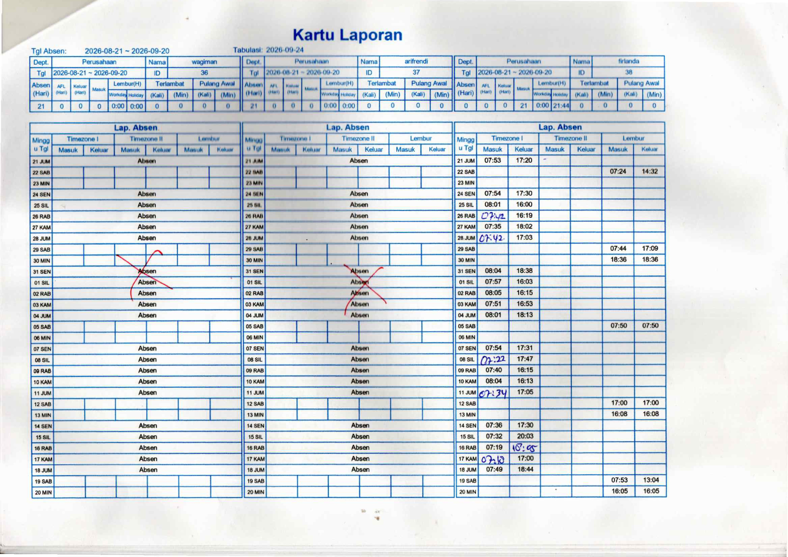

Confidence OCR: 43.00% · Render: 3364×2380px

````text
.       »”                               .
dd                                                                    Kartu Laporan
© TglAbsen: 2026-08-21 ~ 2026-09-20                  Tabulasi: 2026-00-24

Dept] Perusahaan JNama|  wagman [Dept] Pewmwheen [Nama] aod |[Dept] _ Pemisahan [Nema] fenda |
menses Tor — & Ss |» 7 [To [0621 -2000020 | 0 | ww |
EEE ER Ee Ear er OCE EP rm Gak Gi aa rara RR ED

|                       vf] on oc J | | | Fc T oie | ca [ we || Hor            wt le a | 0 | i | ie
[21 [0 0 oJoofooe] 0 | 0 | 0 o Jl # | 0] 00 [ooo[ooo[ o Do | o | oJ ooo] [owfavas 0] 0 fo fo
| Tol | Masuk | Keluar | Manu | Kena | Mami | Wow JP 700 | Masuk | Kekar | Masuk | Keluar | Masuk | Kolar || UT) | Masuk | Keuar | Masuk | Kolar | Masuk | Kou |
om] Ae loam Mee CET) orm wa |- [| | |
meal To LT mes TTT mse] | | | [ora | wm]
EC) I I I I NN 1) [A IS IT LT LT lee SN IT Tn
Gosen| Ase lw Aen ws ore# [za | | | |
ms] Amen lm) Amen lms osot [tee | [| | | |
me] Aen wa] Amen  |mme|Opge| te | | | [|
wow] Aen www Amen lew] ores BK | [| | |
om] Awe waw| Ame |mawlorga| mes | | | | |
EX TI LT Tn TT TT |) TOT TT OT I TT ToT CN ie.
el | I~ VL [ew | TT TT TT TT IT TT [83s | 183s
oon] Aen lloww] Jaen CT ore | ess | | | | |
om] Aen  leeam| Tl Awe lem 0501 [tesa | | | | |
woe TOT 1 TT TT Ne TT | TT wee | | | | oreo | oreo

femal [1 1 Jew TT LL Jew] [TT [1 |
 reen]  Aeen joel | wer | [| | |
(ws | Awe lms] Awe espa wer | | | [|
ome] Ameen ows] Ordo | tens | | | [|
Gow] Amen oww| Aen KT sos [ea | | | [|
Grow] Amen aw] Amen |vmlepgyl mes | | | |
Bel I I I IT Ae TT NE eo Te a LE | 70
ETT) I I I II A ST) I A ER ECT) EE CN ETN
fase sen llwses| Aeen  lweew| Ose | wad | | [|
Cosi Re lw] Re |lww| ors [we | | [|
Gea] Aen wam| Aen |eaw| oro | tees | | | | |
wea] TOT | [1 ee [TT TT [ese] | | | | ores | tens |
EET A I dl ll TT |) I TT TT IT TT er EE NE CN | 60 |

HE
A        Gan                                                                                                                                                                                                                   |
````

## Halaman 5

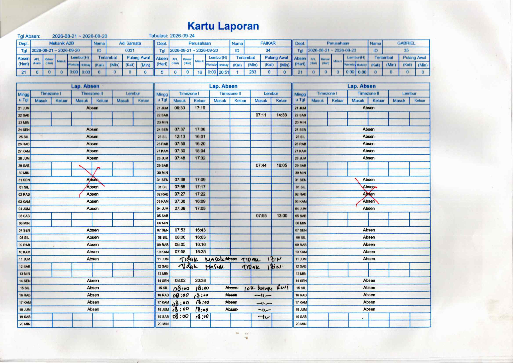

Confidence OCR: 44.00% · Render: 3364×2380px

````text
|                Dp                       |
|    )                                                            Kartu Laporan
Tgl Absen:    2026-08-21 ~ 2026-09-20              Tabulasi: 2026-09-24                                                                                                             |
Dept) ~~ MekankA28 [Nama]  AdiSamata  |lDept| Perusahaan [Nama] ~~ FAKAR  llDept| Perumahan [Namal GABRIEL |                            |
| Tol |2026.0821~20260020 | © | ~~ 0031 = || Tol [02608-21~20260020 | 0 [ 34 | Tol Jo2e0s2i-20200820 | © | 0% |
od | [rnadvuner | (Kai) | (Min) | oa) | (Min) |           oe) | [raf onc | ca | (Min) | cai | te | CHa) | De | 00 | finn | ny | (Min) |) | (Min)

[21 JoJo] ojoojoool 0] 0 | of off s]oofwjooojooss] 1 [263] 0 | off2asjo]o]oJooojoco] of 0] 0] o]
fowl Ae. Hmwawfoss | irae | OO] | |] Hamam] 000 Abe

srl 0 Absen 0 few) O70 | te20 | | Ff jo flaw ~~ Absen |]

pom] Apes  |lmwm| ores | v7a2 | | | | jeram) ~~ Absen

sas] | | ~ dle 1 A1 Wwsel Ff |  |oras]| 160s flwemwl | | | | |] |

own] | LO N/A | | Yew fF 1 1 1 few ] J] | LL

sen] 00000 Adem 00000 DO or3s KI. | f | ~~ Hoe 00 ON Absen

joorae| meen 0 News| or27 [722 | | | | feeww| 0 Aden |                            |
ora) Absen  ljosww| o738 | 100) ff po jer) Ase |

ogo] ~~ Apsen  lloswm| 0138 | 7os | f | | foam] 0 Absen

sss] [| 0 I 1  ffesse] J J]  |orss | 1300 fosww| | | | Of |] |

oss] | |] J] ln ffews] 7 ONSEEEEEEI—— | | | | |

ose] 000000 Awsen 000000 forsew] 0158 | ted |  ] | Horeew| 00000 Absen

joss | meen 000 lleesufoomoo [1&0 | | | ~~ f jet) 0 Absen |]

ora]  Absen 000000 lowes] 0805 | ete [ | | ~~ flewas| 0 Abeen |                            |
oka] Absen Now 0158 | 1685 | | | | jeram 00000 Aen |

pawn] |] fff ffm] 7] 17 pF we) | DL

KI ~~ Mpsen 0 (DES omo2 | 2038] | | | |                             |
won|  Apsen 000 [ws] 08:00 (8:00  Abmen joke batang PWT |[test| 00000000 Asep 0                             |
oman]  Absen | jer) ben |

rr mbsen  llvkau[ 8:00 (8:00  Absen mau JK) 0 Aen |
foam mbsen lfeam[e8:99 (8:00  Abses  ~— Jum) Amen |

joan IEEE IN | “hwnd | | Lo Smee flow] J ] 00] Ni |
````

## Halaman 6

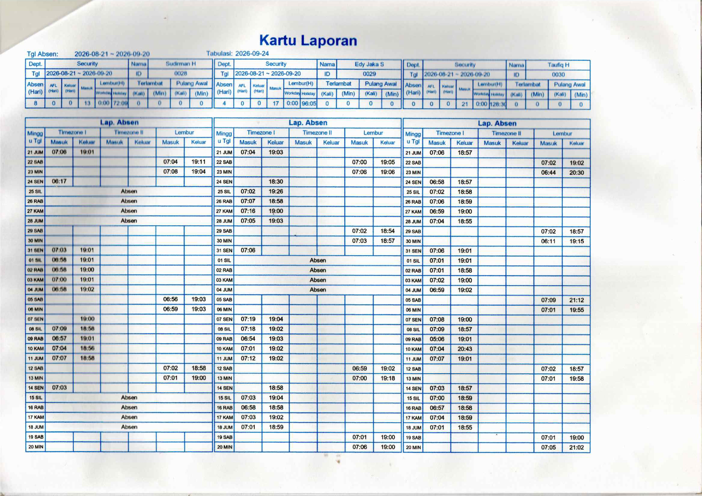

Confidence OCR: 52.00% · Render: 3364×2380px

````text
| DE
|           PP
|                                                                             Kartu Laporan
Tgl Absen:      2026-08-21 ~ 2026-00-20                    Tabulasi: 2026-09-24
[Dept | ~~ Seowity [Nama]  Sudimanti  |[Oept| ~~ Securty ~~ [Nema]  EdyJakaS [Dept]  Secumy [Nema]  TafiqH |
| Tol |2026:08-21~20260020 | 0 | 0028 Jl Tg [20260821~2026-0920 | io | = 0020 | Tg [20260821 - 20260820 | wo | 0030 |
Absen      Bers Be Bes Absen| ari | elu      [Lomburt) | Terlambat | Pulang Awal |        a |
(Hari)               | ewonanfisssy | Kai) | (Min) | (at) | (Min) Jf (Hari) | © | ©) | fworsoa] rouse | (cai J (Min) | (Kai) (min) |        |           workin isin | (Kal) | (Min) | (Kall | (Min)
| 8 J of of vajooojraof 0 | 0 [ of 0 Jl 4 [of of]ooofesos] o | o | o [oo] of ofa ooohasad 0 | 0 [0 | 0]
[Lap Absen
Mega oT Mingg Mingg| Timezonel | Timezone | Lembur |
Tol] Masuk | Kew | Masuk | Kehr | Masuk | Keluar || UT9l | Masuk | Keluar | Masuk | Keluar | Masuk J Keluar || uTol[ Masuk | Keluar | Masuk | Keluar | Masuk | Keluar |
ze] | | |  [oros | tom floss] |] | |  Joroo | 1805 |f2eas] | | | | or02 | 1902 |
mn) pf) | [ores | 1904 fjmww] | |] | | oros | 1906 |[amw] [1 | | oe44 | 2030 |
een) O87 | | | | |  ffawsew| [wa] [7 ] Jlasew[ 0688 | es | | | |
 soul 0102 | 1926 | | | | Nwefore2 | tess | | | |
ores] Amen 0 |lmes[oro7 | 18% | | | | fem 0106 | tse | | | ||
jarkam| Aen 0 lfz7wewf 0146 [1900 | | po laww| 0680 | 1ee0 | | | |
om) Absen  lmwuf 0105 | 1903 | |  f |  lfeswm omo4 | tess | | [||
wean fo | | fesse] Of J] | 8 102 | 1854 |[ws.s| | | | | oroz | 1887 |
oran) oo8 | wot | | | | fos] ~~ Apsen 0 Jwsforot [wer | | ||
Jerman oo06 | 100) | |  [  floemas] 0 Absen 0000 fem over | 1888 | | | |]
oskam) 0700 | wor | | 0 | | flow] Abeer jeram or02 | 00 | | |]
jerami 00an | vo02 | | 0] |  ffoeww] Absen 0 fjeww[oeSe | tee2 | | | |]
oan) | | foeso] 1008 flown] f | 1 1 [ews] JT | | oor | 195 |
losenf J woo | |] | | Hosen 0110 | 1@04 | | Of | Horses omos | 100 | | TT
Joes] ovoo | vse | | | | foesuf ome [tea | Of] | |  Moesw| oreo | esr | | |]
oorsn] 0687 | W001 | | | | flow] 0654 | 105) 0 f 00 | 0[ Jleoras) 0508 | wor [| Of | | |
rok] 07:04 | 1850 | | | |  flowww 0101 | 1902 | Of | | jeram oma [2048 | | TT
(vom| o7or | tee | | 0 | |  ffvaw[oze2 | teo2 | Of Of [vam ono |) | | ||
ess) | | | | oro2 | 858 flees] | | fo | 0650 | 1902 [esas] [| | or02 | 187 |
mn) ff oror | 1900 ffm] | | ff fp oreo | tes [eww] TT | oro | 1958 |
asem) 0703 | | | | |  ffwees| [tess] Of | | jean 0103 | 2887 | | TT
osu] Absen  jjassuf 0103 | 1904 | FJ | Wesforoo [tes | | | |
ora8] Absen 0 llwms[ 0658 | 1858 | | | | fees] 0667 | tess | | [| |
ro] Absen 0000 lve 0108 | 1ee2| Of I | few omos [ese | | TT
won| meen 0 ffweww[oror [eso | [1 | fleww[orot [ess | | ||]
oss) | 1 | lee ~~] I Jorot | 1900 flwse] | TT | oror | 1e00 |
own] | ff 1 Hew] J ff Joreef teoo fawn] 1 [1 Toros | 2102 |
+
````

## Halaman 7

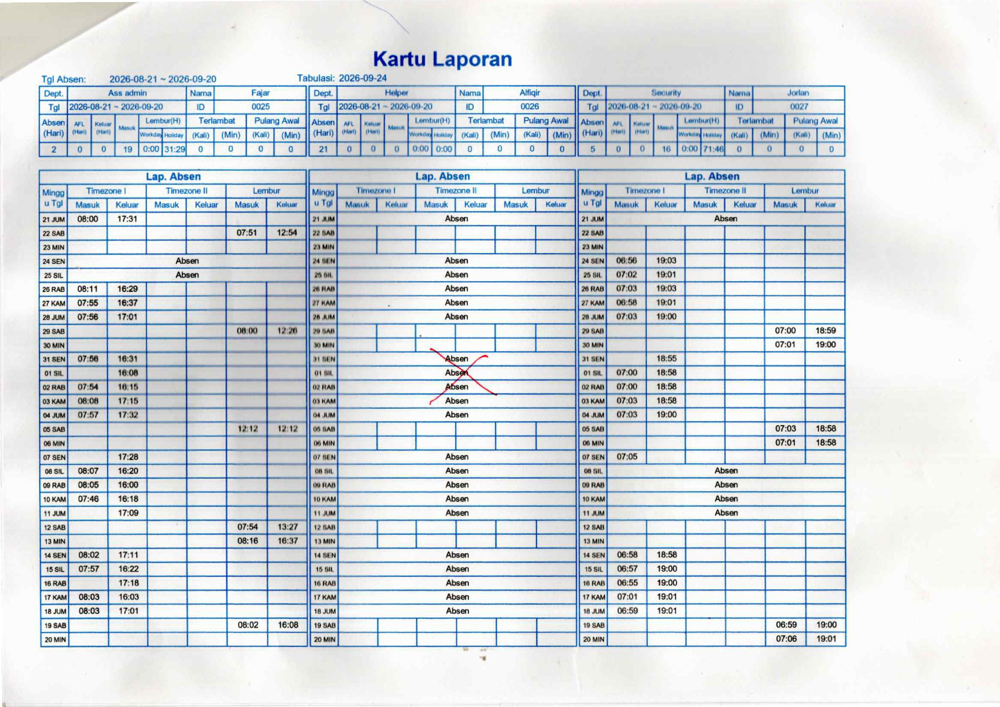

Confidence OCR: 43.00% · Render: 3364×2380px

````text
aa                                                            y
pr                                                                      Kartu Laporan
4         Tgl Absen:      2026-08-21 ~ 2026-09-20                   Tabulasi: 2026-09-24

[Oop] Aswamn  JNama| Faw [Dot] Few [Nowa] Afar [Owl]  Seowy [Nema] join |
(Tol [0e0e21-2e06 | D | 0025 || To [zea 20200020 | © | ooze || Tol aomennai-mmonm | 0 | or |
    [ Comput) | Tenambat | Pulang Ava | Ab  [Centar | Torambot | Pulang Awal |
(Har) CORE etn orn oi t= A mmm Di Call era ri ara
[21 oo owsred o | o | 0] o Jaro] oo [ooofooe] 0 o | o [oJ 5] elo edoejras 0] 0] oo]
Co  tapAbsen J tap Absen J LapAbsen |
[EEE eT Te eee oa
uTol | Masuk | Kolar | Masuk | Ketua | Masuk | Wot || u Tol RIT aver | vos Fob | Wir Tv TO Wo | os | Weir | Wk | |
ow] 0800 | at [| [| lew] Awe aww Ase |
[zee] | | | [omer | ee flmeel | | | TT TT aes | TT TT
mw DI [| Awww [| [| fe [| | [|
wee Awe lew Awe jeje | ees | | [| |
mo] Abe we] Aen ET omee| eer | | | |
ww oer | tea [| [lw Aen ET) ores [ew | [| | |
ow ores | wear | | | | je me Jwww[ oes | weer | | | | |
mow] oss [or | ||| wal Awe maw ores [woo | | | | |
wwe | || oeoo | tam jm) TT [TT weal | | oreo | em |
Bowl 1 0 Www [| few [| oor | tom]
 EC CZ CE I A SC I~ Zo 1) DE A A
[osc wan | ew ed KKN BEAN [Tess | DO DE
C0) CZ CI IN I I | CX I 3 NG CT) BZ BCE I I ER EN
[oom oma | zs | po po po jer Abeen  leewf ros [ese | ||
fool over [va | | [flew Ame Jowam[ ones [eo | | [|
wwe | || [vw [ww je) [TT TT few | | [| ores | ess
own] pn eww [| [fms {oot | fem |
CBE Lia aa ae aa  —— —
| ogo7 | wea | | [| lee] ae flew Ase
wel 0805 | 100 | | | | eww Awe low] Awe |
oran) ora | dee | | || eww Awe jera) Aen
ow] [woe [TT hw] Ame ae Mee
[ewe] | [| [ores [war flees] DIT IT TT flees TT [TT
[own | [| [ost [wear flwww| | | | | Dee | | Il,
fase 0802 | at | | [| hws] Aen we] ose | mse | | [| |
[oo] ore | tez2 | | [| lw | Awe lwe| oer [ee | | |
ome [we | | [| flwww[ Awe fire) 0685 [eo | | | | |
Crow 0805 | 760s | | || lew Awe www] oror [wer | | [| |
ea) 0803 [ zor | | | | flwaw| Amen lwaw| owe [wor [ | | |
owe [| | Tosoz | feos flwse| | [TT Jlwee| | | Toms | fom0
wn [| TT few [TT www] [ores | eer
````

## Halaman 8

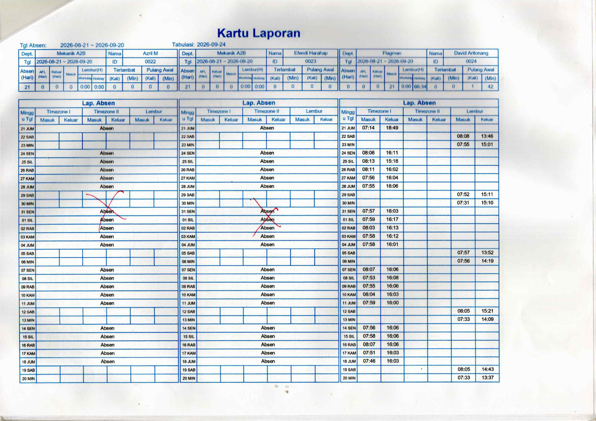

Confidence OCR: 50.00% · Render: 3364×2380px

````text
TR
|                                                                                 Kartu  Laporan
Tgl Absen: 2026-08-21 ~ 2026-09-20                  Tabulasi: 2026-09-24               J                          |

[Oept J MekankA28 ~~ [Nama] Azim |[Dept]  MekmikA2B [Nama]  EtendiHarmhap Nl Dept |  Flegmen [Nema] David Adtonang |
| Tol |20260821~20260020 | © | = 0022 || Tol [2026:08-21-20260020 | w | 0023 || Tol [0200821 -2060020 | 0 | 0024 |
EE 0 cor mo co eC Ff Sa Ba KA ed
(Hedge            osdof ano | (kal) | (Min) | kai) | (Min) || (Har)                 ond vomio | cat) | (Min) | (kai) | (Min) |         ren [Of safer | ca) | (Min) | (ke | (Min) |
[21 J of of ofJoooJooo] of o [ of 0 | ai Jo] o]ofooofooof of o | o [ off o]o]o]a JoooJessa] of 0 | 1 | 4 |
{Ming [ Timezone! | Timezonell | Lembur  llMingg| Timezone! | Timezonell | Lembur | BE pe i TE
EN i T vo | | EER Be es To oe | U9! | Masuk J Keluar | Masuk | Keluar | Masuk | Kel |
| EE | EE) I Jieium) 0114 | 1888 | PO pp
we 1 TI ee | nj | NN | | 0808 | 1346
fan] |] fff few] | [of Jw] Of | | | on85 | 1501
Cr Abeen | 24en| 006 | 161 | | 0 [|
 [oon f 0813 | 1548 | | 0 | |] |
ore] Absen | ora] 0811 | 1802 | | po | |
EX I zuram| 016 | 1604 | | 0 | | |

oom Absen  fjwww| ~~ Apsen  |lmww| o7ss | 1608 | | | | |                                    |
woo] [TT / 1 fess [ 1 | | | Wess] 1 Of | | ors2 | 1511 |

own] | N/T few) 1 TNT New] ff |] om3t | 1510                                     |
oem) [mbeen |] ores] 0803 | 1643 | | | | |
 oka] O78 | 1612 | | | po
oom Absen flem) 0 Absen 0 lloswm| 0158 | tet [ | | | |
oss] ~~ [1 [1 ~~ Meese] [ | | | | jesse] |] | | | ors? | 135
own] | [1 ffeeww] [ff fo]  ffeews] J] [ Of | ore | 1410
forsen| Absen Norse]  Absen  loeew| 0807 | 1606 [| | | | |
 oss] 0153 | 1608 | | | | |
oka] meen jer) ~~ Apsen 0 Now| 0804 | 1608 | | | | |
vom] Asep sum) 0150 | 1800 | | | 1
[ese] TTT TT Nese] | [| 1 | | Wesel | [ | | 0805] 1521
fawn] TTT 7 1 Jew] [ [ [ I PA | KET 1 f | |] 07:38 | 1409 |
foo] 000000 Aen sen) 0156 | 1806 | | | | |
losuf ~~ Apsen [sow] 0158 | 1806 | | | | |
oral Asep | eras] 007 | 1606 | | | | |
ram Absen | rou] 0751 | 1608 | | 0 | | |
um) Absen  lwww| ~~ Aen [www 0148 | te0s | | | | |

wee] [TT TT Jess TT OT ee |] | cf | 0805 | t4d3 |

own] Do lo Lo few | TT OT 1  ffmw] [| [ors | 1397]

LJ
Bema co =.                                                                                                                                                                     “5
````

## Halaman 9

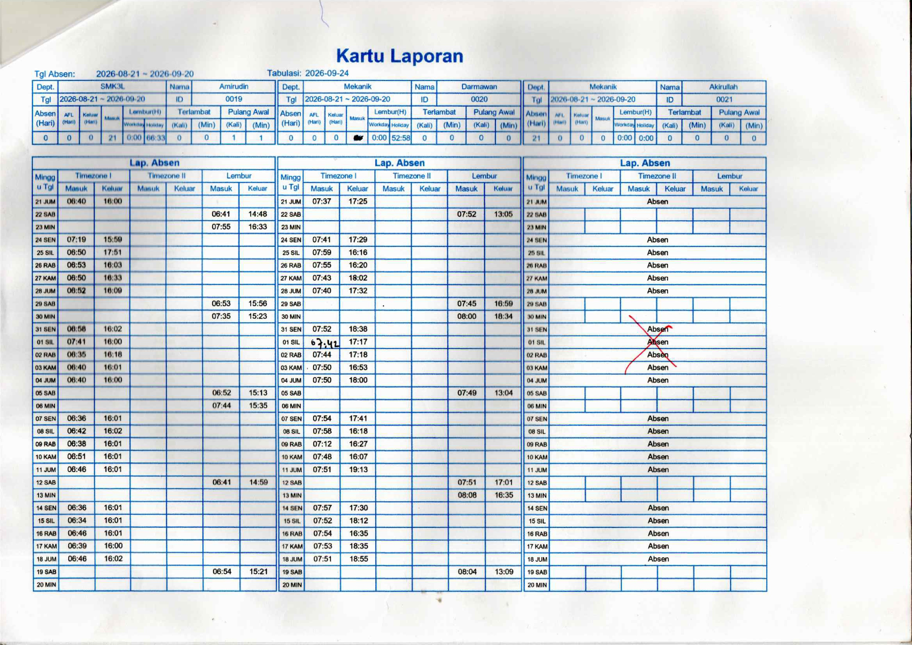

Confidence OCR: 49.00% · Render: 3364×2380px

````text
|                     it                                                   \
       |
Kartu Laporan
Tgl Absen:      2026-08-21 ~ 2026-09-20                   Tabulasi: 2026-09-24
Depe J WK [Nema] Amnugn [Dept]  Mekank [Nama]  Damawan [Dept]  Moook [Nema] Adin |
[Tol [2020821-20200680 | © | ooo || Tol j20260821-20260020 | io | 0020 || vol [M@o0szi-206000 | 0 | oom |
bem | Aap pen = eon re eo oe wm 27 dd ml me Ee ec Jaa
(Hari | tw            Cr Ce) CC | cam eK) ed            rove | Kan | (Mn) | (Kah | (vin)              cl I Cs 2 | (Min) | Kan |
[o [oof fooojeoss o [0 [ 1 1 J o [oo a ooo[sss o | 0 | o | o Jl | 0] 0] o[ooofooo] 0] 0 | 0 | 0]
Fo SES Se TI MS EI CTT ST ET
Tot | Masuk | Keluar | Masuk | Keir | Masuk | Keuar u To (Masuk | Keluar | Masuk | Kear | Masuk | Keto || 0 To! | Masuk | Keuar | Masuk | Keluar | Masuk | Kotor |
arum) 040 | 100 | lawl oer [ares [||| law] Abe
wn] Tomes [ess Jlwww| | | [| ews] [| [|
(woul oos0 | pwr | | [| [we ome | tewe | | | | lam] Aen
ows] 0883 | 1609 | || | |lwwel ores | eo | | [| www] Aen
ow] 0680 | tea | | | | lew] ors [woz [| | | | lew] Abe
san fT [Toess [ 16%6 flees] | |. | Pore | wees flwsw| | | | TT |
own] ores | tees flown] | | | | owoo | esa flows | [~ | | | |
oof oman [9600 [| | fof ey tr [| fee Ben
osm] 0640 [voor [| | fooww| ome [tess | | || low] 7 beens
joran) 0840 | 1800 pp fo fowww] ome | 100 | | || fw been |
sal | | Toss | 113 [wwe] | | | lore | wo je) | TT TT |
own] | [| {ora [was flew] | | | || ews] | | [| | |
[orsen| 0636 | teo1 | | ||" |(oreen| ores | fran | | | | |
[osu ogaz | tee | | || Jloesc| ores | wwe | | | | |
ome| 0838 | 01 | || | lowe 012 | ter | | | | looms] Abeer |
oran) 081 | t601 || || [www] ode | wor | [|| leew] Aen
ow] one | 1601 | | | | fv] ost [teas | | || law] Abs
Gasol | [Tomar | ves |lwsw] | [| [over | wot Jlwsw| | TT TT
fawn] eww  Tesoe | tess em) | | | | |
[wen oes [1601 | | | | je omer | tao | | || lew] Abe
[wou] 0634 [1601 | | [| jeep ore | tee | | || Mere Aen
orl 0646 | teot | | | | |lwwe| ores [ess | | | |
ow] 0639 | 1600 | | | | |lvww| ome [ wees [ | | |
foo] 0646 | 1602 | | | | jeram ost [tess [ | | |
[ose || | Toese | wei Jose) | | | joe | wos flwew| TT | TT |
Be La I NF) IN NN ANN A NN A | CTT) EN A EN EE
-
Ty
````

## Halaman 10

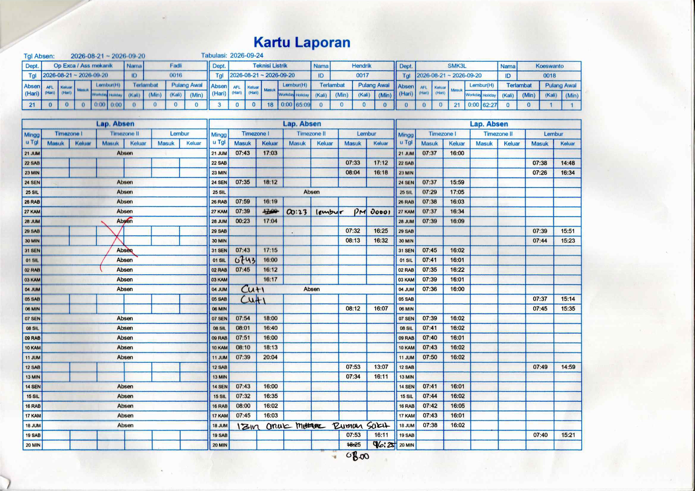

Confidence OCR: 45.00% · Render: 3364×2380px

````text
|
                                                                             Kartu Laporan
Tgl Absen:    2026-08-21 ~ 2026-09-20               Tabulasi: 2026-09-24
Dept. | OpExca/Assmekank Namu Fadi lle]  Tokusitistk [Namal Hendrik Jfoept] ~~ ska [Nama]  Koeswanto |
| Tol [202608-21~20260820 | 0 | 0016 || Tol j20260821- 20280920 | io [|  oot7 Jf vol [202608-21-20260020 | DJ 0018 |
Absen        ey Absen| ar. Absen| ar.
(Hari) | Wo | OR] Dsidal nasi | da) | (Min) | ka | (win) |! (Hari | ©            prosefiwiuo | (kal) | (Min) | (ai) | (im | (Har) | an            rotoaf mn | (cai) | (Min) | kal) (Min)
KE BANDA PA aa
(To [ Masuk | Keluar | Masuk | Keluar | Masuk | Keluar || uTol| Masuk || Keluar | Masuk | Keluar | Masuk | Keluar JI Tol | Masuk | Keluar | Masuk | Keluar | Masuk Kear |                                  |
zoml Absen fewwforaslwmes| fF 0 po Jeram) 0187 | 1600 [|] | 3
eren) |] | | fesse] | Of Of [ora | a2 Jerman) | [ | | ors | 14us |                                  |
pwn) | 1 1 [fee] fff [osoaf vets aww] | [ | | ors | 1634 |
sen) 0 Aen 00 fms] 0186 | wz | | [ | Jmus[orar [ss [ | | | 3
san | Aen 0000000 fms] Absen Hwwforaw[es| OO] OO] |
meme Absen 00000 floswws| ose [ete | [0 [ OT Jleema) 0138 [tees | | | | |                                  |
msl LNA 1 fess] Ff. Ff 0 [ora] 1625 Jase] |] 0 [ |] | ors | 551
fond 1 AN 1 few] fff joes | tes flow] J] Of |] | ora | 523 |
oo] / meen 0 lloeufotwy woo] |] | |] jeep ort freer | Of |] | |                                  |
own] 0 Absen ffoeems] 0145 | tet2 | 0 | 00 | fo Jleme[oras [e222] Of TT  ] |                                  |
owl absen 00000 osww| Jer] [| 0] |  Jloww 0130 [ter | 0 0] |
oooml Absen eww] CU  Absen 000 lleewm| 0136 | 100 | 0 | 0] | |
ssn | MAA 0 [Jose] Cady | 0 | |  ffessw] OF OF 0 [ | orar | 1514 |
foun) ff [0] [  Jjosww] J |] |] fost2] 1607 flown] [ | [ | ores | 1535 |
 onsen] o754 | 1800 | | 00 [ | 2 Joss[ome[tee2| Pp po
Coo TNE CC CON NE EN EE — oes | ort | teo2 | [ 0] 0]                                  |
oral Abeen 0 Jjlooran| 01:61 | teoo | | f |  lfooessf Ordo | ter | 0 | 0] 0] |                                  |
foww] ~~ Asen 00 Jjioram) 0810 | wes] |] Of | Jeram) ores | 3602 | Of |] |] |
ow] men 00000 Mfvwml ore | 2004 | Of | | jam oreo | 1602) | Of | |
esa) | pn TT Jess] J 1 [ors] 1307 (jie) Of Of | | oro | 1450 |
pawn] | ff  f  ffeew] 1 J] ] fora BID few J Ff OO J 0]                                  |
[aed Absen 0 fue 0143 [eco | |] | | fue oran [em] |] | | |                                 |
osu Aen 0 Wweforsz|wess| | [| | ffesjorasfrea| | | | |                                 |
era) Aen 0 Jfwmefoseo | teo2]| |] | |] leew] 0142 | tes | Of |] | |                                  |
ow] Mee 000 Hvkwforas | 1608 | |] 2] | flvewords feo |] Of 0] 0 |                                  |
fom Awe eam] Mw One Mdwe. Puma Sobat (lewm| ore | 02 | | | ||                                    |
oss ff 1 1 of  Jwse] J] | 0] foes] 16911 flee Wf | | | ordo | 1521 |
EL) A LL. lo a — Las ECC) I NN A SE
« OKO
````

## Halaman 11

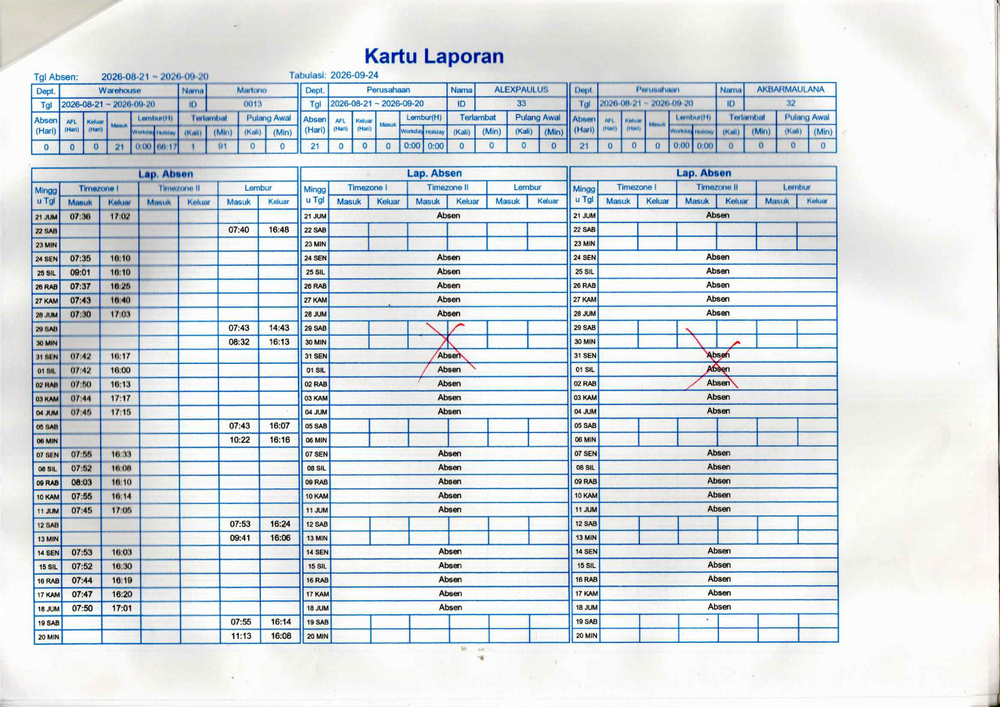

Confidence OCR: 46.00% · Render: 3364×2380px

````text
[ns      ’                                                                                                                                            |
|                                                                                                                                                                                                                                |
Kartu Laporan                                                                                                       |
Tgl Absen:     2026-08-21 ~ 2026-09-20                 Tabulasi: 2026-09-24
[Dept | warehouse JNama| — Matono  |[Dept| ~~ Peusshean [Nama] ALEXPAULUS  llDept|  Peusahaan [Nema] AKBARMAULANA |                                  |
[Tol [2026:0821~20260020 | ID | 0013 || Tol [2026:0821-2026-0920 | wo | 33 || Tol [2608212020020 | io | 32 |                                  |
Absen BE se rer ene ERC Ee re RaR Aaa Absen | art [won [| Lomburttt) | Todambat | Pulang Awal |                                    |
 (ar | vo | ornare | (Kal) | (Min) | (Kal) | (win) J] (Hari) | an            worksa] say | (cai) | (Min) | (Kal) | (Min) | fn] san | aa we er rT Te
oo [oa fomfesis 1+ | on | 0 [ o J[ 2 | oo] ofowloom] o| o | o lola [ooo omfow| opo | oo]
Mingg| Timezone! | Tmeronell | Lembur | Be ER ja BE ee Ee qT Score
TR ve Da  uTol| Masuk | Keluar | Masuk J Keluar | Masuk | Keluar || UT9l | Masuk | Keluar | Masuk | Keluar | Masuk | Keluar
[2m] 0790 | woz | | po po deru) Absen jjaum)  Abses |]                                  |
ena | | | [or40 | tess flees] [| OT TT Toles] J | J 1] |] |
ee | ll Mews] fF Of 0 1 Haws] LL LD OF
[won] 0001 [veto | f 0 [ | | ss]  Absen |
mae] orar | wea | | | | www] Aen lems] Awe |
aw ord [oo | | [leew] Aen Jeram) Aen |
[msl 1 | lores | Mas fms] [| DN Dn ee TT [ [|
Jew 1 loss | tes flown] | DAN | Lo fess | | N | ~ [ | |
Joven] oraz [ver | | | | forse] Abe foes] Megi |
Joran) Ono | tes | | 0 | 00 | | jooras] Abs
CI O74 | azz | | 0 | | osm ~~ Absen |
foewm| 076 | 7:08 | | | | floeww] Aen  Hoeww] 0 Absen |
losmal — | | [Tors |teorflessse] J J TT TT [ Nese] } |] fl |
foown| | | | Ttoz2 | tes ffs] | [| [ | Mews | [ ~~] | |]
foveen[ ores | ved | | | | forsee] Absen  fjorsew| 0 Absen |
[oss | 762 [ eos | | | 1 ee) Ameen Joes] ~~ Abeen |
ooras) 0803 | 1610 [| | | forms] ~~ Absen loses] ~~ Assen
oran) ors | tema | | | po Jeram) Absen 0 foww] 0 Aen
mam) ozs [ros | [1 | fas Aden 0 foes]  Absen ||
mn | J ores | Teme flea] |  0T 1 1 ] Mees fF] OO |] |]
fave SEE 1 Jost | vee flew] OT 00 0 0 0 2 Mew | | | |] |
[cen] o783 | wos | | 0 [ | sen) Absen |
[on [ONENESS | | Hwee] 0 00 Abe 000 Hw] ~~ Abe
oras] O744 | t@t0 | | po | |
rk] o747 | 1820 | 0 ff 0 | EC REA Abe ai
fewm| o750 | amor | | | fo jam) Absen  ffwww| Asep |
oss] | | | lores | teta ffs] [OT Do DN Nee) | | -f |] |] |
own | | | {vs (ejaan | [| | |  ffmw] | 0] [ |] [| |
ir
po
````

## Halaman 12

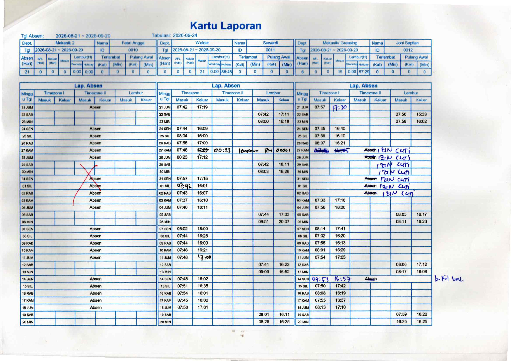

Confidence OCR: 47.00% · Render: 3364×2380px

````text
|                                                                            Kartu Laporan
TglAbsen: 2026-08-21 ~ 2026-09-20                Tabulasi: 2026-09-24
[opt] Mekar? [Nama] FebiAwos [Dept] Weds [Nema] Sumadi |[Dopt| Moke Greasig Nama] Joni Sopian |
[Tol [2026082120000 |i | 010 || Tol [226 0e2r-20260020 | © | oor || Tg aanob2i-2260020 | © | oz |
Fo Eo mo to ed i i 0
(Hari) | 0 | bian | nieve | cy | (Min) | oh | (vi) || (Hari)                 rf | aca J (Min) | kai) | (Min) | (Har) | ©           Fe CY | (Min) | Oa | (in).
[2 jojo fojowjoeof © | 0 | 0 | 0 J ooo] |ooofsas] 0 | o | 0 | ol 80] 0] [ooofsred 0] 0 | 00]
uTol (Masuk | Kear | Masuk | Keluar | Masuk | Kear || uTol (Masuk | Keluar | Masuk | Keluar | Masuk | Ker || UTOl | Masuk | Kear | Masuk | Kear | Masuk | Koh |
[owl Ae leaf ore [me | | | dewe re) | |||
sel 1 | TT ese [TT Tora | ven flea) [| [oreo | mas |
[a] 1 mew Tomo | ede jamu) | | | | ores | te0z |
aosen| Awe lun ores [eos [|| llwwew| ores [eso [| | |
ec] Awe lee omoe [woo | | | | jeep oreo [ew | | |
mre Awe lel ores | wre | | | | jer 0807 [ear | | | |
oan] Awe leaf 0028 | me | | | wa memo cup
ECC] I SE “SN AN SET A I I SN 7 RCN EX I I ET 2X2 5 1 ME
{EC I ED ND AN NNN ET EN AN EN SN TN NT I I Do Ee 7
[omc] 7 mes  es| Ofyp[ eon [| | | few] Aen tpn Cy |
fowl Rese Jjerum| oreo [mn [| | | jeram) ores [mos | | | |
fos TT TT Nee [ores [ares loses] [| || oss | der |
fon TT TT Jew] TT Toes [oor flaws | | | KS | tea
orsen|  Absen  lloreew| ose2 | woo | | | | fore] oa | tear | | | |
[osc] Aeeen lowes ora [62s | | | | flees ose [ex | | | | |
ors Amen looms] ora | 600 | | || fons] oss | ews [| [|
fowl Aen l[oww| odo | tez1 | | || |foww| oor | tea | | | |
Jum een lvaw| ors | ee | || jua ors [mes | | | |
Ps TT TTT less] [| | [ora | 62 flew] | | | fee | 1712 |
fawn] | [| few] | TToe0s | tes2 [own] | | | Dor | eos |
fee] been leew ore | woz | [| | b-¥et La.
Ges meen Jww| oe [tess | | | | flee oso [wae] [| | |
ome Meer  lwme| ore4 | wor | | | | wel osos [ete | | | | |
fowl Amen lw] ors | 1600 | [|| dee ores [wes [| | |
Coo] Aen Jam) ors [dren [| | | lea] ows [amo [ [||
ose] [TT less] 1 [Tese1 | tet jlwew| || [| ors | 622
wn] [| TT lmww] [| Tos26 | eas (mn) | | | | 1625 | i625 |

4
````

## Halaman 13

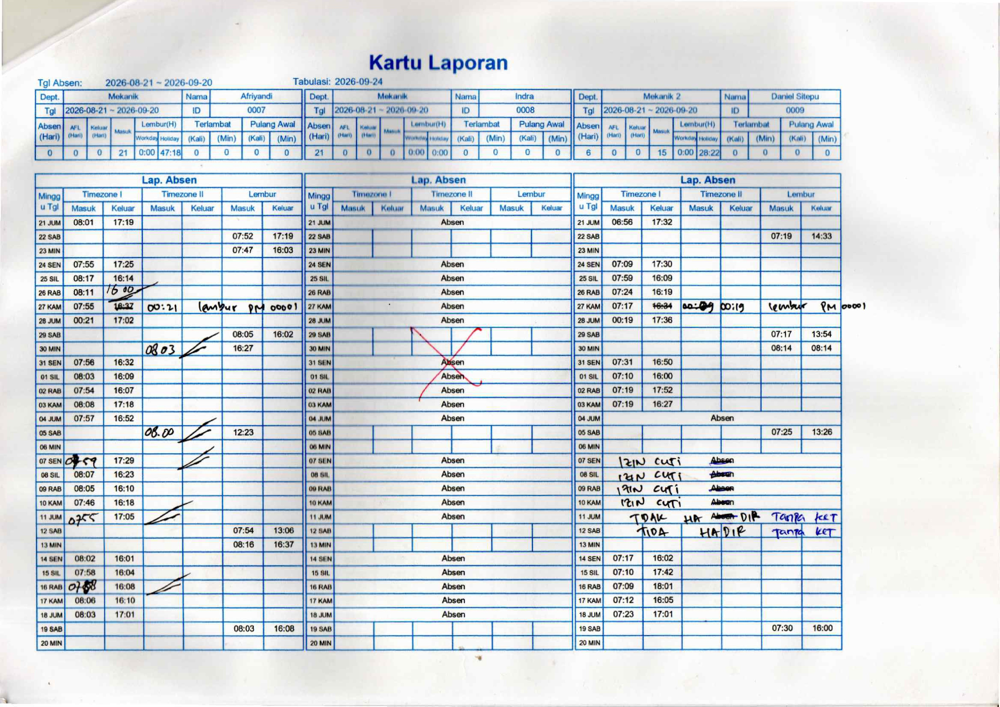

Confidence OCR: 49.00% · Render: 3364×2380px

````text
pr
|                                                                                  Kartu Laporan
Tgl Absen: 2026-08-21 ~ 2026-09-20                 Tabulasi: 2026-09-24
[Oept |  Mekak [Namal  Afyandi  |{Dept]  Mekak JNama| nda  llDept|  Mekank2 [Nama] Daniel Stepu |
| Tol [20260821-20260020 | o | 0007 || Tol [20260821-20200020 | 0 | os || Tol [202608.21-20260020 | ID | 0009 |
rose voce | (ca) | (Min) | ko) | (Min) |       Bl lh CE (IC | (Min) CT yl)                asinine | (Kal) | (Min) | (kab | (Min)                                 |
 Leap Absen ~~ ==0 fl 02 Lap.Absen |
A TE na SE Kena I Le PAR Te ee Le
UTol| Masuk | Keluar | Masuk | Keluar | Masuk | Keluar || TOU] Masuk | Keluar | Masuk | Keluar | Masuk | Keluar || uTol] Masuk | Keluar | Masuk | Keluar | Masuk | Kear |
zo] 0801 | 1118 | | 0 | |  Weww] Aen 000 jlaam) 0688 | 7a2]| Of |] |                                 |
zs] | | |  [ors2 | tree fase] ff 0 f 0|  flese | Of Of | or19 | 1433 |                                 |
zesen] o755 | 725 | | 0 | po  ffaesew] Absen 00000 flmsewj 0109 | 7a | | |] |
(ou 0817 | eta | | 0 | 0 [ fas] ~~ Asen  ji2ssnf 010 | woe | | |] | |
re] 08:11 J0 GOT | | |  lwme] Aen 0 [wmf 0124 | tere | | | | |
ow] 0021 | 1702 | | | | Jie) Aven 00000 llmwwjooto| 736 | f Of | |
woe] | | | 0505 | 1602 fase] IN | A] 0 | ee | Of Of joran | 1354 |
meen] ore | 1682 | T | 0 | Wve 0000 Aken 000 |fmeewj 0131 | eso] | 00] |
ema] 0184 | 1607 | | | | News| ~~ / Absen = 000 [eemss] OTe | 782 | 0 | 00 | 0 |
oskav| 0808 | 17:8 | | [| Noww] ~~ °  Absen 000 foam] ome | 627 | | | | |
owl 0757 | 1652 | | |  [  Nowwm| 0 Abeen 000 foewmf 00 Absen |
osm] | Boo | 77 | 2n]| Mess] [0 [ Of | fesse | Of | | 0125 | 1326 |
oown| | [ 1 1 1  feews ~~ f [ Of | |  Joews Of | 0 0 of |
oseniopeg | 7 | [2m | 1 forse] 0 Ase 00000 |
eoras| 0805 | 1610 | | | | jer Aen 000
roxam| 0146 | 1618 | 0 b- | 0 | jeram) Absen  jjiokam) itu) curi Mee
fawn] | |  [oete] tes www | [ | Of | few I | Ff |
sen] 0802 | 1601 | | | | ffs] 00000 Abeen 000 fuse oraz [tea | Of Of | |
osu forse | eos | OL 1 [Mee Absen ffwsforofaza2f Of 0] |] |
oso} 8 | 1608 | ~~ | | jer 000 Absen 000 wmf oreo | tet | | | [|
kaw 0806 | 1610 [© |  [  ] jeram) Absen 0 www 0112 | tees | |] | | |
eam) 0803 | t7ot | | | [Jews] 00 meen 0000 [wwwfors er] | 0} | |
sae] | [|  Joeos | 1608 flwsw | OT OT Tf lee) | ] | | om | 1600 |
ow] | J 1 1 TT Jew] [ [ Of. 1 of Jew J 1 Dl I |
-
````

## Halaman 14

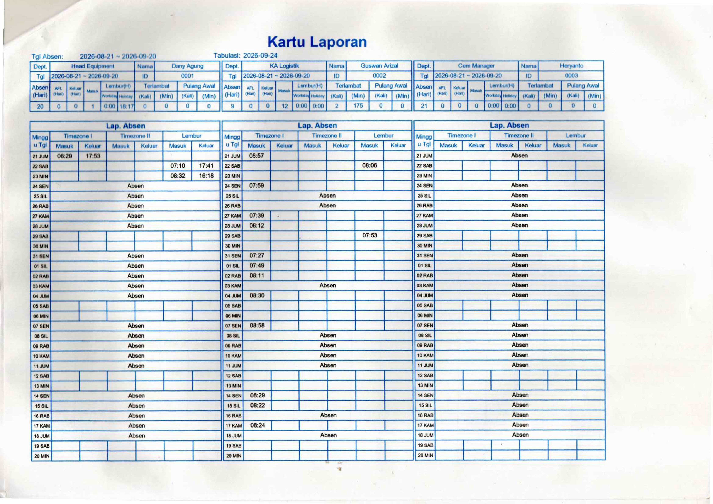

Confidence OCR: 45.00% · Render: 3364×2380px

````text
|                  DD
|                                                                     Kartu Laporan
TgiAbsen: 2026-08-21 ~ 2026-09-20                 Tabulasi: 2026-09-24
[Dept | Head Equipment [Nama  DanyAgung  |[Dept| ~~ KALogistk [Nama] Guswanarizal |[Dept|  ComManager [Nema]  Heyanto |
| Tol [202608-21-20260020 | 0 [ 0001 || Tol [20260821-20260020 | io | 0002 || Tol [20260821-20260920 | ID | 0003 |
(Hart | Oo | 00 |  Iwonielisasay| kal) | (Min) | (kal) | (in) JJ (Hari)                 Wondafonsoy | (Kai) | (Min) | (Kai) | (Min) || (Hari                 proses | (Katy | (Min) | (Kab) | (Min)
Do Lo [oli fomfwi oo [ol oJ ool ofwfemfom] zw oo] a]o]o]sfomfoml so] o]o]
 EE SE BA
Kn DEA Tra oS AT er eT a a Ad EH
Tol | Masuk | Keluar | Masuk | Keluar | Masuk | Keluar || uTol| Masuk | Keluar | Masuk | Keluar | Masuk | Keluar || uT0l| Masuk | Keluar | Masuk | Keluar | Masuk | Kear |
janam) 0620 | 788 | [ [| Jeram) 0887 | pp | | jam) 0 Absen
ass] | | | [orto] 1741 Jae) | | | [oss | Nese | | Of of
(SEE | 1 ee | tes Haw] SRR 1 nee J] 0] J | AR
zesen|  Absen 0 lauss[ ome | | | |] |
 ass Absen 0000000 ffs 0000 Aen 000]
era  Absen lfm] Asep 0000 wesw] 000000 Aen 0
oka] mssen  llowwf oreo |. DA [| few] Assen
om Abeer llwww| 0812 | | Of | Of Jaw] 0 Absen |
een]  Abeen 0000000 lwewforr | | | |] | |
BE Abe Mosfome | Of Of [ | fos] 000 Ase |
aman) Apsen lemes oat | | | | | [foes] 0 Absen |
oom absen 0 NewwJoeo| OT OT [0 Hows] 0 Absen |
IEE TT Te 0] | | | | fees] | J | J |
I [1 wee) 1 1 1 1 few) Dl | 2 | |
forsen| Aen loreew) 0888 [ | © [ [ [ forse] 00000000 Absen |
foes | ~~ aween lose] ~~ Aven 0 CO 0 Abeer 000000
fowl abe jeram) Ameen 00000 flow] 0 Aven 00
fw Absen ffvaw] Mee jum) Ase |
Cro | | [eames [| 1 1 1 oF Hees] [ | I CF 1
PE 1 1 weet 1 1 1 1 fF wes LD 2] oo] | |
se Ameen 0000 Nwee ose] OO] Of Of Of ws] 0000000 Absen 0]
[ow Amen ee | | [ | [  fws] 00000 Absen 00]
era Absen flees] ~~ Absen 00 Jems] 0000000 Absen 0000 |
en mr ae AE LT AE aa
oom Absen jl) Aen jum) Asep
wee] TT TTT ee) TT DN Jess | pd 1 | |
EC I NT I TC I SN DE SN SS CTT NSN EN S— ———
BJ]
|
````

## Halaman 15

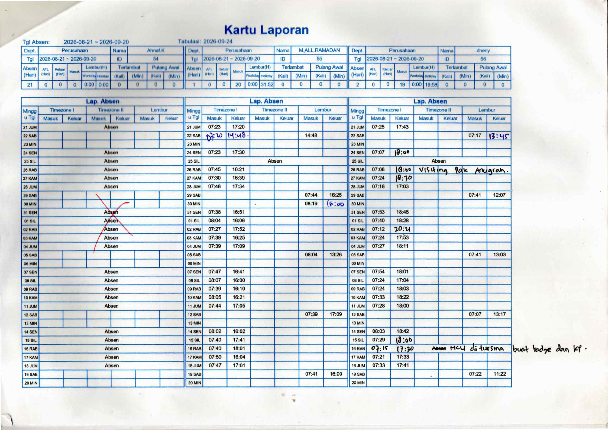

Confidence OCR: 52.00% · Render: 3364×2380px

````text
>                          _
~~                           -
DD”                                                                      Kartu Laporan
~~ TglAbsen: 2026-08-21 ~ 2026-09-20                  Tabulasi: 2026-00-24
| Tol |2026-08-21~20260920 | © | 8 | To) [0260821-20260920 | 0 | 55 || Tg [202608-21~20260820 Jin | 8 |
w           rovanfuvaom | ca) | (Min) | ca | Min) |                      wonsa Holy | (Kai) | (Min) | (ai) | (Min) || (Hari)                Wong oon | (cot) | (Min) | (Kat) | (tin) |
[21 | oo] ofoofom[ 0 | 0 | 0] o J+ [0] oe ]oons] 0] o| oo] zoo] ooofwss 0] 0] 00.
[teas 00 | | lap.Apsen |
Be... ea "ms ci Ti | Dl [ims Tks | oie
uTol | Masuk | Keluar | Masuk | Kehr | Masuk | Keuar || UTol| Masuk | Keluar | Masuk | Keluar | Masuk | Kear Jl uTol[ Masuk | Keluar | Masuk | Keluar | Masuk | Kear |
jum) Awe 000000 fnew 0128 720] | | | loam 0125 | es | | OT 0] |
EU NN RRR ETT) eA DN NN A NS SN CTT) DN DN —— ——
sen] Aen 000 lfoesew] 0123 | 1730 |  [ | | ~~ Nmsew| 0107 | 1006| |] | | |
ssn] ~~ Awe  jjasnf 0000 Asen 0000 flassuf 0000000 Absen 000000 |
jera) Absen Jlzeras| 015 | 121 | | | [|  Viking tdk Andgran.
rw]  Absen 00 Jlarkam) 0130 | 1680 | 0 | 00 | Jo fawwor24 [830] |] | | |
om] Aen 0000 mw 0148 | am | 0 | 00 | | jjeeam| ore wes] Of |] | |                               |
mon] ff N | | | lmee] | | Of jera | 1825 fleas] DO | fo | or4t | 1207 |
joven | ~~ Abeer  jjorsuf 0804 | 1606 | f | [  Nowsuforao | 1828 | | |] | |
oan  AAbsen \ 0 Jjoaras| 0127 | w7s2| | | | fees] 0112 | 20: | | | | |
oswanl ~~ SApsen © 00 fosww| 0180 | 125 | | | |  Nosww| 0128 | 158 | 00 | 00] 0] |
oem) ff Absen 00000 fleeww| 0139 | 1709 | | | |] jeram) 0127 | a81 | |] | | |
joss) | |" | of | fess] | | f | osos | 1326 loss] | | | | or41 | 1303 |
a FT 1 Hoel 1 1 1 pad Hew ] I 2 fF I
orgen) Asen 00000 loreew| 0147 | ter | | | |  floeew 0154 | 3801 | | | | |
oosw| ~~ Absen 0 lossu| 0807 | teoo | | | |  ffoesuf 0124 [moa] | OO] | |
oma] ~~ Absen 0 Jjoerasf 0130 | 110 | | | |  lfoemss] 0124 | 803] | |] | |
okam| ~~ mbsen 0 ffowew| 0805 | 1620 | | Of | Jeram) 0183 | 1822 | | | |
aw] Apsen 0 jim) ors [wos | 0 | 0 | |  flvwwjor2s | 1800 | | | | |
esa [fF | I fess] | | | [orm] imo flee] | | | | oror | 1347
E000 wu 1 ECT A ISS NE (S00 OT DEE CT) SN NN A ——
sen) Absen Jjiasen) 0802 | 102 | | | |  Jjweew 0803 | 3882 | | | | |
[ssw] ~~ Absen 0000 fs] orao | ara | Of Of |  |fresu] ore | (die [| | [|
eras]  Absen 0000 [wm] or4o | 1801 | | | | |  03:15 (3:30       Absen MEU didursina (buat Wdge dan KT:
irkam| Absen lew 0150 | teo4 | | | | few] or | za] | 0 [| |
sum) meen 00 Mweww[orar | aro | | Of |  leww| or3s | azar | | | |
ose) [1 1 1 ffwse] | |] | [om] 1600 ws] |] | | | 0122 | 1122
own] {If 0 1 few Of 1 of of 1 Jw Of 1 1 1 1 |
.
ke 1                                                                      :             .                                                                                         ;
````

## Halaman 16

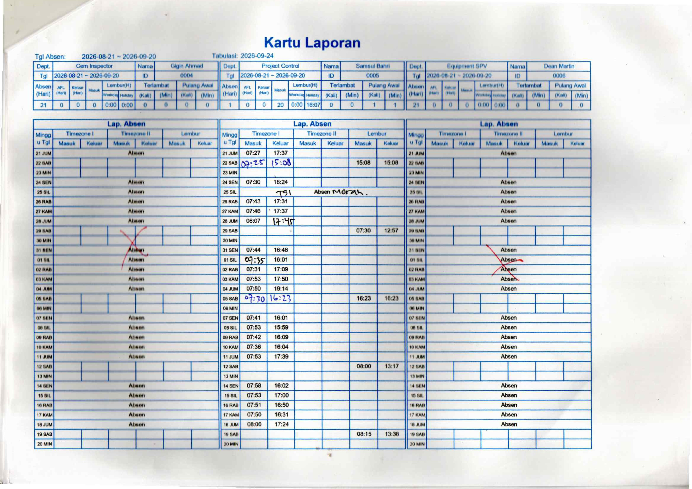

Confidence OCR: 44.00% · Render: 3364×2380px

````text
|,
Kartu Laporan

|        Tg! Absen:    2026-08-21 ~ 2026-09-20              Tabulasi: 2026-09-24

|        | Tol [2026-08-21~20260020 | ID | 0004 Jl Tg J20260821-20260920 | iD | 0005 Jl Tol [w2e0ed domo jan | 0006|
Ee EY mm im 1 ee EE om £5 cd cd le Daan
[21 [oJ of oJocofoool Ol 0 ff of oJ] + [o]ooJoofieo] of o | 1 | 3 Hape fo fo ovofoeol 0] 0] ©] 0
El IW laa EE [41 wv nol IN RE EA
UT Masuk | Keluar | Masuk | Keio | Masuk | Keluar || TOU] Masuk | Keluar | Masuk | Keluar | Masuk | Kea JP 0 TO! Masuk | Kets | Masuk | Keli | Masuk | Ko |
EE | EET CEA EEA EE I EC) DO
CIT0Rese 0 | EE ETT) DL CN NNN MN CC ny  —
seen] Amen lfxesen] o730 [ 1824 | [ff (CT) Abe
(oe | Awe fast] BA Asen™MOrAN,  flwe| Ame
(om Amen lfm] ogo7 Eta [0 ff DT Abe                        :
EX DO A EE EIT IY ee ee em
een) Ae fsisen| 0744 | tees | |] | Hawewf ON Absen
om] Ame  fosf0e teot [| ff Hemf  N\Absea~
oon) Awe fof oms3 | a7so [| | ff Moves) CC Absew |
oes] | | | | |  Josse[op:3p[le:Rd[ | | 1623 1 +42 Hew) | | Of Of |
Do TT EE NE ME Cn DE AL AA
ore) Awen  lorsew| Ozer [tet | [| DO formw|  Absen
joo] ~~ Amen CT o753 | vs50 [| | | | Hoe] ~~ Absen
oman ~~ Amen foomms| 0142 | 1609 | | | | Nowa ~~ Absen
owas] Amen Jjwowau| 01:36 | 1604 | | | I jer) ~~ Absen 3
vam Ameen foam] 01:65 | 4739 | ff fwamf 0 Absen 0000
ean) fF] Hess] TT TJ osoo | 137 flues | | TTT
EET) I A ETT IIT A ee em
eee Awe fesc|oorss | zoo | ||| fea Asep                 |
eran) Aen Jjieras) 0151 | 1680 | | | fo Nwww ~~ Absen |
rea] Aen  flvkw ors0 | e301 | | | | Now| ~~ Absen
oom ~~ Ameen lfewm| 0800 | 1724 | | | ff ~~ jam) 0 Absen |
wes] [Tf | | Nese | | [loss] 138 flwew [| [° | | |]
EDEN ET Umm TTT DR ON DN TT 1 DE Ye

+                                                            ees                                                                                                         —
````

